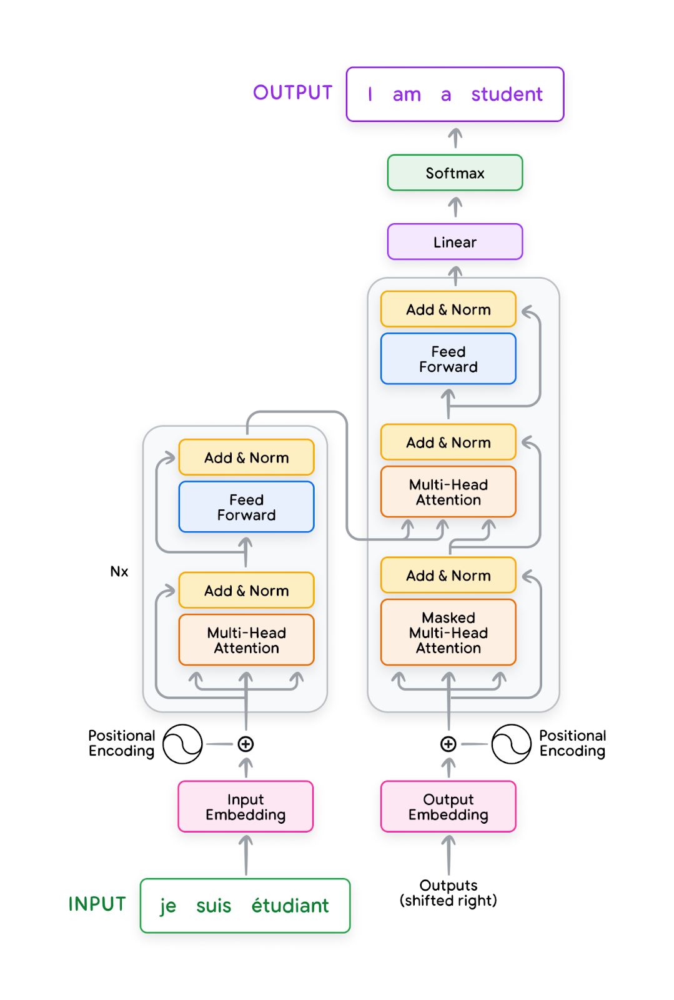
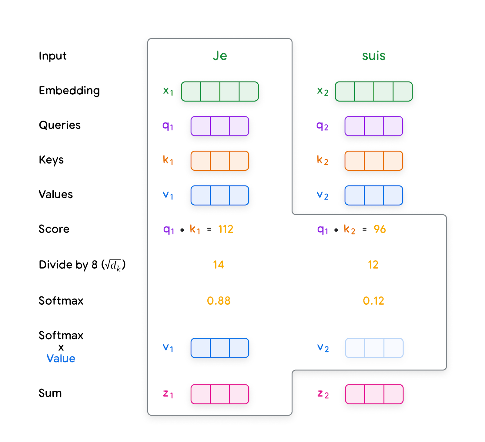
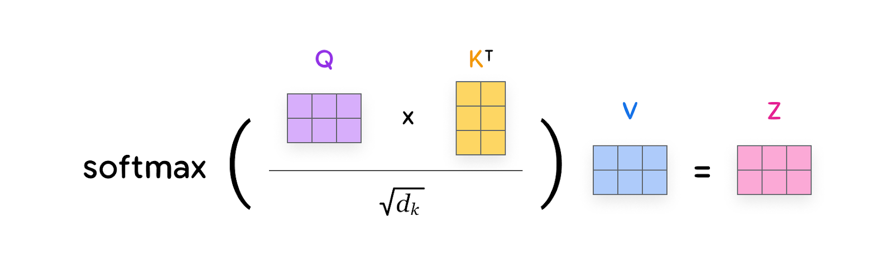
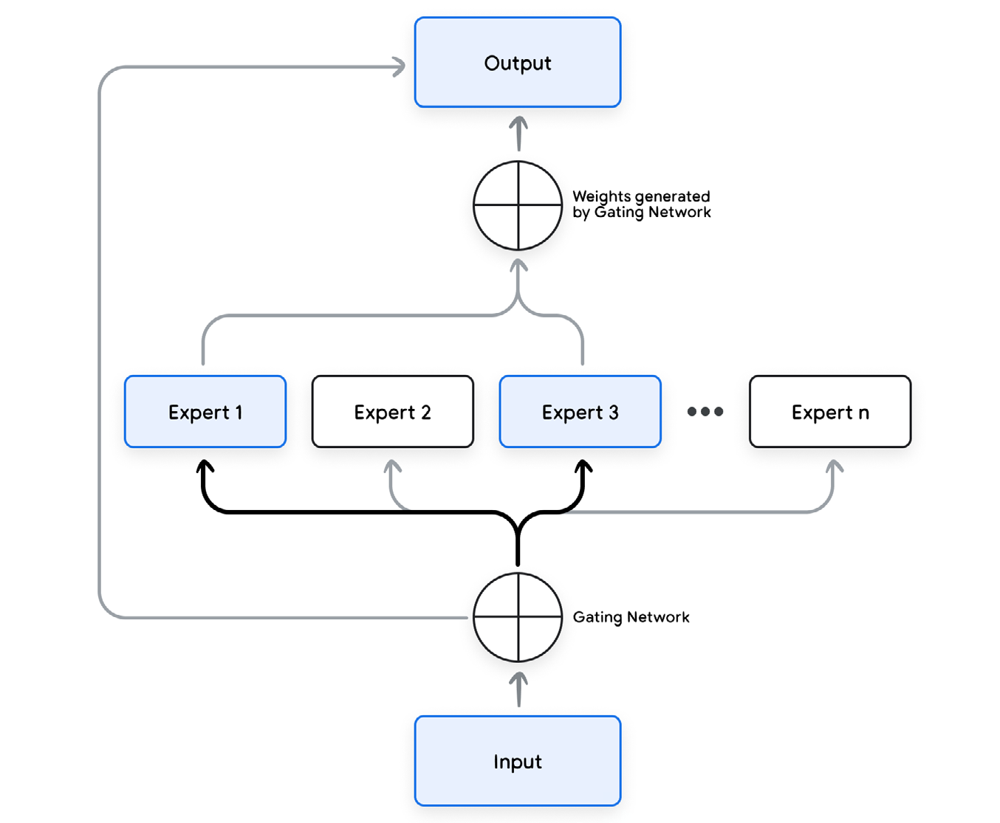

# Large language models

大语言模型

A language model predicts the probability of a sequence of words. Commonly, when given a prefix of text, a language model assigns probabilities to subsequent words. For example, given the prefix “The most famous city in the US is…”, a language model might predict high probabilities to the words “New York” and “Los Angeles” and low probabilities to the words “laptop” or “apple”. You can create a basic language model by storing an n-gram table,2 while modern language models are often based on neural models, such as transformers.

语言模型预测一个词序列的概率。常见情形是：给定一段文本前缀，语言模型给后续的词分配概率。例如，给定前缀 “The most famous city in the US is…”，语言模型可能给 “New York” 和 “Los Angeles” 很高的概率，给 “laptop” 或 “apple” 很低的概率。存一张 n-gram 表就能做出一个基本的语言模型，2 而现代语言模型往往基于神经网络模型 (Model)，例如 Transformer。

Before the invention of transformers1, recurrent neural networks (RNNs) were the popular approach for modeling sequences. In particular, “long short-term memory” (LSTM) and “gated recurrent unit” (GRU) were common architectures.3 This area includes language problems such as machine translation, text classification, text summarization, and question-answering, among others. RNNs process input and output sequences sequentially. They generate a sequence of hidden states based on the previous hidden state and the current input. The sequential nature of RNNs makes them compute-intensive and hard to parallelize during training (though recent work in state space modeling is attempting to overcome these challenges).

在 Transformer 发明之前，1 循环神经网络（recurrent neural network, RNN）是建模序列的流行做法。其中「长短期记忆」（long short-term memory, LSTM）和「门控循环单元」（gated recurrent unit, GRU）是常见架构。3 这一领域包括机器翻译、文本分类、文本摘要和问答等语言问题。RNN 按顺序处理输入和输出序列。它们根据前一个隐藏状态和当前输入，生成一串隐藏状态。RNN 的顺序性使它们计算量大，训练时也难以并行（不过状态空间建模方面的近期工作正在试图克服这些困难）。

Transformers, on the other hand, are a type of neural network that can process sequences of tokens in parallel thanks to the self-attention mechanism.1 This means that transformers can model long-term contexts more effectively and are easier to parallelize than RNNs. This makes them significantly faster to train, and more powerful compared to RNNs for handling long-term dependencies in long sequence tasks. However, the cost of self-attention in the original transformers is quadratic in the context length which limits the size of the context, while RNNs have a theoretically infinite context length. Although they have infinite context length, in practice they struggle to utilize it due to vanishing gradient problem. Transformers have become the most popular approach for sequence modeling and transfer learning problems in recent years.

另一方面，Transformer 是一类神经网络。借助自注意力 (self-attention) 机制，它们可以并行处理词元 (token) 序列。1 这意味着 Transformer 能更有效地建模长期上下文，也比 RNN 更容易并行。因此它们训练起来快得多；在长序列任务里处理长期依赖时，也比 RNN 更有力。不过，最初的 Transformer 里，自注意力的代价随上下文长度 (context length) 呈二次增长，从而限制了上下文的规模；RNN 在理论上则有无限的上下文长度。尽管上下文长度无限，实践中它们却因梯度消失问题而难以用上这段长度。近年来，Transformer 已成为序列建模和迁移学习问题最流行的做法。

Herein, we discuss the first version of the transformer model and then move on to the more recent advanced models and algorithms.

这里我们先讨论 Transformer 模型的第一个版本，再转到更晚近的高级模型与算法。

---

## Transformer

Transformer

The transformer architecture was developed at Google in 2017 for use in a translation model.1 It’s a sequence-to-sequence model capable of converting sequences from one domain into sequences in another domain. For example, translating French sentences to English sentences. The original transformer architecture consists of two parts: an encoder and a decoder. The encoder converts the input text (e.g., a French sentence) into a representation, which is then passed to the decoder. The decoder uses this representation to generate the output text (e.g., an English translation) autoregressively.1 Notably, the size of the output of the transformer encoder is linear in the size of its input. Figure 1 shows the design of the original transformer architecture.

Transformer 架构于 2017 年在 Google 开发，用于一个翻译模型。1 它是序列到序列模型，能把一个领域的序列转换成另一个领域的序列。例如，把法语句子译成英语句子。最初的 Transformer 架构由两部分组成：编码器 (encoder) 和解码器 (decoder)。编码器把输入文本（例如一个法语句子）转换成一种表示，再交给解码器。解码器用这个表示自回归地生成输出文本（例如英语译文）。1 值得注意的是，Transformer 编码器的输出规模与其输入规模成线性关系。图 1 给出了最初 Transformer 架构的设计。

The transformer consists of multiple layers. A layer in a neural network comprises a set of parameters that perform a specific transformation on the data. In the diagram you can see an example of some layers which include Multi-Head Attention, Add & Norm, Feed-Forward, Linear, Softmax etc. The layers can be sub-divided into the input, hidden and output layers. The input layer (e.g., Input/Output Embedding) is the layer where the raw data enters the network. Input embeddings are used to represent the input tokens to the model. Output embeddings are used to represent the output tokens that the model predicts. For example, in a machine translation model, the input embeddings would represent the words in the source language, while the output embeddings would represent the words in the target language. The output layer (e.g., Softmax) is the final layer that produces the output of the network. The hidden layers (e.g., Multi-Head Attention) are between the input and output layers and are where the magic happens!

Transformer 由多层组成。神经网络中的一层包含一组参数，对数据做一种特定变换。图中可以看到若干层的例子，包括多头注意力（Multi-Head Attention）、相加与归一化（Add & Norm）、前馈（Feed-Forward）、线性层（Linear）、Softmax 等。这些层可以再分成输入层、隐藏层和输出层。输入层（例如 Input/Output Embedding）是原始数据进入网络的那一层。输入嵌入 (embedding) 用来表示送入模型的输入词元。输出嵌入用来表示模型所预测的输出词元。例如在机器翻译模型里，输入嵌入表示源语言的词，输出嵌入表示目标语言的词。输出层（例如 Softmax）是产生网络输出的最后一层。隐藏层（例如多头注意力）位于输入层和输出层之间，神奇的事情就发生在这里。

**Figure 1. Original Transformer1 (P.C:5)**

[图片_001：原始 Transformer 的编码器—解码器架构 - 第 10 页]

图 1：原始 Transformer。1（图源：5）左侧是编码器：输入 “je suis étudiant” 经输入嵌入和位置编码，进入重复 N 次的多头注意力、前馈网络，以及各自的 Add & Norm 残差。右侧是解码器：已生成的输出右移后经输出嵌入和位置编码，先做带掩码的多头注意力，再对编码器输出做多头注意力，然后经过前馈网络；顶部经线性层和 Softmax 得到 “I am a student”。

To better understand the different layers in the transformer, let’s use a French-to-English translation task as an example. Here, we explain how a French sentence is input into the transformer and a corresponding English translation is output. We will also describe each of the components inside the transformer from Figure 1.

为了更好地理解 Transformer 里的不同层，我们用法译英作为例子。这里说明一个法语句子如何输入 Transformer，以及对应的英语译文如何输出。我们也会描述图 1 里 Transformer 的各个组件。

---

## Input preparation and embedding

输入准备与嵌入

To prepare language inputs for transformers, we convert an input sequence into tokens and then into input embeddings. At a high level, an input embedding is a high-dimensional vector68 that represents the meaning of each token in the sentence. This embedding is then fed into the transformer for processing. Generating an input embedding involves the following steps:

为 Transformer 准备语言输入时，我们把输入序列转换成词元 (token)，再转换成输入嵌入 (embedding)。从高层看，输入嵌入是一个高维向量，68 表示句子里每个词元的含义。这个嵌入随后送入 Transformer 处理。生成输入嵌入包括以下步骤：

1. Normalization (Optional): Standardizes text by removing redundant whitespace, accents, etc.

1. 归一化（可选）：去掉多余空白、重音等，使文本标准化。

2. Tokenization: Breaks the sentence into words or subwords and maps them to integer token IDs from a vocabulary.

2. 分词：把句子拆成词或子词，并映射到词表里的整数词元 ID。

3. Embedding: Converts each token ID to its corresponding high-dimensional vector, typically using a lookup table. These can be learned during the training process.

3. 嵌入：把每个词元 ID 转换成对应的高维向量，通常用查找表。这些向量可以在训练过程中学习。

4. Positional Encoding: Adds information about the position of each token in the sequence to help the transformer understand word order.

4. 位置编码：加入每个词元在序列中位置的信息，帮助 Transformer 理解词序。

These steps help to prepare the input for the transformers so that they can better understand the meaning of the text.

这些步骤帮助把输入准备好，让 Transformer 能更好地理解文本的含义。

---

## Multi-head attention

多头注意力

After converting input tokens into embedding vectors, you feed these embeddings into the multi-head attention module (see Figure 1). Self-attention is a crucial mechanism in transformers; it enables them to focus on specific parts of the input sequence relevant to the task at hand and to capture long-range dependencies within sequences more effectively than traditional RNNs.

把输入词元转换成嵌入向量之后，你把这些嵌入送入多头注意力模块（见图 1）。自注意力 (self-attention) 是 Transformer 里的关键机制。它使模型能聚焦于输入序列中与当前任务相关的部分，并比传统 RNN 更有效地捕捉序列内的长程依赖。

---

## Understanding self-attention

理解自注意力

Consider the following sentence: “The tiger jumped out of a tree to get a drink because it was thirsty.” Self-attention helps to determine relationships between different words and phrases in sentences. For example, in this sentence, “the tiger” and “it” are the same object, so we would expect these two words to be strongly connected. Self-attention achieves this through the following steps (Figure 2):

考虑这个句子：“The tiger jumped out of a tree to get a drink because it was thirsty.” 自注意力帮助确定句子里不同词和短语之间的关系。例如在这个句子里，“the tiger” 和 “it” 是同一个对象，因此我们会期望这两个词强烈相连。自注意力通过以下步骤做到这一点（图 2）：

1. Creating queries, keys, and values: Each input embedding is multiplied by three learned weight matrices (Wq, Wk, Wv) to generate query (Q), key (K), and value (V) vectors. These are like specialized representations of each word.

1. 构造查询、键和值：每个输入嵌入乘以三个学到的权重矩阵（Wq、Wk、Wv），生成查询（Q）、键（K）和值（V）向量。它们像是每个词的专门表示。

- Query: The query vector helps the model ask, “Which other words in the sequence are relevant to me?”

- 查询：查询向量帮助模型问：「序列里还有哪些词与我相关？」

- Key: The key vector is like a label that helps the model identify how a word might be relevant to other words in the sequence.

- 键：键向量像一个标签，帮助模型辨认一个词可能如何与序列里的其他词相关。

- Value: The value vector holds the actual word content information.

- 值：值向量保存词的实际内容信息。

2. Calculating scores: Scores are calculated to determine how much each word should ‘attend’ to other words. This is done by taking the dot product of the query vector of one word with the key vectors of all the words in the sequence.

2. 计算分数：分数用来确定每个词应当在多大程度上「注意」其他词。做法是取一个词的查询向量与序列中所有词的键向量的点积。

3. Normalization: The scores are divided by the square root of the key vector dimension (dk) for stability, then passed through a softmax function to obtain attention weights. These weights indicate how strongly each word is connected to the others.

3. 归一化：为了稳定，把分数除以键向量维度的平方根（dk），再送入 softmax 函数，得到注意力 (attention) 权重。这些权重表示每个词与其他词连接的强弱。

4. Weighted values: Each value vector is multiplied by its corresponding attention weight. The results are summed up, producing a context-aware representation for each word.

4. 加权的值：每个值向量乘以对应的注意力权重。把结果加总，就为每个词产生一个带上下文的表示。

**Figure 2. The process of computing self-attention in the multi-head attention module1 (P.C:5)**

[图片_002：以 Je、suis 两词计算自注意力 - 第 13 页]

图 2：多头注意力模块中计算自注意力的过程。1（图源：5）以 “Je” 和 “suis” 为例：嵌入 x1、x2 分别变成查询 q、键 k 和值 v。q1 与 k1 的点积为 112，与 k2 的点积为 96；除以 8（√dk）得到 14 和 12；softmax 得到 0.88 和 0.12；再与值向量相乘并求和，得到 z1、z2。

In practice, these computations are performed at the same time, by stacking the query, key and value vectors for all the tokens into Q, K and V matrices and multiplying them together as shown in Figure 3.

实践中，这些计算同时进行：把所有词元的查询、键、值向量堆成 Q、K、V 矩阵，再按图 3 那样相乘。

**Figure 3. The basic operation of attention,1 with Q=query, K=Keys and V=Value, Z=Attention, d_k = dimension of queries and keys (P.C:5)**

[图片_003：缩放点积注意力的矩阵形式 - 第 14 页]

图 3：注意力的基本运算。1 Q 为查询，K 为键，V 为值，Z 为注意力输出，d_k 为查询和键的维度。（图源：5）图中为 softmax(Q KT / √dk) 再乘以 V，得到 Z。

---

## Multi-head attention: power in diversity

多头注意力：多样性带来的能力

Multi-head attention employs multiple sets of Q, K, V weight matrices. These run in parallel, each ‘head’ potentially focusing on different aspects of the input relationships. The outputs from each head are concatenated and linearly transformed, giving the model a richer representation of the input sequence.

多头注意力使用多套 Q、K、V 权重矩阵。它们并行运行，每个「头」可能聚焦于输入关系的不同方面。各头的输出拼接后再做线性变换，使模型得到对输入序列更丰富的表示。

The use of multi-head attention improves the model’s ability to handle complex language patterns and long-range dependencies. This is crucial for tasks that require a nuanced understanding of language structure and content, such as machine translation, text summarization, and question-answering. The mechanism enables the transformer to consider multiple interpretations and representations of the input, which enhances its performance on these tasks.

使用多头注意力，提高了模型处理复杂语言模式和长程依赖的能力。这对需要细致理解语言结构与内容的任务至关重要，例如机器翻译、文本摘要和问答。这一机制让 Transformer 能考虑输入的多种解释和表示，从而提升它在这些任务上的表现。

---

## Layer normalization and residual connections

层归一化与残差连接

Each layer in a transformer, consisting of a multi-head attention module and a feed-forward layer, employs layer normalization and residual connections. This corresponds to the Add and Norm layer in Figure 1, where ‘Add’ corresponds to the residual connection and ‘Norm’ corresponds to layer normalization. Layer normalization computes the mean and variance of the activations to normalize the activations in a given layer. This is typically performed to reduce covariate shift as well as improve gradient flow to yield faster convergence during training as well as improved overall performance.

Transformer 的每一层都包含一个多头注意力模块和一个前馈层，并使用层归一化与残差连接。这对应图 1 里的 Add and Norm 层：Add 对应残差连接，Norm 对应层归一化。层归一化计算激活的均值和方差，以归一化给定层中的激活。这样做通常是为了减小协变量偏移，并改善梯度流动，从而使训练收敛更快，整体性能也更好。

Residual connections propagate the inputs to the output of one or more layers. This has the effect of making the optimization procedure easier to learn and also helps deal with vanishing and exploding gradients.

残差连接把输入传到一层或多层的输出上。这使优化过程更容易学，也有助于处理梯度消失和梯度爆炸。

The Add and Norm layer is applied to both the multi-head attention module and the feed-forward layer described in the following section.

Add and Norm 层既用在多头注意力模块上，也用在下一节要讲的前馈层上。

---

## Feedforward layer

前馈层

The output of the multi-head attention module and the subsequent ‘Add and Norm’ layer is fed into the feedforward layer of each transformer block. This layer applies a position-wise transformation to the data, independently for each position in the sequence, which allows the incorporation of additional non-linearity and complexity into the model’s representations. The feedforward layer typically consists of two linear transformations with a non-linear activation function, such as ReLU or GELU, in between. This structure adds further representational power to the model. After processing by the feedforward layer, the data undergoes another ‘Add and Norm’ step, which contributes to the stability and effectiveness of deep transformer models.

多头注意力模块及其后的 Add and Norm 层的输出，送入每个 Transformer 块的前馈层。这一层对数据做按位置的变换，序列中每个位置独立进行，从而能在模型的表示里加入额外的非线性和复杂度。前馈层通常由两次线性变换组成，中间夹一个非线性激活函数，例如 ReLU 或 GELU。这种结构给模型增加了进一步的表示能力。经过前馈层之后，数据再做一次 Add and Norm，这有助于深层 Transformer 模型的稳定和有效。

---

## Encoder and decoder

编码器与解码器

The original transformer architecture relies on a combination of encoder and decoder modules. Each encoder and decoder consists of a series of layers, with each layer comprising key components: a multi-head self-attention mechanism, a position-wise feed-forward network, normalization layers, and residual connections.

最初的 Transformer 架构依赖编码器模块与解码器模块的组合。每个编码器和解码器都由一系列层组成，每一层包含这些关键组件：多头自注意力机制、按位置的前馈网络、归一化层和残差连接。

The encoder’s primary function is to process the input sequence into a continuous representation that holds contextual information for each token. The input sequence is first normalized, tokenized, and converted into embeddings. Positional encodings are added to these embeddings to retain sequence order information. Through self-attention mechanisms, each token in the sequence can dynamically attend to any other token, thus understanding the contextual relationships within the sequence. The output from the encoder is a series of embedding vectors Z representing the entire input sequence.

编码器的主要功能是把输入序列处理成一种连续表示，其中保存每个词元的上下文信息。输入序列先做归一化、分词，并转换成嵌入。再给这些嵌入加上位置编码，以保留序列顺序信息。通过自注意力机制，序列中每个词元都可以动态地注意任何其他词元，从而理解序列内部的上下文关系。编码器的输出是一系列嵌入向量 Z，表示整个输入序列。

The decoder is tasked with generating an output sequence based on the context provided by the encoder’s output Z. It operates in a token-by-token fashion, beginning with a start-of-sequence token. The decoder layers employ two types of attention mechanisms: masked self-attention and encoder-decoder cross-attention. Masked self-attention ensures that each position can only attend to earlier positions in the output sequence, preserving the auto-regressive property. This is crucial for preventing the decoder from having access to future tokens in the output sequence. The encoder-decoder cross-attention mechanism allows the decoder to focus on relevant parts of the input sequence, utilizing the contextual embeddings generated by the encoder. This iterative process continues until the decoder predicts an end-of-sequence token, thereby completing the output sequence generation.

解码器的任务是根据编码器输出 Z 所提供的上下文，生成输出序列。它逐词元工作，从一个序列起始词元开始。解码器层使用两种注意力机制：带掩码的自注意力，以及编码器—解码器交叉注意力。带掩码的自注意力保证每个位置只能注意输出序列中更早的位置，从而保持自回归性质。这一点至关重要，它防止解码器看到输出序列中未来的词元。编码器—解码器交叉注意力让解码器聚焦于输入序列的相关部分，并利用编码器生成的上下文嵌入。这个迭代过程一直持续到解码器预测出序列结束词元，输出序列的生成就此完成。

Majority of recent LLMs adopted a decoder-only variant of transformer architecture. This approach forgoes the traditional encoder-decoder separation, focusing instead on directly generating the output sequence from the input. The input sequence undergoes a similar process of embedding and positional encoding before being fed into the decoder. The decoder then uses masked self-attention to generate predictions for each subsequent token based on the previously generated tokens. This streamlined approach simplifies the architecture for specific tasks where encoding and decoding can be effectively merged.

近期的大语言模型大多采用只有解码器的 Transformer 变体。这种做法放弃传统的编码器—解码器分离，转而直接从输入生成输出序列。输入序列先经过类似的嵌入和位置编码，再送入解码器。解码器随后用带掩码的自注意力，根据先前已生成的词元，为每一个后续词元生成预测。对那些编码与解码可以有效合并的特定任务，这种精简做法简化了架构。

---

## Mixture of Experts (MoE)

混合专家 (MoE)

A Mixture of Experts (MoE) is an architecture that combines multiple specialized sub-models (the “experts”) to improve overall performance, particularly on complex tasks. It’s a form of ensemble learning, but with a key difference: instead of simply aggregating the predictions of all experts, it learns to route different parts of the input to different experts. This allows the model to specialize, with each expert becoming proficient in a specific sub-domain or aspect of the data. Here’s a more technical breakdown describing the main components of an MoE:

混合专家 (Mixture of Experts, MoE) 是一种架构，它把多个专门的子模型（「专家」）组合起来，以提高整体性能，尤其是在复杂任务上。它是集成学习的一种形式，但有一个关键差别：它并不简单地把所有专家的预测聚合起来，而是学会把输入的不同部分路由到不同专家。这使模型能够专门化，每个专家精于数据的某个子领域或某个方面。下面更技术地拆开 MoE 的主要组件：

- Experts: These are the individual sub-models, each designed to handle a specific subset of the input data or a particular task. They can be any type of model (e.g., neural networks, decision trees, etc.), but in the context of large language models, they are typically themselves transformer-based architectures.

- 专家：这些是一个个的子模型，各自设计来处理输入数据的某个子集或某项特定任务。它们可以是任何类型的模型（例如神经网络、决策树等），但在大语言模型的语境里，它们本身通常也是基于 Transformer 的架构。

- Gating Network (Router): This is a crucial component that learns to route the input to the appropriate expert(s). It takes the input and produces a probability distribution over the experts. This distribution determines how much each expert should “contribute” to the final prediction. The gating network is also typically a neural network.

- 门控网络（路由器）：这是一个关键组件，它学会把输入路由到合适的专家。它接收输入，并在专家上产生一个概率分布。这个分布决定每个专家应当对最终预测「贡献」多少。门控网络通常也是一个神经网络。

- Combination Mechanism: This combines the outputs of the experts, weighted by the probabilities from the gating network, to produce the final prediction. A common approach is a weighted average.

- 组合机制：它把各专家的输出按门控网络给出的概率加权组合，得到最终预测。常见做法是加权平均。

In practice, a Mixture of Experts (MoE) architecture combines multiple specialized sub-models, called “experts,” to tackle complex tasks. Instead of simply averaging all expert predictions, an MoE uses a “gating network” to intelligently route different parts of the input to the most relevant experts. Both the experts and the gating network receive the input. Each expert processes the input and generates its output. Simultaneously, the gating network analyzes the input and produces a probability distribution over the experts, indicating how much each expert should contribute to the final result. These probabilities then weight the outputs of the experts, and the weighted combination becomes the final prediction. This allows different experts to specialize in handling specific types of data or sub-tasks, improving overall performance and, through “sparse activation,” potentially reducing computational cost by only activating a subset of experts for any given input.

实践中，混合专家架构把多个称为「专家」的专门子模型组合起来，以处理复杂任务。MoE 并不简单地把所有专家的预测平均，而是用「门控网络」把输入的不同部分智能地路由到最相关的专家。专家和门控网络都接收输入。每个专家处理输入并生成自己的输出。与此同时，门控网络分析输入，并在专家上产生一个概率分布，表明每个专家应当对最终结果贡献多少。这些概率再给专家的输出加权，加权组合成为最终预测。这使不同专家可以专门处理特定类型的数据或子任务，从而提高整体性能；并且通过「稀疏激活」，对任一给定输入只激活一部分专家，有可能降低计算成本。

**Figure 4. Mixture of experts ensembling70**

[图片_004：门控网络把输入路由到若干专家 - 第 18 页]

图 4：混合专家集成。70 输入同时进入门控网络和 Expert 1 到 Expert n。门控网络把输入分发给各专家；被选中的专家（图中 Expert 1 与 Expert 3）把输出送往由门控网络产生权重的组合节点，再得到最终输出。一条回路从输出回到门控网络。

---

## Large Reasoning Models

大型推理模型

Achieving robust reasoning capabilities in Large Models is a complex endeavor that involves a combination of architectural designs, training methodologies, and prompting strategies. One crucial aspect is incorporating inductive biases that favor reasoning-conducive patterns. Transformer architectures, with their self-attention mechanisms, are foundational, allowing the model to weigh the importance of different parts of the input sequence when generating an output. However, vanilla Transformers alone are not sufficient for complex reasoning.

要在大模型里获得稳健的推理 (Reasoning) 能力，是一件复杂的事，需要架构设计、训练方法和提示策略一起上。一个关键方面是加入有利于推理模式的归纳偏置。带自注意力机制的 Transformer 架构是基础，它让模型在生成输出时权衡输入序列不同部分的重要性。然而，单靠普通的 Transformer 并不足以做复杂推理。

Chain-of-Thought prompting explicitly encourages the model to generate intermediate reasoning steps before arriving at a final answer. By providing examples of step-by-step reasoning in the prompt, the model learns to decompose complex problems into smaller, manageable sub-problems. This mimics human reasoning processes and significantly improves performance on tasks requiring multi-step inference. Tree-of-Thoughts takes this further, exploring multiple reasoning paths and using a search algorithm to find the most promising solution. This technique is useful with game trees or combinatorial problems. Least-to-Most prompting guides the model to solve subproblems, which get progressively more complex, and the output of one subproblem is used as part of the prompt of the more complex, subsequent problem.

思维链 (Chain-of-Thought) 提示明确鼓励模型在得出最终答案之前生成中间推理步骤。通过在提示 (Prompt) 里给出逐步推理的例子，模型学会把复杂问题分解成更小、可处理的子问题。这模仿了人的推理过程，并显著提高需要多步推断的任务上的表现。思维树 (Tree-of-Thoughts) 更进一步：它探索多条推理路径，并用搜索算法找出最有希望的解。这一技术对博弈树或组合问题很有用。从少到多提示（Least-to-Most prompting）引导模型去解子问题，子问题逐步变复杂，前一个子问题的输出会成为后一个更复杂问题的提示的一部分。

Fine-tuning on datasets specifically designed for reasoning tasks is also crucial. These datasets may contain logical puzzles, mathematical problems, or commonsense reasoning challenges. Instruction tuning, where the model is trained to follow natural language instructions, further enhances its ability to understand and respond to complex reasoning prompts. Reinforcement Learning from Human Feedback (RLHF) refines the model’s outputs based on human preferences, improving the quality and coherence of its reasoning. RLHF helps in reward models that score reasoning ability as well as “helpfulness.”

在专门为推理任务设计的数据集上做微调 (fine-tuning) 也同样关键。这些数据集可以包含逻辑谜题、数学问题或常识推理挑战。指令微调是让模型学会遵循自然语言指令，它进一步增强模型理解并回应复杂推理提示的能力。基于人类反馈的强化学习 (Reinforcement Learning from Human Feedback, RLHF) 根据人的偏好打磨模型的输出，提高其推理的质量与连贯性。RLHF 也有助于奖励模型，这些模型既给推理能力打分，也给「有用性」打分。

Knowledge distillation, transferring knowledge from a larger, more capable “teacher” model to a smaller, more efficient “student” model, can be used to improve the reasoning abilities of smaller models while maintaining efficiency. This approach allows the student model to learn the reasoning patterns of the teacher model without requiring the same computational resources. During inference, techniques like beam search, which explores multiple candidate outputs simultaneously, can improve the quality of reasoning by considering different possibilities. Temperature scaling, adjusting the randomness of the model’s output, can also influence the exploration-exploitation trade-off in reasoning. Finally, incorporating external knowledge sources, such as knowledge graphs or structured databases, can provide the model with additional information to support its reasoning process. This can be achieved through techniques like retrieval-augmented generation, where the model retrieves relevant information from an external source before generating an output. These techniques all combined, across many domains of reasoning, create the best performing reasoning large language models.

知识蒸馏把知识从一个更大、更能干的「教师」模型转移到一个更小、更高效的「学生」模型，可以在保持效率的同时提高小模型的推理能力。这种做法让学生模型学到教师模型的推理模式，而不需要同样的计算资源。在推断 (inference) 时，束搜索一类技术同时探索多个候选输出，通过考虑不同可能来提高推理质量。温度缩放调节模型输出的随机性，也会影响推理中的探索—利用权衡。最后，纳入外部知识源，例如知识图谱或结构化数据库，可以为模型的推理过程提供额外信息。这可以通过检索增强生成 (retrieval-augmented generation) 一类技术实现：模型在生成输出之前，先从外部来源检索相关信息。这些技术合在一起，跨许多推理领域，造就表现最好的推理大语言模型。

---

## Training the transformer

训练 Transformer

When talking about machine learning models, it’s important to differentiate between training and inference. Training typically refers to modifying the parameters of the model, and involves loss functions and backpropagation. Inference is when model is used only for the predicted output, without updating the model weights. The model parameters are fixed during inference. Up until now we learned how transformers generate outputs during inference. Next, we focus on how to train transformers to perform one or more given tasks.

谈机器学习模型时，区分训练和推断很重要。训练通常指修改模型的参数，涉及损失函数和反向传播。推断是模型只用来产生预测输出，而不更新模型权重。推断期间模型参数是固定的。到目前为止，我们了解了 Transformer 在推断时如何生成输出。接下来，我们关注如何训练 Transformer，使它完成一项或多项给定任务。

---

## Data preparation

数据准备

The first step is data preparation, which involves a few important steps itself. First, clean the data by applying techniques such as filtering, deduplication, and normalization. The next step is tokenization where the dataset is converted into tokens using techniques such as Byte-Pair Encoding8, 9 and Unigram tokenization.8, 10 Tokenization generates a vocabulary, which is a set of unique tokens used by the LLM. This vocabulary serves as the model’s ’language’ for processing and understanding text. Finally, the data is typically split into a training dataset for training the model as well as a test dataset which is used to evaluate the models performance.

第一步是数据准备，它本身又包含几个重要步骤。首先清洗数据，使用过滤、去重和归一化等技术。下一步是分词：用字节对编码 (Byte-Pair Encoding)8, 9 和 Unigram 分词8, 10 等技术，把数据集转换成词元。分词产生一个词表，也就是大语言模型所使用的一组互不相同的词元。这个词表充当模型处理和理解文本的「语言」。最后，数据通常分成用来训练模型的训练集，以及用来评估模型性能的测试集。

---

## Training and loss function

训练与损失函数

A typical transformer training loop consists of several parts: First, batches of input sequences are sampled from a training dataset. For each input sequence, there is a corresponding target sequence. In unsupervised pre-training, the target sequence is derived from the input sequence itself. The batch of input sequences is then fed into the transformer. The transformer generates predicted output sequences. The difference between the predicted and target sequences is measured using a loss function (often cross-entropy loss)11. Gradients of this loss are calculated, and an optimizer uses them to update the transformer’s parameters. This process is repeated until the transformer converges to a certain level of performance or until it has been trained on a pre-specified number of tokens.

典型的 Transformer 训练循环包含几个部分。首先，从训练数据集中采样一批输入序列。每个输入序列都有一个对应的目标序列。在无监督预训练 (pre-training) 中，目标序列由输入序列本身导出。然后把这一批输入序列送入 Transformer。Transformer 生成预测的输出序列。预测序列与目标序列的差异用损失函数衡量（常常是交叉熵损失）。11 计算这个损失的梯度，优化器用它们更新 Transformer 的参数。这个过程重复进行，直到 Transformer 收敛到某一性能水平，或直到它已经在预先指定数量的词元上训练过。

There are different approaches to formulating the training task for transformers depending on the architecture used:

根据所用架构，为 Transformer 表述训练任务有不同做法：

- Decoder-only models are typically pre-trained on the language modeling task (e.g., see endnote12, 13). The target sequence for the decoder is simply a shifted version of the input sequence. Given a training sequence like ‘the cat sat on the mat’ various input/target pairs can be generated for the model. For example the input “the cat sat on” should predict “the” and subsequently the input “the cat sat on the” should predict target sequence “mat”.

- 只有解码器的模型通常在语言建模任务上预训练（例如见尾注12, 13）。解码器的目标序列只是输入序列的一个移位版本。给定像 ‘the cat sat on the mat’ 这样的训练序列，可以为模型生成各种输入 / 目标对。例如，输入 “the cat sat on” 应当预测 “the”，随后输入 “the cat sat on the” 应当预测目标序列 “mat”。

- Encoder-only models (like BERT)14 are often pre-trained by corrupting the input sequence in some way and having the model try to reconstruct it. One such approach is masked language modeling (MLM).14 In our example, the input sequence could be “The [MASK] sat on the mat” and the sequence target would be the original sentence.

- 只有编码器的模型（如 BERT）14 常常这样预训练：以某种方式破坏输入序列，再让模型试着把它重建出来。掩码语言建模（masked language modeling, MLM）就是这样一种做法。14 在我们的例子里，输入序列可以是 “The [MASK] sat on the mat”，序列目标则是原来的句子。

- Encoder-decoder models (like the original transformer) are trained on sequence-to-sequence supervised tasks such as translation (input sequence “Le chat est assis sur le tapis” and target “The cat sat on the mat”), question-answering (where the input sequence is a question and the target sequence is the corresponding answer), and summarization (where the input sequence is a full article and the target sequence is its corresponding summary). These models could also be trained in an unsupervised way by converting other tasks into sequence-to-sequence format. For example, when training on Wikipedia data, the input sequence might be the first part of an article, and the target sequence comprises the remainder of the article.

- 编码器—解码器模型（如最初的 Transformer）在序列到序列的监督任务上训练，例如翻译（输入序列 “Le chat est assis sur le tapis”，目标 “The cat sat on the mat”）、问答（输入序列是一个问题，目标序列是对应的答案）和摘要（输入序列是一篇全文，目标序列是对应的摘要）。这些模型也可以用无监督方式训练：把其他任务转换成序列到序列的格式。例如在维基百科数据上训练时，输入序列可以是文章的前一部分，目标序列则是文章的其余部分。

An additional factor to consider during training is the ‘context length’. This refers to the number of previous tokens the model can ‘remember’ and use to predict the next token in the sequence. Longer context lengths allow the model to capture more complex relationships and dependencies within the text, potentially leading to better performance. However, longer contexts also require more computational resources and memory, which can slow down training and inference. Choosing an appropriate context length involves balancing these trade-offs based on the specific task and available resources.

训练时还要考虑的一个因素是「上下文长度」。它指模型能够「记住」并用来预测序列中下一个词元的先前词元数量。更长的上下文长度让模型能捕捉文本中更复杂的关系和依赖，有可能带来更好的性能。然而，更长的上下文也需要更多计算资源和内存，可能拖慢训练和推断。选择合适的上下文长度，就是根据具体任务和可用资源来平衡这些权衡。
