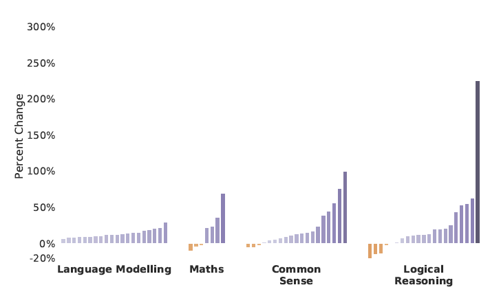
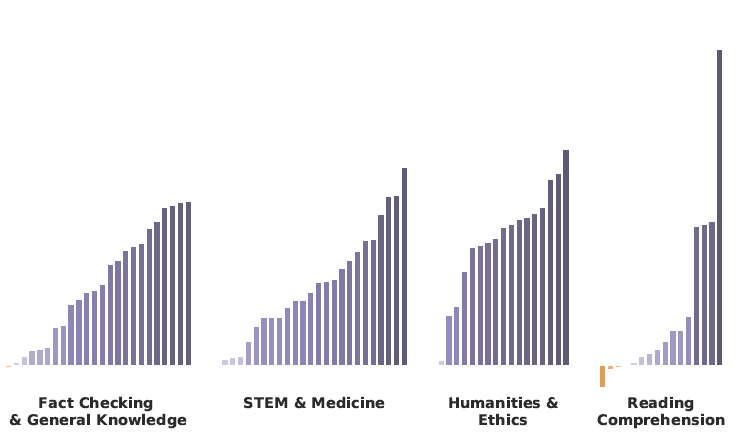
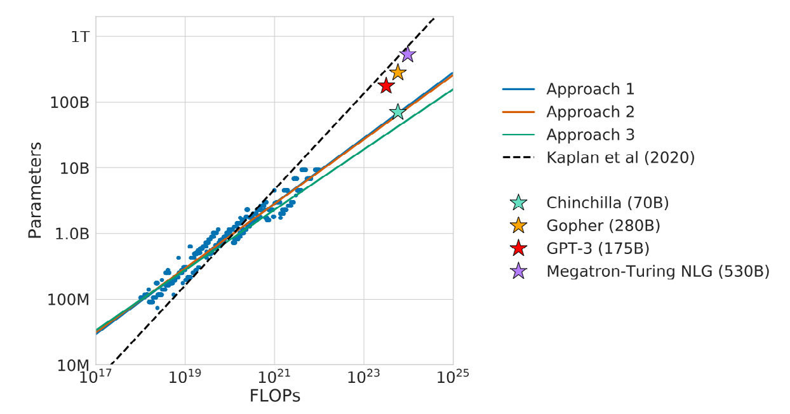
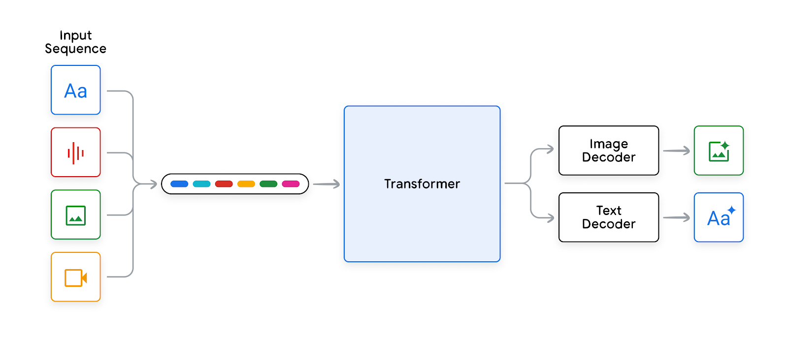

# The evolution of transformers

Transformer 的演进

The next sections provide an overview of the various transformer architectures. These include encoder-only, encoder-decoder, as well as decoder-only transformers. We start with GPT-1 and BERT and end with Google’s latest family of LLMs called Gemini.

接下来几节概述各种 Transformer 架构。其中包括只有编码器的、编码器—解码器的，以及只有解码器的 Transformer。我们从 GPT-1 和 BERT 开始，到 Google 最新的大语言模型 (LLM) 家族 Gemini 结束。

---

## GPT-1

GPT-1

GPT-1 (Generative pre-trained transformer version 1)15 was a decoder-only model developed by OpenAI in 2018. It was trained on the BooksCorpus dataset (containing approximately several billion words) and is able to generate text, translate languages, write different kinds of creative content, and answer questions in an informative way. The main innovations in GPT-1 were:

GPT-1（生成式预训练 Transformer 第 1 版）15 是 OpenAI 在 2018 年开发的只有解码器的模型 (Model)。它在 BooksCorpus 数据集上训练（大约包含数十亿词），能够生成文本、翻译语言、写出不同种类的创造性内容，并以有信息量的方式回答问题。GPT-1 的主要创新是：

- Combining transformers and unsupervised pre-training: Unsupervised pre-training is a process of training a language model on a large corpus of unlabeled data. Then, supervised data is used to fine-tune the model for a specific task, such as translation or sentiment classification. In prior works, most language models were trained using a supervised learning objective. This means that the model was trained on a dataset of labeled data, where each example had a corresponding label. This approach has two main limitations. First, it requires a large amount of labeled data, which can be expensive and time-consuming to collect. Second, the model can only generalize to tasks that are similar to the tasks that it was trained on. Semi-supervised sequence learning was one of the first works that showed that unsupervised pre-training followed by supervised training was superior than supervised training alone.

- 把 Transformer 与无监督预训练结合起来：无监督预训练 (pre-training) 是在大量无标注数据上训练语言模型的过程。然后用监督数据把模型微调 (fine-tuning) 到特定任务，例如翻译或情感分类。在此前的工作里，大多数语言模型用监督学习目标来训练。这意味着模型在标注数据上训练，每个样本都有对应的标签。这种做法有两个主要局限。第一，它需要大量标注数据，收集起来又贵又费时。第二，模型只能泛化到与它所训练的任务相似的任务。半监督序列学习是最早表明「先无监督预训练、再监督训练」优于单独监督训练的工作之一。

Unsupervised pre-training addresses these limitations by training the model on a large corpus of unlabeled data. This data can be collected more easily and cheaply than labeled data. Additionally, the model can generalize to tasks that are different from the tasks that it was trained on. The BooksCorpus dataset is a large (5GB) corpus of unlabeled text that was used to train the GPT-1 language model. The dataset contains over 7,000 unpublished books, which provides the model with a large amount of data to learn from. Additionally, the corpus contains long stretches of contiguous text, which helps the model learn long-range dependencies. Overall, unsupervised pre-training is a powerful technique that can be used to train language models that are more accurate and generalizable than models that are trained using supervised learning alone.

无监督预训练用大量无标注数据训练模型，从而应对这些局限。这类数据比标注数据更容易、也更便宜收集。此外，模型可以泛化到与它所训练的任务不同的任务。BooksCorpus 是一个很大（5GB）的无标注文本语料，用来训练 GPT-1 语言模型。数据集包含 7,000 多本未出版的书，给模型提供大量可学习的数据。此外，语料里有很长的连续文本，帮助模型学习长程依赖。总体而言，无监督预训练是一种有力的技术，可以用来训练出比单独用监督学习训练的模型更准确、更能泛化的语言模型。

- Task-aware input transformations: There are different kinds of tasks such as textual entailment and question-answering that require a specific structure. For example, textual entailment requires a premise and a hypothesis; question-answering requires a context document; a question and possible answers. One of the contributions of GPT-1 is converting these types of tasks which require structured inputs into an input that the language model can parse, without requiring task-specific architectures on top of the pre-trained architecture. For textual entailment, the premise p and the hypothesis h are concatenated with a delimiter token ($) in between - [p, $, h]. For question answering, the context document c is concatenated with the question q and a possible answer a with a delimiter token in between the question and answer - [c, q, $, a].

- 任务感知的输入变换：文本蕴含和问答等不同任务需要特定的结构。例如，文本蕴含需要一个前提和一个假设；问答需要一篇上下文文档、一个问题和若干可能的答案。GPT-1 的贡献之一，是把这些需要结构化输入的任务，转换成语言模型能够解析的输入，而不必在预训练架构之上再加任务专用的架构。对文本蕴含，前提 p 和假设 h 用一个分隔词元 ($) 拼在中间：[p, $, h]。对问答，上下文文档 c 与问题 q、一个可能的答案 a 拼接，问题和答案之间放一个分隔词元：[c, q, $, a]。

GPT-1 surpassed previous models on several benchmarks, achieving excellent results. While GPT-1 was a significant breakthrough in natural language processing (NLP), it had some limitations. For example, the model was prone to generating repetitive text, especially when given prompts outside the scope of its training data. It also failed to reason over multiple turns of dialogue and could not track long-term dependencies in text. Additionally, its cohesion and fluency were limited to shorter text sequences, and longer passages would lack cohesion. Despite these limitations, GPT-1 demonstrated the power of unsupervised pre-training, which laid the foundation for larger and more powerful models based on the transformer architecture.

GPT-1 在若干基准上超过了此前的模型，取得了很好的结果。尽管 GPT-1 是自然语言处理的一次重要突破，它仍有一些局限。例如，模型容易生成重复文本，尤其是在提示 (Prompt) 超出其训练数据范围时。它也不能在多轮对话上做推理 (Reasoning)，也不能跟踪文本中的长期依赖。此外，它的衔接和流畅只限于较短的文本序列，更长的段落会缺乏衔接。尽管有这些局限，GPT-1 展示了无监督预训练的力量，为基于 Transformer 架构的更大、更强的模型打下了基础。

---

## BERT

BERT

BERT14 which stands for Bidirectional Encoder Representations from Transformers, distinguishes itself from traditional encoder-decoder transformer models by being an encoder-only architecture. Instead of translating or producing sequences, BERT focuses on understanding context deeply by training on a masked language model objective. In this setup, random words in a sentence are replaced with a [MASK] token, and BERT tries to predict the original word based on the surrounding context. Another innovative aspect of BERT’s training regime is the next sentence prediction loss, where it learns to determine whether a given sentence logically follows a preceding one. By training on these objectives, BERT captures intricate context dependencies from both the left and right of a word, and it can discern the relationship between pairs of sentences. Such capabilities make BERT especially good at tasks that require natural language understanding, such as question-answering, sentiment analysis, and natural language inference, among others. Since this is an encoder-only model, BERT cannot generate text.

BERT14 是 Bidirectional Encoder Representations from Transformers（来自 Transformer 的双向编码器表示）的缩写。它与传统的编码器—解码器 Transformer 模型的区别在于，它是只有编码器的架构。BERT 并不翻译或产生序列，而是通过在掩码语言模型目标上训练，专注于深入理解上下文。在这个设置里，句子中的随机词被换成 [MASK] 词元 (token)，BERT 试着根据周围上下文预测原来的词。BERT 训练方案的另一个创新是下一句预测损失：它学习判断给定的句子是否在逻辑上接在前一句之后。通过在这些目标上训练，BERT 捕捉一个词左右两侧细密的上下文依赖，并能辨别句子对之间的关系。这些能力使 BERT 特别擅长需要自然语言理解的任务，例如问答、情感分析和自然语言推理等。由于这是只有编码器的模型，BERT 不能生成文本。

---

## GPT-2

GPT-2

GPT-2,12 the successor to GPT-1, was released in 2019 by OpenAI. The main innovation of GPT-2 was a direct scale-up, with a tenfold increase in both its parameter count and the size of its training dataset:

GPT-212 是 GPT-1 的后继，由 OpenAI 于 2019 年发布。GPT-2 的主要创新是直接放大：参数量和训练数据集规模都增加了约十倍。

- Data: GPT-2 was trained on a large (40GB) and diverse dataset called WebText, which consists of 45 million webpages from Reddit with a Karma rating of at least three. Karma is a rating metric used on Reddit and a value of three means that all the posts were of a reasonable level of quality.

- 数据：GPT-2 在一个很大（40GB）且多样的数据集 WebText 上训练。它由 Reddit 上 Karma 评分至少为 3 的 4,500 万个网页组成。Karma 是 Reddit 使用的评分指标，值为 3 意味着这些帖子都有还算过得去的质量。

- Parameters: GPT-2 had 1.5 billion parameters, which was an order of magnitude larger than the previous model. More parameters increase the model’s learning capacity. The authors trained four language models with 117M (the same as GPT-1), 345M, 762M, and 1.5B (GPT-2) parameters, and found that the model with the most parameters performed better on every subsequent task.

- 参数：GPT-2 有 15 亿参数，比前一个模型大一个数量级。更多参数提高模型的学习容量。作者训练了四个语言模型，参数量分别为 1.17 亿（与 GPT-1 相同）、3.45 亿、7.62 亿和 15 亿（GPT-2），并发现参数最多的模型在随后的每一项任务上都表现更好。

This scaling up resulted in a model that was able to generate more coherent and realistic text than GPT-1. Its ability to generate human-like responses made it a valuable tool for various natural language processing tasks, such as content creation and translation. Specifically, GPT-2 demonstrated significant improvement in capturing long-range dependencies and common sense reasoning. While it performed well in some tasks, it did not outperform state-of-the-art reading comprehension, summarization, and translation. GPT-2’s most significant achievement was its ability to perform zero-shot learning on a variety of tasks. Zero-shot task transfer is the ability of a model to generalize to a new task without being trained on it, which requires the model to understand the task based on the given instruction. For example, for an English to German translation task, the model might be given an English sentence followed by the word “German” and a prompt (“:”). The model would then be expected to understand that this is a translation task and generate the German translation of the English sentence. GPT-2 was able to perform tasks such as machine translation, text summarization, and reading comprehension without any explicit supervision.

这次放大得到的模型，能生成比 GPT-1 更连贯、更逼真的文本。它生成像人一样的回答的能力，使它成为内容创作和翻译等各种自然语言处理任务的有用工具。具体而言，GPT-2 在捕捉长程依赖和常识推理上有显著改进。它在一些任务上表现不错，但并没有超过当时阅读理解、摘要和翻译的前沿水平。GPT-2 最重要的成就是能在多种任务上做零样本 (zero-shot) 学习。零样本任务迁移是模型在未经该任务训练的情况下泛化到新任务的能力，这要求模型根据给定的指令理解任务。例如，对英译德任务，可以给模型一个英语句子，后面跟上词 “German” 和一个提示（“:”）。然后期望模型明白这是翻译任务，并生成该英语句子的德语译文。GPT-2 能够在没有任何显式监督的情况下做机器翻译、文本摘要和阅读理解等任务。

The study discovered that performance on zero-shot tasks increased in a log-linear manner as the model’s capacity increased. GPT-2 showed that training on a larger dataset and having more parameters improved the model’s ability to understand tasks and surpass the state-of-the-art on many tasks in zero-shot settings.

这项研究发现，随着模型容量增加，零样本任务上的性能以对数线性的方式提高。GPT-2 表明，在更大的数据集上训练并拥有更多参数，提高了模型理解任务的能力，并在零样本设置下于许多任务上超过了当时的前沿。

---

## GPT-3/3.5/4

GPT-3/3.5/4

GPT-3,13 or the third iteration of the Generative Pre-trained Transformer model, represents a significant evolution from its predecessor, GPT-2, primarily in terms of scale, capabilities, and flexibility. The most noticeable difference is the sheer size of GPT-3, boasting a whopping 175 billion parameters, compared to GPT-2’s largest model which had 1.5 billion parameters. This increase in model size allowed GPT-3 to store and recall an even more vast amount of information, understand nuanced instructions, and generate more coherent and contextually relevant text over longer passages.

GPT-313，也就是生成式预训练 Transformer 模型的第三代，相对其前身 GPT-2 是一次显著演进，主要体现在规模、能力和灵活性上。最显眼的差别是 GPT-3 的体量：它有 1,750 亿参数，而 GPT-2 最大的模型只有 15 亿参数。模型规模的增加使 GPT-3 能存储并召回更加庞大的信息量，理解细微的指令，并在更长的段落上生成更连贯、更贴合上下文的文本。

While GPT-2 could be fine-tuned on specific tasks with additional training data, GPT-3 can understand and execute tasks with just a few examples, or sometimes even without any explicit examples—simply based on the instruction provided. This highlights GPT-3’s more dynamic understanding and adaptation abilities, reducing the need for task-specific fine-tuning which was more prevalent in GPT-2.

GPT-2 可以用额外的训练数据在特定任务上微调，而 GPT-3 只需几个例子就能理解并执行任务，有时甚至不需要任何显式例子——只根据所给的指令。这突出了 GPT-3 更动态的理解与适应能力，减少了对任务专用微调的需要，而这种微调在 GPT-2 时代更为常见。

Finally, GPT-3’s large model scale and diverse training corpus have led to better generalization across a broader range of tasks. This means that out-of-the-box, without any further training, GPT-3 exhibits improved performance on diverse NLP challenges, from translation to question-answering, compared to GPT-2. It’s also worth noting that the release approach differed: while OpenAI initially held back GPT-2 due to concerns about misuse, they chose to make GPT-3 available as a commercial API, reflecting both its utility and the organization’s evolving stance on deployment.

最后，GPT-3 巨大的模型规模和多样的训练语料，带来了在更广任务范围上更好的泛化。这意味着开箱即用、无需进一步训练，GPT-3 在从翻译到问答的多种 NLP 挑战上，相对 GPT-2 表现出更好的性能。发布方式也值得一提：OpenAI 起初因担心滥用而暂缓发布 GPT-2，却选择把 GPT-3 作为商业 API 提供，这既反映了它的实用性，也反映了该组织在部署立场上的变化。

Instruction tuning was then introduced with InstructGPT17, a version of GPT-3 that was fine-tuned, using Supervised Fine-Tuning, on a dataset of human demonstrations of desired model behaviors. Outputs from this model were then ranked and it was then further fine-tuned using Reinforcement Learning from Human Feedback. This led to improved instruction following in the model. A 1.3B parameter InstructGPT model had better human evaluations than the 175B parameter GPT-3 model. It also showed improvements in truthfulness and reductions in toxicity.

随后，指令微调随 InstructGPT17 引入。它是 GPT-3 的一个版本，用监督微调 (Supervised Fine-Tuning) 在一份人类演示期望模型行为的数据集上微调。然后对这个模型的输出排序，再用基于人类反馈的强化学习 (Reinforcement Learning from Human Feedback) 进一步微调。这改善了模型对指令的遵循。一个 13 亿参数的 InstructGPT 模型，在人类评估上优于 1,750 亿参数的 GPT-3 模型。它也在真实性上有改进，并降低了毒性。

GPT-3.5 models, including GPT-3.5 turbo, improve over GPT-3 as it is capable of understanding and generating code. It’s been optimized for dialogue. And it’s capable of receiving context windows of up to 16,385 tokens and can generate outputs of up to 4,096 tokens.

GPT-3.5 模型，包括 GPT-3.5 turbo，相对 GPT-3 有改进，因为它能够理解并生成代码。它为对话做了优化。它能够接收最长 16,385 个词元的上下文窗口，并能生成最长 4,096 个词元的输出。

GPT-4 extends GPT-3.5 as a large multimodal model capable of processing image and text inputs and producing text outputs.19 Specifically, accepting text or images as input and outputting text. This model has broader general knowledge and advanced reasoning capabilities. It can receive context windows of up to 128,000 tokens and has a maximum output of 4,096 tokens. GPT-4 demonstrates remarkable versatility by solving complex tasks across diverse fields like mathematics, coding, vision, medicine, law, and psychology – all without specialized instructions. Its performance often matches or even exceeds human capabilities and significantly outperforms earlier models like GPT-3.5.

GPT-4 在 GPT-3.5 之上扩展，成为一个大型多模态模型，能够处理图像和文本输入并产生文本输出。19 具体而言，它接受文本或图像作为输入，并输出文本。这个模型有更广的一般知识和更高级的推理能力。它能够接收最长 128,000 个词元的上下文窗口，最大输出为 4,096 个词元。GPT-4 显示出很强的通用性：它在数学、编程、视觉、医学、法律和心理学等不同领域解决复杂任务，而且都不需要专门的指令。它的表现常常达到甚至超过人的能力，并显著优于 GPT-3.5 等更早的模型。

---

## LaMDA

LaMDA

Google’s LaMDA,20 which stands for ‘Language Model for Dialogue Applications’ is another contribution to the arena of large-scale language models, designed primarily to engage in open-ended conversations. Unlike traditional chatbots which operate in more constrained and predefined domains, LaMDA is engineered to handle a wide array of topics, delivering more natural and flowing conversations. LaMDA was trained on dialogue-focused data to encourage ongoing conversational flow, not just isolated responses, ensuring users can have more extensive and explorative dialogues.

Google 的 LaMDA20 是 Language Model for Dialogue Applications（面向对话应用的语言模型）的缩写，是大规模语言模型领域的另一项贡献，主要设计来进行开放式对话。传统聊天机器人在更受约束、预先划定的领域里运作，LaMDA 则被设计来处理很宽的话题范围，给出更自然、更流畅的对话。LaMDA 在以对话为重点的数据上训练，以鼓励持续的对话流，而不只是孤立的回答，从而让用户能进行更充分、更有探索性的对话。

While GPT models, especially the later iterations like GPT-3, have strived to address a multitude of tasks simultaneously, from text generation to code writing, LaMDA’s primary focus is on maintaining and enhancing conversational depth and breadth. GPT models shine on their ability to produce coherent long-form content and perform various tasks with minimal prompting, whereas LaMDA emphasizes the flow and progression of dialogue, striving to mimic the unpredictability and richness of human conversations.

GPT 模型，尤其是 GPT-3 等较晚的版本，力图同时应对从文本生成到写代码的许多任务，而 LaMDA 的首要焦点是维持并增强对话的深度和广度。GPT 模型的长处是生成连贯的长文，并用很少的提示完成各种任务；LaMDA 则强调对话的流动和推进，力求模仿人类对话的不可预测和丰富。

---

## Gopher

Gopher

Gopher22 is a 280 billion parameter language model based on the decoder-only transformer architecture, developed by DeepMind in 2021.22 It can generate text, translate languages, write different kinds of creative content, and answer your questions in an informative way. Similar to GPT-3, Gopher focused on improving dataset quality and optimization techniques:

Gopher22 是一个 2,800 亿参数的语言模型，基于只有解码器的 Transformer 架构，由 DeepMind 于 2021 年开发。22 它能生成文本、翻译语言、写出不同种类的创造性内容，并以有信息量的方式回答问题。与 GPT-3 相似，Gopher 着重改进数据集质量和优化技术：

- Dataset: The researchers curated a high-quality text dataset called MassiveText, which contains over 10 terabytes of data and 2.45B documents from web pages, books, news articles, and code (GitHub). They only trained on 300B tokens, which is 12% of the dataset. Importantly, they improved the quality of the data by filtering it, such as by removing duplicate text and deduplicating similar documents. This significantly improved the model’s performance on downstream tasks.

- 数据集：研究人员整理了一个高质量文本数据集 MassiveText，包含超过 10 TB 的数据，以及来自网页、书籍、新闻文章和代码（GitHub）的 24.5 亿篇文档。他们只在 3,000 亿词元上训练，占数据集的 12%。重要的是，他们通过过滤提高数据质量，例如去掉重复文本，并对相似文档去重。这显著提高了模型在下游任务上的性能。

- Optimization: The researchers used a warmup learning rate for 1,500 steps and then decayed it using a cosine schedule. They also had an interesting rule that as they increased the model size, they decreased the learning rate and increased the number of tokens in each batch. Additionally, they found that clipping gradients to be a maximum of 1 based on the global gradient norm helped stabilize the training.

- 优化：研究人员在 1,500 步内使用预热学习率，然后用余弦调度让它衰减。他们还有一条有意思的规则：模型变大时，降低学习率，并增加每个批次中的词元数。此外，他们发现按全局梯度范数把梯度裁剪到最大为 1，有助于稳定训练。

The authors also conducted a study on the effect of model size on different types of tasks. Figure 4 shows the results of this ablation study. Specifically, the authors found that increasing the number of parameters had a significant impact on logical reasoning and reading comprehension, but it did not improve performance as much on tasks such as general knowledge, where performance eventually almost plateaued.

作者还研究了模型规模对不同类型任务的影响。图 4 给出了这项消融研究的结果。具体而言，作者发现增加参数量对逻辑推理和阅读理解有显著影响，但对一般知识等任务的性能提升没有那么大，这些任务上的性能最终几乎平台化。

**Figure 5. Ablation study22 on the effect of model size on the performance of Gopher on different types of tasks**

[图片_005：Gopher 在语言建模、数学、常识和逻辑推理上随规模的变化 - 第 30 页]

[图片_006：Gopher 在事实核查、理工与医学、人文与伦理、阅读理解上随规模的变化 - 第 30 页]

图 5：关于模型规模对 Gopher 在不同类型任务上性能之影响的消融研究。22 左图纵轴为百分比变化，四组任务是语言建模、数学、常识和逻辑推理；右图是事实核查与一般知识、理工与医学、人文与伦理、阅读理解。每组内的柱从浅到深大致对应更大的模型。逻辑推理和阅读理解最右侧的深色柱高出很多；语言建模和事实核查的升幅更平缓。数学、常识和阅读理解的最左侧有少量低于零的橙色柱。

---

## GLaM

GLaM

GLaM (Generalist Language Model)23 was the first sparsely-activated mixture-of-experts language model. Mixture-of-experts based models are much more computationally efficient given their parameter count. This is achieved by only activating a subset of their parameters (i.e. experts) for each input token. GLaM consists of 1.2 trillion parameters but uses only ⅓ of the energy used to train GPT-3 and half of the FLOPs for inference while achieving better overall performance compared to GPT-3.

GLaM（通用语言模型）23 是第一个稀疏激活的混合专家 (Mixture of Experts) 语言模型。给定参数量，基于混合专家的模型在计算上高效得多。这是通过对每个输入词元只激活其参数的一个子集（也就是专家）来实现的。GLaM 有 1.2 万亿参数，但训练所用能量只有训练 GPT-3 的三分之一，推断 (inference) 的浮点运算次数只有一半，同时整体性能优于 GPT-3。

---

## Chinchilla

Chinchilla

Until 2022, LLMs were primarily scaled by increasing the model size and using datasets that are relatively small by current standards (up to 300 billion tokens for the largest models). This approach was informed by the Kaplan et al.24 study, which examined how performance of a language model, measured by cross-entropy loss, varies with changes in computational budget, model size, and dataset size. Specifically, given a 100-fold increase in computational resources (C), Kaplan et al.24 recommended scaling model size by approximately 28.8 times (Nopt ∝ C0.73), while increasing dataset size by only 3.5 times (Dopt ∝ C0.27).

直到 2022 年，大语言模型的放大主要靠增加模型规模，并用按今天标准相对较小的数据集（最大的模型最多约 3,000 亿词元）。这种做法受到 Kaplan 等人24 研究的影响。该研究考察语言模型的性能（以交叉熵损失衡量）如何随计算预算、模型规模和数据集规模变化。具体而言，当计算资源 (C) 增加 100 倍时，Kaplan 等人24 建议把模型规模放大约 28.8 倍（Nopt ∝ C0.73），而数据集规模只增加 3.5 倍（Dopt ∝ C0.27）。

The Chinchilla paper,25 revisited the compute optimal scaling laws and used three different approaches to find that near equal scaling in parameters and data is optimal with increasing compute. Thus, a 100-fold increase in compute should translate into a tenfold increase in both data size and model size.

Chinchilla 论文25 重新考察了计算最优的缩放定律，并用三种不同方法发现：随着计算增加，参数和数据近乎等比例放大才是最优的。因此，计算增加 100 倍，应当转化为数据规模和模型规模都增加十倍。

**Figure 6. Overlaid predictions from three different approaches from Chinchilla paper,25 along with projections from Kaplan et al24**

[图片_007：参数量随 FLOPs 的缩放，对照 Kaplan 与 Chinchilla - 第 32 页]

图 6：Chinchilla 论文25 中三种方法的预测叠在一起，并附上 Kaplan 等人24 的投影。横轴为 FLOPs（1017 到 1025），纵轴为参数量（10M 到 1T）。Approach 1、2、3 三条实线聚在一起，斜率低于 Kaplan et al (2020) 的虚线。星标为 Chinchilla（70B）、Gopher（280B）、GPT-3（175B）和 Megatron-Turing NLG（530B）。散点是各次训练运行。

To verify the updated scaling law, DeepMind trained a 70B parameter model (called Chinchilla) using the same compute budget as the previously trained Gopher model. Chinchilla uniformly and significantly outperformed Gopher (280B),21 GPT-3 (175B),13 and Megatron-Turing NLG (530B)26 on a large range of downstream evaluation tasks. Due to being 4x smaller than Gopher, both the memory footprint and the inference cost of Chinchilla are also smaller.

为了验证更新后的缩放定律，DeepMind 用与先前训练的 Gopher 模型相同的计算预算，训练了一个 700 亿参数的模型（称为 Chinchilla）。在很大范围的下游评估任务上，Chinchilla 一致且显著地优于 Gopher（2,800 亿），21 GPT-3（1,750 亿），13 以及 Megatron-Turing NLG（5,300 亿）。26 由于规模只有 Gopher 的四分之一，Chinchilla 的内存占用和推断成本也都更小。

The findings of Chinchilla had significant ramifications for the development of future LLMs. Focus shifted into finding ways to scale dataset size (while maintaining quality) alongside increasing parameter count. Extrapolating this trend suggests that training dataset size may soon be limited by the amount of text data available. This has led to new research by Muennighoff et al.27 exploring scaling laws in data-constrained regimes.

Chinchilla 的发现对未来大语言模型的开发有重大影响。焦点转到在增加参数量的同时，寻找放大数据集规模（并保持质量）的方法。把这一趋势外推，训练数据集的规模可能很快就会受到可用文本数据量的限制。这引出了 Muennighoff 等人27 的新研究，探索数据受限情形下的缩放定律。

---

## PaLM

PaLM

Pathways language model (PaLM)28 is a 540-billion parameter transformer-based large language model developed by Google AI. It was trained on a massive dataset of text and code and is capable of performing a wide range of tasks, including common sense reasoning, arithmetic reasoning, joke explanation, code generation, and translation.

Pathways 语言模型 (PaLM)28 是 Google AI 开发的、基于 Transformer 的 5,400 亿参数大语言模型。它在海量文本和代码数据集上训练，能够完成很宽的任务范围，包括常识推理、算术推理、笑话解释、代码生成和翻译。

At the time of its release, PaLM was also able to achieve state-of-the-art performance on many language benchmarks, for example GLUE and SuperGLUE.29

发布之时，PaLM 也能在许多语言基准上达到当时的前沿性能，例如 GLUE 和 SuperGLUE。29

One of the key features of PaLM is its ability to scale efficiently. This is thanks to the Pathways system, which Google developed to distribute the training of large language models across two TPU v4 Pods.

PaLM 的关键特性之一是能高效地放大。这要归功于 Pathways 系统。Google 开发它，是为了把大语言模型的训练分布到两个 TPU v4 Pod 上。

---

## PaLM 2

PaLM 2

PaLM 230 is a successor to PaLM that was announced in May 2023. Thanks to a number of architectural and training enhancements, PaLM 2 is even more capable than PaLM, with fewer total parameters. It excels at advanced reasoning tasks, including code generation, math, classification, question answering, and translation.

PaLM 230 是 PaLM 的后继，于 2023 年 5 月公布。得益于若干架构和训练上的增强，PaLM 2 比 PaLM 更能干，总参数却更少。它擅长高级推理任务，包括代码生成、数学、分类、问答和翻译。

PaLM 2 has also been shown to be more efficient than PaLM and became the basis for a number of commercial models Google released as part of Google Cloud Generative AI.

PaLM 2 也已被表明比 PaLM 更高效，并成为 Google 作为 Google Cloud 生成式 AI 的一部分所发布的若干商业模型的基础。

---

## Gemini

Gemini

**Figure 7. Gemini can receive multi-modal inputs including text, audio, images, and video data. These are all tokenized and fed into its transformer model. The transformer generates an output that can contain images and text.**

[图片_008：Gemini 把文本、音频、图像和视频分词后送入 Transformer - 第 34 页]

图 7：Gemini 可以接收多模态输入，包括文本、音频、图像和视频数据。它们全部被分词，送入其 Transformer 模型。Transformer 生成的输出可以包含图像和文本。图中左侧输入序列是文字 Aa、音频波形、图像和视频四个图标，汇成一串彩色词元，进入 Transformer；右侧分成图像解码器和文本解码器，分别输出图像和文字。

Gemini31 (Figure 6) is a state-of-the-art multimodal language family of models that can take interleaved sequences of text, image, audio, and video as input. It’s built on top of transformer decoders and has architectural improvements for scale as well as optimized inference on Google’s Tensor Processing Units (TPUs). In its current version, these models are trained to support contexts of different sizes, up to 2M tokens in the Gemini Pro version on Vertex AI and employ mechanisms such as multi-query attention for efficiency. Gemini models also employ a Mixture of Experts architecture to optimize efficiency and capabilities of the models. Multimodality allows the models to process text, images and video in input, with more modalities in input and output expected in the future.

Gemini31（图 6）是一族前沿的多模态语言模型，可以把交错的文本、图像、音频和视频序列作为输入。它建立在 Transformer 解码器之上，有面向规模的架构改进，并在 Google 的张量处理单元（Tensor Processing Unit, TPU）上做了优化的推断。在当前版本中，这些模型被训练来支持不同大小的上下文，在 Vertex AI 上的 Gemini Pro 版本最长可达 200 万词元，并采用多查询注意力等机制以提高效率。Gemini 模型也采用混合专家架构，以优化模型的效率和能力。多模态使模型能在输入中处理文本、图像和视频，未来预期输入和输出还会有更多模态。

The Gemini models are trained on Google’s TPUv5e and TPUv4 processors, depending on size and configuration. The pre-training data consists of web documents, books, code, and image, audio, and video data.

Gemini 模型根据规模和配置，在 Google 的 TPUv5e 和 TPUv4 处理器上训练。预训练数据包括网页文档、书籍、代码，以及图像、音频和视频数据。

Larger models are trained for the compute-optimal number of tokens using the same approach as in Chinchilla paper,25 while small models are trained on significantly more tokens than compute optimal to improve performance for a given inference budget.

较大的模型按 Chinchilla 论文25 中的同一做法，训练到计算最优的词元数；小模型则在明显多于计算最优的词元上训练，以便在给定的推断预算下提高性能。

The Gemini family of models is optimized for different sizes: Gemini Ultra, Gemini Pro, Gemini Nano and Flash. Gemini Ultra is used for highly complex tasks and achieves state-of-the-art results in 30 out of 32 benchmark tasks. Gemini Pro enables deployment at scale and Gemini Nano is designed for on-device applications. The Gemini Nano models leverage advancements such as distillation to produce state-of-the-art performance for small language models on tasks such as summarization and reading comprehension. As the Gemini models are natively multi-modal, it can be seen that training across multiple modalities does indeed lead to a model that is capable of achieving strong capabilities in each domain.

Gemini 模型家族按不同规模优化：Gemini Ultra、Gemini Pro、Gemini Nano 和 Flash。Gemini Ultra 用于高度复杂的任务，在 32 项基准任务中的 30 项上达到当时的前沿结果。Gemini Pro 使大规模部署成为可能，Gemini Nano 则为端侧应用而设计。Gemini Nano 模型利用蒸馏等进展，在摘要和阅读理解等任务上为小语言模型带来前沿性能。由于 Gemini 模型原生就是多模态的，可以看到跨多种模态训练确实会得到一个在每个领域都能取得强能力的模型。

During the initial part of 2024, Google introduced the latest model of the Gemini family, Gemini 1.5 Pro,32 a highly compute-efficient multimodal mixture-of-experts model. This model also dramatically increased the size of the context window to millions of tokens and is capable of recalling and reasoning over those millions of tokens, including multiple long documents and hours of video and audio. Gemini 1.5 Pro demonstrates remarkable capabilities across different domains:

2024 年初，Google 推出了 Gemini 家族当时最新的模型 Gemini 1.5 Pro，32 一个计算效率很高的多模态混合专家模型。这个模型也把上下文窗口的规模大幅增加到数百万词元，并能在这数百万词元上回忆和推理，包括多篇长文档以及数小时的视频和音频。Gemini 1.5 Pro 在不同领域展示出突出的能力：

- Code understanding: It can process massive codebases and answer highly specific code-related questions.

- 代码理解：它能处理巨大的代码库，并回答非常具体的代码相关问题。

- Language learning: The model can learn new languages never observed at training time solely based on reference materials provided within its input.

- 语言学习：模型可以仅根据输入中提供的参考材料，学会训练时从未见过的新语言。

- Multimodal reasoning: It understands images and text, allowing it to locate a famous scene from the novel ‘Les Misérables’ based on a simple sketch.

- 多模态推理：它理解图像和文本，因而能根据一幅简单草图，定位小说《悲惨世界》中的一个著名场景。

- Video comprehension: It can analyze entire movies, answering detailed questions and pinpointing specific timestamps with remarkable accuracy.

- 视频理解：它能分析整部电影，回答细节问题，并以很高的准确度指出具体时间戳。

Google’s Gemini 1.5 Pro model excels at retrieving information from even very long documents. In their study,32 it demonstrated 100% recall on documents up to 530,000 tokens, and over 99.7% recall on those up to 1 million tokens. Impressively, it maintains 99.2% accuracy when finding information in documents up to 10 million tokens.

Google 的 Gemini 1.5 Pro 模型擅长从很长的文档里检索信息。在他们的研究中，32 它在最长 53 万词元的文档上展示了 100% 的召回，在最长 100 万词元的文档上召回超过 99.7%。令人印象深刻的是，在最长 1,000 万词元的文档中查找信息时，它仍保持 99.2% 的准确率。

Moreover, Gemini 1.5 Pro demonstrates a major leap forward in how well LLMs follow complex instructions. In a rigorous test with 406 multi-step prompts, it significantly outperformed previous Gemini models. The model accurately followed almost 90% of instructions and fully completed 66% of the complex tasks.

此外，Gemini 1.5 Pro 在大语言模型遵循复杂指令的程度上向前跨了一大步。在一项包含 406 条多步提示的严格测试中，它显著优于此前的 Gemini 模型。该模型准确遵循了近 90% 的指令，并完整完成了 66% 的复杂任务。

Gemini Flash is a new addition to the Gemini model family and the fastest Gemini model served in the API. It’s optimized for high-volume, high-frequency tasks at scale, is more cost-efficient to serve and features a breakthrough long context window of 1 million tokens. Although it is a lighter weight model than 1.5 Pro, it is highly capable of multimodal reasoning across vast amounts of information and delivers impressive quality for its size.

Gemini Flash 是 Gemini 模型家族的新成员，也是 API 中提供的最快的 Gemini 模型。它为大规模、高吞吐、高频率的任务而优化，服务成本更低，并具有 100 万词元这一突破性的长上下文窗口。尽管它比 1.5 Pro 更轻，它仍高度能够在海量信息上做多模态推理，并相对其规模给出令人印象深刻的质量。

Gemini 2.0 represents a significant leap forward in Google’s multimodal AI models. It builds upon the foundation of Gemini 1.0 with enhanced capabilities and a focus on efficiency and new modalities. In more details:

Gemini 2.0 是 Google 多模态 AI 模型的一次显著飞跃。它建立在 Gemini 1.0 的基础上，能力更强，并聚焦于效率和模态。细节如下：

Gemini 2.0 Flash: This version is designed for speed and efficiency, exceeding the performance of Gemini 1.5 Pro while maintaining the responsiveness developers expect. It showcases improvements in multimodal understanding, text processing, code generation, video analysis, and spatial reasoning. Notably, it has enhanced spatial understanding, leading to more accurate object identification and captioning, especially for small objects in complex scenes. Gemini 2.0 Flash was introduced in late 2024.

Gemini 2.0 Flash：这个版本为速度和效率而设计，性能超过 Gemini 1.5 Pro，同时保持开发者所期望的响应速度。它在多模态理解、文本处理、代码生成、视频分析和空间推理上展示出改进。值得注意的是，它增强了空间理解，从而更准确地识别物体并生成描述，尤其是复杂场景中的小物体。Gemini 2.0 Flash 于 2024 年末推出。

Gemini 2.0 Pro is positioned as a highly capable model for a broad range of tasks. It likely serves as a workhorse for various applications, balancing performance and efficiency. It is likely an evolution of the original Gemini Pro model with improvements across multiple domains.

Gemini 2.0 Pro 被定位为面向广泛任务的高能力模型。它很可能充当各种应用的主力，在性能和效率之间取得平衡。它很可能是最初 Gemini Pro 模型的演进，在多个领域都有改进。

Gemini 2.0 Nano: As with the previous generation, Nano focuses on on-device deployment. It is optimized for resource efficiency and speed, enabling AI capabilities directly on devices like smartphones.

Gemini 2.0 Nano：与上一代一样，Nano 聚焦于端侧部署。它为资源效率和速度而优化，使智能手机等设备上能直接具备 AI 能力。

Gemini 2.0 Flash Thinking Experimental is a fast, high-performance reasoning model, enhanced with explainability through visible “thought processes,” particularly excelling in complex science and math problems; it accepts text and image inputs, produces text outputs, supports a 1 million token input context and a 64,000 token output, utilizes code execution, has a knowledge cutoff of August 2024, is best suited for complex tasks where latency is not a primary concern, and is available via Google AI Studio, the Gemini API, and Vertex AI, though currently in an experimental deployment status.

Gemini 2.0 Flash Thinking Experimental 是一个快速、高性能的推理模型，通过可见的「思考过程」增强了可解释性，尤其擅长复杂的科学和数学问题。它接受文本和图像输入，产生文本输出，支持 100 万词元的输入上下文和 64,000 词元的输出，使用代码执行，知识截止日期为 2024 年 8 月。它最适合延迟不是首要考虑的复杂任务，可通过 Google AI Studio、Gemini API 和 Vertex AI 使用，不过目前处于实验性部署状态。

---

## Gemma

Gemma

Furthermore, recently advanced Gemma is a family of lightweight, state-of-the-art open models built from the same research and technology used to create the Gemini models.33 The first model by Gemma boasts a large vocabulary of 256,000 words and has been trained on a massive 6 trillion token dataset. This makes it a valuable addition to the openly-available LLM collection. Additionally, the 2B parameter version is intriguing as it can run efficiently on a single GPU.

此外，近期推进的 Gemma 是一族轻量、前沿的开放模型，用与创建 Gemini 模型相同的研究和技术构建。33 Gemma 的第一个模型拥有 256,000 词的大词表，并在高达 6 万亿词元的数据集上训练。这使它成为公开可用的大语言模型收藏中有价值的一员。另外，20 亿参数的版本很有意思，因为它能在单块 GPU 上高效运行。

Gemma 2,33 developed by Google AI, represents a significant advancement in the field of open large language models. Designed with a focus on efficiency, the 27-billion parameter model boasts performance comparable to much larger models like Llama 3 70B33 on standard benchmarks. This makes Gemma 2 a powerful and accessible tool for a wide range of AI developers. Its compatibility with diverse tuning toolchains, from cloud-based solutions to popular community tools, further enhances its versatility. With its strong performance, efficient architecture, and accessible nature, Gemma 2 plays a vital role in driving innovation and democratizing AI capabilities.

Gemma 233 由 Google AI 开发，代表开放大语言模型领域的一次显著进展。它以效率为设计重点，270 亿参数的模型在标准基准上的性能堪比 Llama 3 70B33 这样大得多的模型。这使 Gemma 2 成为广大 AI 开发者强大且容易获得的工具。它与多样的调优工具链兼容，从基于云的方案到流行的社区工具，进一步增强了它的通用性。凭借强性能、高效架构和可获得性，Gemma 2 在推动创新和使 AI 能力民主化方面扮演重要角色。

Gemma 3 represents Google’s latest advancement in its family of open models, built upon the research and technology that also powers the Gemini models. A key feature of Gemma 3 is its multimodality, enabling it to process both text and image inputs and generate text outputs. This version significantly expands capabilities with a large, 128K context window, and broad multilingual support encompassing over 140 languages. To cater to diverse hardware and performance needs, Gemma 3 is available in various sizes, including 1B, 4B, 12B, and 27B parameter models. These varieties allow developers to select the most suitable model for their specific applications, ranging from resource-constrained devices to high-performance computing environments.

Gemma 3 代表 Google 开放模型家族的最新进展，建立在同样驱动 Gemini 模型的研究和技术之上。Gemma 3 的一个关键特性是多模态：它能处理文本和图像输入，并生成文本输出。这一版以 128K 的大上下文窗口和覆盖 140 多种语言的广泛多语言支持，显著扩展了能力。为了适应多样的硬件和性能需求，Gemma 3 提供多种规模，包括 10 亿、40 亿、120 亿和 270 亿参数的模型。这些品种让开发者能为自己的具体应用选择最合适的模型，从资源受限的设备到高性能计算环境。

---

## LLaMA

LLaMA

Llama models are transformer-based language models, similar in high-level architecture to other large language models (LLMs) like GPT. They are primarily based on the decoder-only architecture, meaning they focus on predicting the next token in a sequence given the preceding tokens.

Llama 模型是基于 Transformer 的语言模型，高层架构与 GPT 等其他大语言模型相似。它们主要基于只有解码器的架构，也就是专注于在给定先前词元的情况下预测序列中的下一个词元。

Meta has released several key versions of Llama. The original Llama 1 models came in various sizes, from 7B to 65B parameters, and were notable for their strong performance compared to other open-source models of similar size. Llama 234 represented a major advancement, featuring a larger context window extended to 4096 tokens for handling longer texts, and importantly, it was fine-tuned for chat applications, significantly improving its conversational abilities. Llama 2 was offered in 7B, 13B, and 70B parameter versions and, unlike Llama 1, was released with a license allowing commercial use. Llama 3 builds upon these advancements with enhanced performance across reasoning, coding, and general knowledge, and is expected to include a wider range of sizes. A key focus of Llama 3 is increased safety, with efforts to reduce harmful outputs through improved training and alignment techniques. Llama 2 is a family of pretrained and fine-tuned LLMs, ranging from 7B to 70B parameters, with improvements like a 40% larger training dataset, doubled context length, and grouped-query attention. The fine-tuned version, Llama 2-Chat, excels in dialogue. The next generation, Llama 3.2, includes multilingual text-only models and vision LLMs, with quantized versions for on-device deployment. Llama 3.2 uses grouped-query attention and a 128K token vocabulary.

Meta 发布了 Llama 的几个关键版本。最初的 Llama 1 模型有多种规模，从 70 亿到 650 亿参数，相对同等规模的其他开源模型，其强性能很引人注目。Llama 234 是一次重大进展：上下文窗口扩大到 4,096 个词元，以处理更长的文本；更重要的是，它为聊天应用做了微调，显著提高了对话能力。Llama 2 提供 70 亿、130 亿和 700 亿参数的版本，并且与 Llama 1 不同，以允许商业使用的许可发布。Llama 3 在这些进展之上，在推理、编程和一般知识上增强了性能，并预期包含更宽的规模范围。Llama 3 的一个重点是更高的安全性，通过改进的训练和对齐技术努力减少有害输出。Llama 2 是一族预训练并微调过的大语言模型，规模从 70 亿到 700 亿参数，改进包括训练数据集大 40%、上下文长度翻倍，以及分组查询注意力（grouped-query attention）。微调版本 Llama 2-Chat 擅长对话。下一代 Llama 3.2 包括多语言的纯文本模型和视觉大语言模型，并有供端侧部署的量化版本。Llama 3.2 使用分组查询注意力和 128K 词元的词表。

---

## Mixtral

Mixtral

Developed by Mistral AI35, Mixtral 8x7B is a Sparse Mixture of Experts (SMoE) model. While its total parameter count is 47B, it utilizes only 13B active parameters per token during inference, leading to faster inference and higher throughput. This model excels in mathematics, code generation, and multilingual tasks, often outperforming LLaMA 2 70B in these domains. Mixtral also supports a 32k token context length, enabling it to handle significantly longer sequences. Its instruction-tuned version, Mixtral 8x7B-Instruct, surpasses several closed-source models on human evaluation benchmarks. Mistral makes several of its models available as open source under the Apache 2.0 license, emphasizing open access to model weights. In addition, Mistral offers a range of models through its API, providing various sizes and capabilities to suit diverse requirements.

由 Mistral AI 开发的 Mixtral 8x7B35 是一个稀疏混合专家（Sparse Mixture of Experts, SMoE）模型。它的总参数量是 470 亿，但推断时每个词元只使用 130 亿活跃参数，因而推断更快、吞吐更高。这个模型擅长数学、代码生成和多语言任务，在这些领域常常优于 LLaMA 2 70B。Mixtral 也支持 32k 词元的上下文长度，使它能处理明显更长的序列。它的指令微调版本 Mixtral 8x7B-Instruct 在人类评估基准上超过若干闭源模型。Mistral 以 Apache 2.0 许可把若干模型作为开源提供，强调对模型权重的开放访问。此外，Mistral 通过其 API 提供一系列模型，有各种规模和能力，以适应不同需求。

---

## OpenAI O1

OpenAI O1

OpenAI’s new “o1” series represents a significant advancement in models, focusing on complex reasoning abilities honed through reinforcement learning. These models employ an internal “chain-of-thought” process, engaging in extensive deliberation before generating a response. This deliberate approach results in exceptional performance on challenging scientific reasoning tasks. Benchmarks demonstrate their proficiency: o1 models achieve an 89th percentile ranking on Codeforces programming competitions, score within the top 500 nationally on the AIME (a USA Math Olympiad qualifier), and surpass PhD-level human accuracy on a comprehensive physics, biology, and chemistry benchmark (GPQA). The API offers two variants: o1: The flagship model, optimized for tackling difficult problems that require broad, general world knowledge, and o1-mini: A faster, more cost-effective version, excelling in domains like coding, mathematics, and scientific tasks where deep specialized knowledge is more critical than extensive general knowledge.

OpenAI 新的 “o1” 系列代表模型的一次显著进展，聚焦于通过强化学习打磨出来的复杂推理能力。这些模型采用内部的「思维链」过程，在生成回答之前进行大量斟酌。这种审慎的做法，在有挑战性的科学推理任务上带来了出色的性能。基准显示了它们的熟练程度：o1 模型在 Codeforces 编程竞赛中达到第 89 百分位，在 AIME（美国数学奥林匹克资格赛）上进入全国前 500，并在一项综合的物理、生物和化学基准（GPQA）上超过博士水平的人类准确率。API 提供两个变体。o1：旗舰模型，为处理需要广泛、一般世界知识的困难问题而优化。o1-mini：更快、更省成本的版本，擅长编程、数学和科学任务等深度专门知识比广泛一般知识更关键的领域。

---

## DeepSeek

DeepSeek

DeepSeek has demonstrated that competitive reasoning performance, comparable to OpenAI’s “o1” series, can be achieved through a novel reinforcement learning approach, even without relying on extensive labeled data. This is exemplified by their DeepSeek-R1-Zero model, trained purely with RL. Traditional RL methods for LLMs often depend on a “critic” model, trained on labeled data, to provide feedback. DeepSeek’s innovation, called Group Relative Policy Optimization (GRPO), eliminates this critic. Instead, GRPO uses a set of predefined rules (assessing coherence, completeness, and fluency) to score the model’s outputs across multiple rounds. The model learns by comparing its performance against the group average, effectively learning from its own “self-play” without explicit human-provided labels. This pure-RL approach, while successful in achieving high reasoning scores (matching “o1” on the AIME 2024 mathematics competition), initially resulted in outputs with poor readability and language mixing.

DeepSeek 表明，即便不依赖大量标注数据，也可以通过一种新的强化学习方法，达到与 OpenAI “o1” 系列相当的有竞争力的推理性能。他们的 DeepSeek-R1-Zero 模型就是例子，它纯粹用强化学习训练。大语言模型传统的强化学习方法常常依赖一个在标注数据上训练的「评论家」模型来提供反馈。DeepSeek 的创新称为组相对策略优化（Group Relative Policy Optimization, GRPO），去掉了这个评论家。GRPO 改用一组预先定义的规则（评估连贯性、完整性和流畅性），在多轮中给模型的输出打分。模型通过把自己的表现与组平均比较来学习，实际上是从自己的「自我对弈」中学习，而没有人显式提供的标签。这种纯强化学习做法在取得高推理分数上是成功的（在 AIME 2024 数学竞赛上与 “o1” 相当），但最初得到的输出可读性差，并且会混用语言。

To address these shortcomings, DeepSeek developed a multi-stage training process for their DeepSeek-R1 model. This process begins with supervised fine-tuning (SFT) on a small “cold start” dataset, providing a basic foundation of language understanding. Next, pure-RL (using GRPO) is applied to enhance reasoning abilities, similar to the R1-Zero model. Critically, near the end of the RL phase, rejection sampling (e.g. filtering) is employed. The model generates multiple outputs, and only the best, according to the GRPO rules, are selected. This creates a high-quality “synthetic” dataset generated by the model itself. This synthetic data is then combined with supervised data from the original base model (covering areas like writing and factual knowledge). A final round of fine-tuning and further RL is performed, leveraging both the synthetic and supervised data, refining the model’s overall performance and generalization capabilities. This multi-stage approach leverages the strengths of each training method: the initial SFT provides a basic linguistic foundation; pure-RL fosters strong reasoning skills; rejection sampling creates high-quality training data; and the final SFT and RL steps ensure a polished, well-rounded model. The result is the DeepSeek-R1 model that matches or exceeds the o1 model in many areas. Chain-of-thought (CoT) reasoning at inference time is intrinsically linked to this RL-based training. The model learns to generate intermediate reasoning steps during training, which are essential for its strong performance on complex tasks at inference. Despite providing model weights, DeepSeek’s models are effectively closed-source due to the lack of transparency regarding training data, processing scripts, and data curation methods.

为了应对这些不足，DeepSeek 为 DeepSeek-R1 模型开发了多阶段训练过程。这个过程从在一个小的「冷启动」数据集上做监督微调 (supervised fine-tuning, SFT) 开始，提供语言理解的基本基础。接下来施加纯强化学习（使用 GRPO）以增强推理能力，类似于 R1-Zero 模型。关键的是，在强化学习阶段接近结束时使用拒绝采样（例如过滤）。模型生成多个输出，只按 GRPO 规则选出最好的那些。这就产生了一个由模型自己生成的高质量「合成」数据集。然后把这些合成数据与来自原始基座模型的监督数据结合起来（覆盖写作和事实知识等领域）。再做最后一轮微调和进一步的强化学习，同时利用合成数据和监督数据，打磨模型的整体性能和泛化能力。这种多阶段做法利用每种训练方法的长处：最初的监督微调提供基本的语言基础；纯强化学习培养强推理技能；拒绝采样产生高质量训练数据；最后的监督微调和强化学习步骤保证一个打磨好、面面俱到的模型。结果就是 DeepSeek-R1 模型，它在许多方面达到或超过 o1 模型。推断时的思维链 (Chain-of-Thought, CoT) 推理与这种基于强化学习的训练内在相连。模型在训练期间学会生成中间推理步骤，这些步骤对其在推断时复杂任务上的强表现至关重要。尽管提供了模型权重，由于训练数据、处理脚本和数据整理方法缺乏透明度，DeepSeek 的模型实际上仍是闭源的。

---

## Other open models

其他开放模型

The landscape of open LLMs is rapidly evolving, with a growing number of models where both the code and pre-trained weights are publicly accessible. Below we highlight some of the known examples:

开放大语言模型的版图正在迅速变化，代码和预训练权重都公开可访问的模型越来越多。下面我们突出若干已知的例子：

- Qwen 1.536: This LLM series from Alibaba comes in six sizes: 0.5B, 1.8B, 4B, 7B, 14B, and 72B. Qwen 1.5 models uniformly support a context length of up to 32k tokens and show strong performance across various benchmarks. Notably, Qwen 1.5-72B outperforms LLaMA2-70B on all evaluated benchmarks, demonstrating exceptional capabilities in language understanding, reasoning, and math.

- Qwen 1.536：阿里巴巴的这一大语言模型系列有六种规模：5 亿、18 亿、40 亿、70 亿、140 亿和 720 亿。Qwen 1.5 模型一律支持最长 32k 词元的上下文长度，并在各种基准上表现强劲。值得注意的是，Qwen 1.5-72B 在所有被评估的基准上都优于 LLaMA2-70B，在语言理解、推理和数学上展示出突出能力。

- Yi37: Created by 01.AI, the Yi model family includes 6B and 34B base models pre-trained on a massive 3.1 trillion token English and Chinese dataset. Yi emphasizes data quality through rigorous cleaning and filtering processes. The 34B model achieves performance comparable to GPT-3.5 on many benchmarks and can be efficiently served on consumer-grade GPUs with 4-bit quantization. Yi also offers extensions like a 200k context model, a vision-language model (Yi-VL), and a depth-upscaled 9B model.

- Yi37：由 01.AI 创建。Yi 模型家族包括 60 亿和 340 亿的基座模型，在高达 3.1 万亿词元的英汉数据集上预训练。Yi 通过严格的清洗和过滤强调数据质量。340 亿模型在许多基准上达到与 GPT-3.5 相当的性能，并能以 4 比特量化在消费级 GPU 上高效服务。Yi 也提供扩展，例如 200k 上下文模型、视觉—语言模型（Yi-VL），以及深度放大的 90 亿模型。

- Grok 3: Developed by xAI, Grok-3 is released in Grok 3 (Think) and Grok 3 mini (Think). Both models were trained using reinforcement learning. Grok 3 (Think) learned to refine its problem-solving strategies, correct errors through backtracking, simplify steps, and utilize the knowledge it picked up during pretraining. With a context window of 1 million tokens its 8 times larger than previous Grok models.

- Grok 3：由 xAI 开发。Grok-3 以 Grok 3 (Think) 和 Grok 3 mini (Think) 发布。两个模型都用强化学习训练。Grok 3 (Think) 学会改进解题策略，通过回溯纠正错误，简化步骤，并利用预训练期间学到的知识。它的上下文窗口为 100 万词元，是此前 Grok 模型的 8 倍。

The pace of innovation with LLMs has been rapid and shows no signs of slowing down. There have been many contributions to the field in both the academic and commercial settings.

大语言模型的创新步伐很快，也没有放慢的迹象。学术界和商业界都对这个领域有许多贡献。

With over 20,000 papers published about LLMs in arxiv.org it is impossible to name all of the models and teams that have contributed to the development of LLMs. However, an abbreviated list of open models of interest could include EleutherAI’s GPT-NeoX and GPT-J, Stanford’s Alpaca, Vicuna from LMSYS, Grok from xAI, Falcon from TII, PHI from Microsoft, NVLM from Nvidia, DBRX from Databricks, Qwen from Alibaba, Yi from 01.ai, Llama from Meta mentioned above and many others. Some of notable companies developing commercial foundation LLM models include Anthropic, Cohere, Character.ai, Reka, AI21, Perplexity, xAI and many others in addition to Google and OpenAI mentioned in previous sections. It is important when using a model to confirm that the license is appropriate for your use case as many models are provided with very specific terms of use.

arxiv.org 上已发表超过 20,000 篇关于大语言模型的论文，不可能点名所有为开发大语言模型做出贡献的模型和团队。不过，一份简短的值得关注的开放模型清单可以包括：EleutherAI 的 GPT-NeoX 和 GPT-J、斯坦福的 Alpaca、LMSYS 的 Vicuna、xAI 的 Grok、TII 的 Falcon、微软的 PHI、Nvidia 的 NVLM、Databricks 的 DBRX、阿里巴巴的 Qwen、01.ai 的 Yi、上面提到的 Meta 的 Llama，以及许多其他模型。除前面几节提到的 Google 和 OpenAI 之外，开发商业基础大语言模型的著名公司还包括 Anthropic、Cohere、Character.ai、Reka、AI21、Perplexity、xAI 等许多公司。使用模型时，确认许可适合你的用例很重要，因为许多模型附有非常具体的使用条款。

---

## Comparison

比较

In this section, we observed how transformer-based language models have evolved. They started as encoder-decoder architectures with hundreds of millions of parameters trained on hundreds of millions of tokens, and have grown to be massive decoder-only architectures with billions of parameters and trained on trillions of tokens. Table 1 shows how the important hyperparameters for all the models discussed in this whitepaper have evolved over time. The scaling of data and parameters has not only improved the performance of LLMs on downstream tasks, but has also resulted in emergent behaviors and zero- or few-shot generalizations to new tasks. However, even the best of these LLMs still have many limitations. For example, they are not good at engaging in human-like conversations, their math skills are limited, and they might not be aligned with human ethics (e.g., they might be biased or generate toxic responses). In the next section, we learn how a lot of these issues are being addressed.

在这一节，我们看到基于 Transformer 的语言模型如何演进。它们从数亿参数、在数亿词元上训练的编码器—解码器架构起步，成长为数十亿参数、在数万亿词元上训练的巨大的只有解码器的架构。表 1 展示本白皮书讨论的所有模型的重要超参数如何随时间变化。数据和参数的放大不仅提高了大语言模型在下游任务上的性能，也带来了涌现行为，以及对新任务的零样本或少样本 (few-shot) 泛化。然而，即便这些大语言模型里最好的那些，仍然有许多局限。例如，它们不擅长进行像人一样的对话，数学技能有限，也可能与人类伦理不对齐（例如可能有偏见，或生成有毒的回答）。下一节我们了解这些问题中的许多如何正在被处理。

**Table 1. Important hyperparameters for transformers-based large language models**

表 1：基于 Transformer 的大语言模型的重要超参数。

| | Attention (2017) | GPT (2018) | GPT-2 (2019) | GPT-3 (2020) | LaMDA (2021) | Gopher (2021) | Chinchilla (2022) |
| --- | --- | --- | --- | --- | --- | --- | --- |
| Optimizer 优化器 | ADAM | ADAM | ADAM | ADAM | ADAM | ADAM | ADAM-W |
| # Parameters 参数量 | 213M | 117M | 1.5B | 175B | 137B | 280B | 70B |
| Vocab size 词表大小 | ~37K | ~40K | ~50K | ~50K | ~32K | ~32K | ~32K |
| Embedding dimension 嵌入维度 | 1024 | 768 | 1600 | 12288 | 8192 | 16384 | 8192 |
| Key dimension 键维度 | 64 | 64 | 64 | 128 | 128 | 128 | 128 |
| # heads (H) 头数 | 16 | 12 | 25 | 96 | 128 | 128 | 64 |
| # encoder layers 编码器层数 | 6 | N/A | N/A | N/A | N/A | N/A | N/A |
| # decoder layers 解码器层数 | 6 | 12 | 48 | 96 | 64 | 80 | 80 |
| Feed forward dimension 前馈维度 | 4 * 1024 | 4 * 768 | 4 * 1600 | 4 * 12288 | 8 * 8192 | 4 * 16384 | 4 * 8192 |
| Context Token Size 上下文词元规模 | N/A | 512 | 1024 | 2048 | N/A | 2048 | 2048 |
| Pre-Training tokens 预训练词元 | ~160MA | ~1.25BA | ~10B | ~300B | ~168B | ~300B | ~1.4T |

A. This number is an estimate based on the reported size of the dataset.

A. 这个数字是根据所报告的数据集规模作出的估计。
