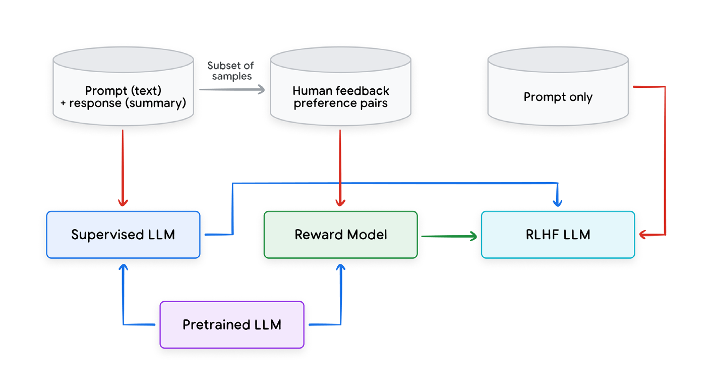

# Fine-tuning large language models

微调大语言模型

Large language models typically undergo multiple training stages. The first stage, often referred to as pre-training, is the foundational stage where an LLM is trained on large, diverse, and unlabelled text datasets where it’s tasked to predict the next token given the previous context. The goal of this stage is to leverage a large, general distribution of data and to create a model that is good at sampling from this general distribution. After language model pretraining, the resulting LLM usually demonstrates a reasonable level of language understanding and language generation skills across a variety of different tasks which are typically tested through zero-shot or few-shot prompting (augmenting the instruction with a few examples / demonstrations). Pretraining is the most expensive in terms of time (from weeks to months depending on the size of the model) and the amount of required computational resources, (GPU/TPU hours).

大语言模型 (LLM) 通常经历多个训练阶段。第一阶段常称为预训练 (pre-training)，是基础阶段：在大规模、多样、无标注的文本数据集上训练大语言模型，任务是给定先前上下文，预测下一个词元 (token)。这一阶段的目标是利用一个大而一般的数据分布，并造出一个擅长从这个一般分布中采样 (Sampling) 的模型 (Model)。语言模型预训练之后，得到的大语言模型通常在多种不同任务上表现出还算可以的语言理解和语言生成技能。这些技能通常通过零样本 (zero-shot) 或少样本 (few-shot) 提示来测试（在指令上附几个例子 / 演示）。就时间（视模型规模从数周到数月）和所需计算资源（GPU/TPU 小时）而言，预训练是最贵的。

After training, the model can be further specialized via fine-tuning, typically called instruction-tuning or simply supervised fine-tuning (SFT). SFT involves training an LLM on a set of task-specific demonstration datasets where its performance is also measured across a set of domain-specific tasks. The following are some examples of behaviors that can be improved using fine-tuning:

训练之后，模型可以通过微调 (fine-tuning) 进一步专门化，通常称为指令微调，或简单地称为监督微调 (supervised fine-tuning, SFT)。监督微调是在一组任务专用的演示数据集上训练大语言模型，其性能也在一组领域专用任务上衡量。下面是一些可以用微调改善的行为：

- Instruction-tuning/instruction following: The LLM is provided as input an instruction to follow which might include summarizing a piece of text, writing a piece of code, or writing a poem in a certain style.<sup>17</sup>

- 指令微调 / 遵循指令：给大语言模型一条要遵循的指令作为输入，其中可能包括摘要一段文本、写一段代码，或按某种风格写一首诗。<sup>17</sup>

- Dialogue-tuning: This is a special case of instruction tuning where the LLM is fine-tuned on conversational data in the form of questions and responses. This is often called multi-turn dialogue.<sup>39</sup>

- 对话微调：这是指令微调的一个特例，在问答形式的对话数据上微调大语言模型。这常称为多轮对话。<sup>39</sup>

- Safety tuning: This is crucial for mitigating risks associated with bias, discrimination, and toxic outputs. It involves a multi-pronged approach encompassing careful data selection, human-in-the-loop validation, and incorporating safety guardrails. Techniques like reinforcement learning with human feedback (RLHF)<sup>40</sup> enable the LLM to prioritize safe and ethical responses.

- 安全微调：这对缓解与偏见、歧视和有毒输出相关的风险至关重要。它涉及多管齐下的做法，包括仔细选择数据、人在回路的校验，以及纳入安全护栏。基于人类反馈的强化学习 (reinforcement learning with human feedback, RLHF)<sup>40</sup> 一类技术，使大语言模型优先给出安全、合乎伦理的回答。

Fine-tuning is considerably less costly and more data efficient compared to pre-training. Numerous techniques exist to optimize the costs further which are discussed later in this whitepaper.

相对预训练，微调便宜得多，数据效率也更高。还有许多技术可以进一步优化成本，本白皮书后面会讨论。

---

## Supervised fine-tuning

监督微调

As mentioned in the previous section, SFT is the process of improving an LLM’s performance on a specific task or set of tasks by further training it on domain-specific, labeled data. The dataset is typically significantly smaller than the pre-training datasets, and is usually human-curated and of high quality.

如上一节所说，监督微调是通过在领域专用的标注数据上进一步训练，提高大语言模型在某项或某组任务上的性能。数据集通常比预训练数据集小得多，并且通常由人整理、质量很高。

In this setting, each data point consists of an input (prompt) and a demonstration (target response). For example, questions (prompt) and answers (target response), translations from one language (prompt) to another language (target response), a document to summarize (prompt), and the corresponding summary (target response).

在这个设置里，每个数据点由一个输入（提示，Prompt）和一个演示（目标回答）组成。例如，问题（提示）和答案（目标回答），从一种语言（提示）到另一种语言（目标回答）的翻译，待摘要的文档（提示）和对应的摘要（目标回答）。

It’s important to note that, while fine-tuning can be used to improve the performance on particular tasks as mentioned above, it can also serve the purpose of helping the LLM improve its behavior to be safer, less toxic, more conversational, and better at following instructions.

需要注意：微调既可以用来提高上面所说的特定任务上的性能，也可以用来帮助大语言模型改善行为，使它更安全、毒性更低、更善于对话，也更善于遵循指令。

---

## Reinforcement learning from human feedback

基于人类反馈的强化学习

Typically, after performing SFT, a second stage of fine-tuning occurs which is called reinforcement learning from human feedback (RLHF). This is a very powerful fine-tuning technique that enables an LLM to better align with human-preferred responses (i.e. making its responses more helpful, truthful, safer, etc.).

通常，做完监督微调之后会有第二阶段的微调，称为基于人类反馈的强化学习 (reinforcement learning from human feedback, RLHF)。这是一种很有力的微调技术，使大语言模型更好地对齐人更偏好的回答（也就是使回答更有帮助、更真实、更安全等）。



**Figure 8. An example RLHF procedure**

[图片_009：从预训练模型到奖励模型和 RLHF 模型的流程 - 第 47 页]

图 8：一个 RLHF 流程示例。底部的预训练大语言模型分别初始化监督大语言模型和奖励模型。左侧数据「提示（文本）+ 回答（摘要）」进入监督大语言模型，其中一部分样本成为「人类反馈偏好对」，再进入奖励模型。监督大语言模型连向奖励模型。奖励模型用绿色箭头连向右侧的 RLHF 大语言模型。最右侧的「仅提示」数据也进入 RLHF 大语言模型。

In contrast to SFT, where an LLM is only exposed to positive examples (e.g. high-quality demonstration data), RLHF makes it possible to also leverage negative outputs thus penalizing an LLM when it generates responses that exhibit undesired properties. Penalizing negative output makes it less likely to generate unhelpful or unsafe responses.

与监督微调不同——监督微调里大语言模型只接触正例（例如高质量的演示数据）——RLHF 也使利用负向输出成为可能，从而在大语言模型生成具有不受欢迎性质的回答时惩罚它。惩罚负向输出，使它更不容易生成无帮助或不安全的回答。

To leverage RLHF, a reward model (RM) typically needs to be trained with a procedure similar to that in Figure 8. An RM is usually initialized with a pretrained transformer model, often also one that is SFT. Then it is tuned on human preference data which is either single sided (with a prompt, response and a score) or composed of a prompt and a pair of responses along with a preference label indicating which of the two responses was preferred. For example, given two summaries, A and B, of the same article, a human rater selects a preferred summary (relying on the detailed guidance). We refer to the provided preference labels as human feedback. Preferences can be in the binary form (e.g. ‘good’ or ‘bad’), on the Likert scale<sup>42</sup>, rank order when more than 2 candidates are evaluated, or a more detailed assessment of the summary quality. The preference signal can also incorporate many dimensions that capture various aspects that define a high quality response, e.g., as safety, helpfulness, fairness, and truthfulness.

要用上 RLHF，通常需要按与图 8 相似的过程训练一个奖励模型（reward model, RM）。奖励模型通常用一个预训练的 Transformer 模型初始化，往往也是一个经过监督微调的模型。然后在人类偏好数据上调优。这些数据或者是单侧的（一个提示、一个回答和一个分数），或者由一个提示、一对回答以及一个偏好标签组成，标签标明两个回答中更偏好哪一个。例如，给定同一篇文章的两份摘要 A 和 B，人类评分者选出更偏好的摘要（依据详细的指引）。我们把所提供的偏好标签称为人类反馈。偏好可以是二元形式（例如「好」或「坏」），可以在李克特量表 (Likert scale) 上，<sup>42</sup> 在评估超过 2 个候选时可以是排序，也可以是对摘要质量更细致的评估。偏好信号也可以纳入许多维度，捕捉定义高质量回答的各个方面，例如安全性、有用性、公平性和真实性。

Figure 8 shows a typical RLHF pipeline where a Reward model is initialized and finetuned on preference pairs. Once an RM has been trained, it’s then used by a Reinforcement Learning (RL)<sup>43</sup> policy gradient algorithm, which further finetunes a previously instruction-tuned LLM to generate responses that are better aligned with human preferences.

图 8 展示一条典型的 RLHF 流水线：奖励模型被初始化，并在偏好对上微调。奖励模型训练好之后，由强化学习 (Reinforcement Learning, RL)<sup>43</sup> 的策略梯度算法使用，进一步微调一个先前做过指令微调的大语言模型，使它生成与人类偏好更对齐的回答。

To better scale RLHF, RL from AI Feedback (RLAIF)<sup>44</sup> leverages AI feedback instead of human feedback to generate preference labels. It’s also possible to remove the need for training RLHF by leveraging approaches such as direct preference optimization (DPO).<sup>45</sup> Both RLHF and RLAIF can be used on Google Cloud.

为了更好地放大 RLHF，基于 AI 反馈的强化学习 (RL from AI Feedback, RLAIF)<sup>44</sup> 用 AI 反馈而不是人类反馈来生成偏好标签。也可以借助直接偏好优化 (direct preference optimization, DPO)<sup>45</sup> 一类方法，去掉训练 RLHF 的需要。RLHF 和 RLAIF 都可以在 Google Cloud 上使用。

---

## Parameter Efficient Fine-Tuning

参数高效微调

Both SFT and RLHF are still very costly in terms of compute time and accelerators required, especially when full-fine tuning entire LLMs on the orders of billions of parameters. Luckily, there are some really useful and effective techniques that can make fine-tuning significantly cheaper and faster compared to pre-training and full fine-tuning. One such family of methods is parameter efficient fine-tuning (PEFT) techniques.

就计算时间和所需加速器而言，监督微调和 RLHF 仍然很贵，尤其是在对数十亿参数量级的整个大语言模型做全量微调时。好在有一些确实有用且有效的技术，能使微调相对预训练和全量微调便宜得多、也快得多。其中一族方法是参数高效微调 (parameter efficient fine-tuning, PEFT) 技术。

At a high-level, PEFT approaches append a significantly smaller set of weights (e.g., on the order of thousands of parameters) that are used to ‘perturb’ the pre-trained LLM weights. The perturbation has the effect of fine-tuning the LLM to perform a new task or set of tasks. This has the benefit of training a significantly smaller set of weights, compared to traditional fine-tuning of the entire model.

从高层看，PEFT 方法附加一组小得多的权重（例如千参数量级），用来「扰动」预训练大语言模型的权重。这种扰动起到把大语言模型微调到一项或一组新任务的效果。好处是，相对传统的整个模型微调，只需训练小得多的一组权重。

Some common PEFT techniques include the adapter, low-rank adaptation, and soft prompting:

一些常见的 PEFT 技术包括适配器、低秩适配和软提示：

- Adapter-based fine-tuning<sup>46</sup> employs small modules, called adapters, to the pre-trained model. Only the adapter parameters are trained, resulting in significantly fewer parameters than traditional SFT.

- 基于适配器的微调<sup>46</sup> 把称为适配器 (adapter) 的小模块加到预训练模型上。只训练适配器的参数，参数量比传统监督微调少得多。

- Low-Rank Adaptation (LoRA)<sup>47</sup> tackles efficiency differently. It uses two smaller matrices to approximate the original weight matrix update instead of fine-tuning the whole LLM. This technique freezes the original weights and trains these update matrices, significantly reducing resource requirements with minimum additional inference latency. Additionally, LoRA has improved variants such as QLoRA,<sup>48</sup> which uses quantized weights for even greater efficiency. A nice advantage of LoRA modules is that they can be plug-and-play, meaning you can train a LoRA module that specializes in one task and easily replace it with another LoRA module trained on a different task. It also makes it easier to transfer the model since assuming the receiver has the original matrix, only the update matrices need to be provided.

- 低秩适配 (Low-Rank Adaptation, LoRA)<sup>47</sup> 以不同方式处理效率。它用两个更小的矩阵来近似原来的权重矩阵更新，而不是微调整个大语言模型。这项技术冻结原始权重，训练这些更新矩阵，在额外推断 (inference) 延迟很小的情况下显著降低资源需求。此外，LoRA 有改进变体，例如 QLoRA，<sup>48</sup> 它使用量化权重以获得更高的效率。LoRA 模块的一个好处是可以即插即用：你可以训练一个专精于某项任务的 LoRA 模块，再轻松换成另一个在不同任务上训练的 LoRA 模块。它也使转移模型更容易，因为假定接收方已有原始矩阵，只需提供更新矩阵。

- Soft prompting<sup>49</sup> is a technique for conditioning frozen large language models with learnable vectors instead of hand-crafted text prompts. These vectors, called soft prompts, are optimized on the training data and can be as few as five tokens, making them parameter-efficient and enabling mixed-task inference.

- 软提示 (soft prompting)<sup>49</sup> 是一种用可学习向量而不是手写文本提示来调节被冻结的大语言模型的技术。这些向量称为软提示，在训练数据上优化，可以少到五个词元，因而参数高效，并能使混合任务的推断成为可能。

For most tasks, full fine-tuning is still the most performant, followed by LoRA and Soft prompting, but the order is reversed when it comes to cost. All three approaches are more memory efficient than traditional fine-tuning and achieve comparable performance.

对大多数任务，全量微调仍然性能最好，其次是 LoRA 和软提示；但论成本，次序正好反过来。三种做法都比传统微调更省内存，并达到相当的性能。

**Python**

```python
# Before you start run this command:
# pip install --upgrade --user --quiet google-cloud-aiplatform
# after running pip install make sure you restart your kernel

import vertexai
from vertexai.generative_models import GenerativeModel
from vertexai.preview.tuning import sft

# TODO : Set values as per your requirements
# Project and Storage Constants
PROJECT_ID = '<project_id>'
REGION = '<region>'

vertexai.init(project=PROJECT_ID, location=REGION)

# define training & eval dataset.
TRAINING_DATASET = 'gs://cloud-samples-data/vertex-ai/model-evaluation/peft_train_sample.jsonl'
# set base model and specify a name for the tuned model
BASE_MODEL = 'gemini-1.5-pro-002'
TUNED_MODEL_DISPLAY_NAME = 'gemini-fine-tuning-v1'

# start the fine-tuning job
sft_tuning_job = sft.train(
    source_model=BASE_MODEL,
    train_dataset=TRAINING_DATASET,
    # # Optional:
    tuned_model_display_name=TUNED_MODEL_DISPLAY_NAME,
)

# Get the tuning job info.
sft_tuning_job.to_dict()

# tuned model endpoint name
tuned_model_endpoint_name = sft_tuning_job.tuned_model_endpoint_name

# use the tuned model
tuned_genai_model = GenerativeModel(tuned_model_endpoint_name)
print(tuned_genai_model.generate_content(contents='What is a LLM?'))
```

**Snippet 1. SFT fine tuning on Google cloud**

片段 1：在 Google Cloud 上做监督微调。
