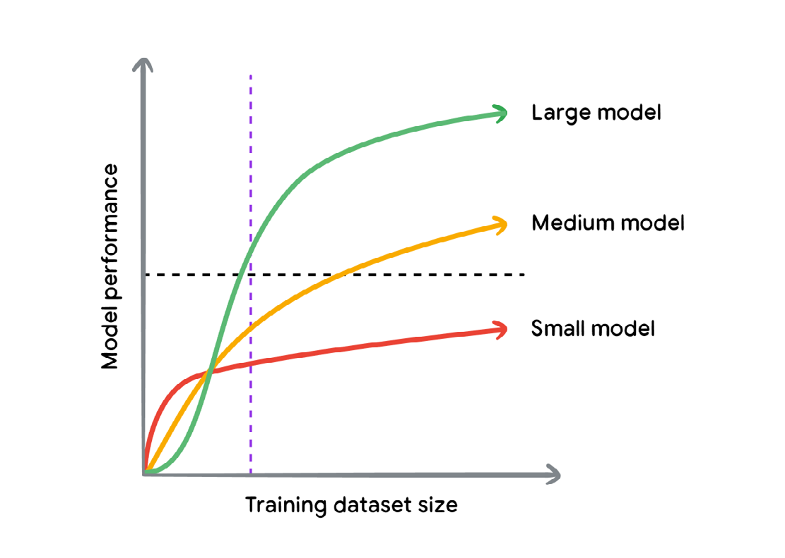
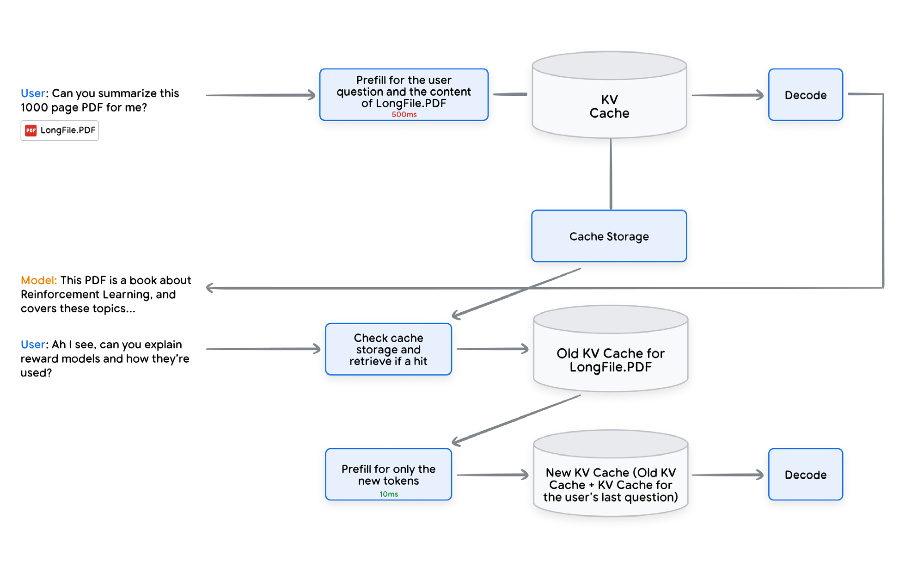
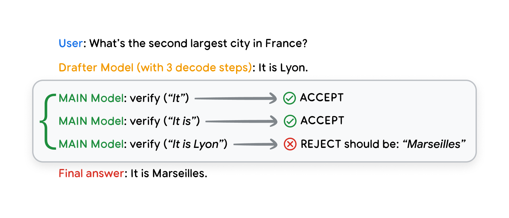

# Accelerating inference

加速推断

The scaling laws for LLMs which were initially explored by the Kaplan et al.24 study continue to hold today. Language models have been consistently increasing in size and this has been a direct contributor to the vast improvement in these models’ quality and accuracy over the last few years. As increasing the number of parameters has improved the quality of LLMs it has also increased the computational resources needed to run them. Numerous approaches have been used to try and improve the efficiency of LLMs for different tasks as developers are incentivized to reduce cost and latency for model users. Balancing the expense of serving a model in terms of time, money, energy is known as the cost-performance tradeoff and often needs adjusting for particular use cases.

Kaplan 等人24 最初探索的大语言模型 (LLM) 缩放定律今天仍然成立。语言模型的规模一直在增大，这直接促成了这些模型 (Model) 在过去几年里质量和准确度的大幅提高。增加参数量提高了大语言模型的质量，也增加了运行它们所需的计算资源。开发者有动力为模型用户降低成本和延迟，因此已有许多方法试图提高大语言模型在不同任务上的效率。在时间、金钱和能量上平衡服务一个模型的开销，称为成本—性能权衡，并且常常需要按具体用例调整。

Two of the main resources used by LLMs are memory and computation. Techniques for improving the efficiency or speed of inference focus primarily on these resources. The speed of the connection between memory and compute is also critical, but usually hardware constrained. As LLMs have grown in size 1000x from millions to billions of parameters. Additional parameters increase both the size of memory required to hold the model and computations needed to produce the model results.

大语言模型使用的两项主要资源是内存和计算。提高推断 (inference) 效率或速度的技术主要聚焦这两项资源。内存与计算之间连接的速度也很关键，但通常受硬件约束。大语言模型的规模已从数百万参数增长到数十亿，放大了 1000 倍。额外的参数既增加容纳模型所需的内存规模，也增加产生模型结果所需的计算。

With LLMs being increasingly adopted for large-scale and low-latency use cases, finding ways to optimize their inference performance has become a priority and an active research topic with significant advancements. We will explore a number of methods and a few tradeoffs for accelerating inference.

随着大语言模型越来越多地用于大规模、低延迟的用例，寻找优化其推断性能的方法已成为优先事项，也是一个有显著进展的活跃研究课题。我们将探索若干加速推断的方法，以及几项权衡。

---

## Trade offs

权衡

Many of the high yielding inference optimisation methods mandate trading off a number of factors, this can be tweaked on a case-by-case basis allowing for tailored approaches to different inference use cases and requirements. A number of the optimization methods we will discuss later fall somewhere on the spectrum of these tradeoffs.

许多收益很高的推断优化方法都要求在若干因素之间做权衡。这可以逐案调整，从而为不同的推断用例和要求定制做法。我们后面要讨论的若干优化方法，都落在这些权衡的光谱上的某处。

Trading off one factor against the other (e.g. latency vs quality or cost) doesn’t mean that we’re completely sacrificing that factor, it just means that we’re accepting what might be a marginal degradation in quality, latency or cost for the benefit of substantially improving another factor.

用一个因素换另一个因素（例如延迟对质量或成本）并不意味着我们完全牺牲那个因素。它只是意味着，我们接受质量、延迟或成本上可能很边际的下降，以换取另一个因素的大幅改善。

---

## The Quality vs Latency/Cost Tradeoff

质量与延迟 / 成本的权衡

It is possible to improve the speed and cost of inference significantly through accepting what might be marginal to negligible drops in the model’s accuracy. One example of this is using a smaller model to perform the task. Another example is quantisation where we decrease the precision of the model’s parameters thereby leading to faster and less memory intensive calculations.

接受模型准确度上可能很边际、甚至可以忽略的下降，就有可能显著改善推断的速度和成本。一个例子是用更小的模型来完成任务。另一个例子是量化 (quantization)：我们降低模型参数的精度，从而使计算更快、更不吃内存。

One important distinction when approaching this trade-off is between the theoretical possibility of a quality loss versus the practical capability of the model to perform the desired task. This is use case specific and exploring it will often lead to significant speedups without sacrificing quality in a meaningful or noticeable way. For example, if the task we want the model to perform is simple, then a smaller model or a quantised one will likely be able to perform this task well. Reduction in parametric capacity or precision does not automatically mean that the model is less capable at that specific task.

处理这项权衡时，一个重要区分是：质量损失的理论可能性，与模型完成期望任务的实际能力。这取决于用例。探索它，常常能在不以有意义或可察觉的方式牺牲质量的前提下，得到显著加速。例如，如果我们要模型做的任务很简单，那么更小的模型或量化后的模型很可能也能把这项任务做好。参数容量或精度的降低，并不自动意味着模型在那项具体任务上能力更差。

---

## The Latency vs Cost Tradeoff

延迟与成本的权衡

Another name for this tradeoff is the latency vs throughput tradeoff. Where throughput refers to the system’s ability at handling multiple requests efficiently. Better throughput on the same hardware means that our LLM inference cost is reduced, and vice versa.

这项权衡的另一个名字是延迟与吞吐的权衡。吞吐指系统高效处理多个请求的能力。在同样的硬件上吞吐更好，意味着我们的大语言模型推断成本降低，反之亦然。

Much like traditional software systems, there are often multiple opportunities to tradeoff latency against the cost of LLM inference. This is an important tradeoff since LLM inference tends to be the slowest and most expensive component in the entire stack; balancing latency and cost intentionally is key to making sure we tailor LLM performance to the product or use case it’s being used in. An example would be bulk inference use cases (e.g. offline labeling) where cost can be a more important factor than the latency of any particular request. On the other hand, an LLM chatbot product will place much higher importance on request latency.

很像传统软件系统，常常有多种机会用延迟去换大语言模型推断的成本。这项权衡很重要，因为大语言模型推断往往是整个技术栈里最慢、最贵的组件。有意识地平衡延迟和成本，是确保我们把大语言模型性能裁剪到它所用的产品或用例上的关键。一个例子是批量推断用例（例如离线标注），这时成本可能比任一请求的延迟更重要。另一方面，一个大语言模型聊天机器人产品会把请求延迟放在高得多的位置上。

Now that we’ve covered some of the important tradeoffs to consider when optimizing inference, let’s examine some of the most effective inference acceleration techniques. As discussed in the tradeoffs section, some optimization techniques can have an impact on the model’s output. Therefore we will split the methods into two types: output-approximating and output-preserving.

我们已经讲过优化推断时要考虑的一些重要权衡，现在来看一些最有效的推断加速技术。如权衡一节所讨论的，有些优化技术会影响模型的输出。因此我们把方法分成两类：近似输出的，和保持输出的。

As of this writing, Gemini 2.0 Flash Thinking offers an unparalleled balance of quality, as measured by its ELO score, and affordability, with a cost per million tokens that is ten times lower than comparable models; its position on a quality-versus-cost graph (where further up and to the right is superior) demonstrates its transformative development. Moreover, the picture highlights the rapid advancements in reasoning and thinking capabilities within the AI field, with a 27-fold improvement observed in the last three months.

在本文写作之时，Gemini 2.0 Flash Thinking 在质量（以其 ELO 分数衡量）与可负担性之间提供了难以比拟的平衡，每百万词元 (token) 的成本比可比模型低十倍。它在质量对成本图上的位置（越往上、越往右越好）展示了它的变革性发展。此外，这幅图突出了 AI 领域推理 (Reasoning) 与思考能力的快速进展：过去三个月观察到 27 倍的改进。

---

## Output-approximating methods

近似输出的方法

### Quantization

量化

LLMs are fundamentally composed of multiple numerical matrices (a.k.a the model weights). During inference, matrix operations are then applied to these model weights to produce numerical outputs (a.k.a activations). Quantization is the process of decreasing the numerical precision in which weights and activations are stored, transferred and operated upon. The default representation of weights and activations is usually 32 bits floating numbers, with quantization we can drop the precision to 8 or even 4 bit integers.

大语言模型从根本上由多个数值矩阵组成（也就是模型权重）。推断时，对这些模型权重施加矩阵运算，产生数值输出（也就是激活）。量化是降低权重和激活在存储、传输和运算时所使用的数值精度的过程。权重和激活的默认表示通常是 32 位浮点数；通过量化，我们可以把精度降到 8 位甚至 4 位整数。

Quantization has multiple performance benefits, it reduces the memory footprint of the model, allowing to fit larger models on the same hardware, it also reduces the communication overhead of weights and activations within one chip and across chips in a distributed inference setup- therefore speeding up inference as communication is a major contributor to latency. In addition, decreasing the precision of weights/activations can enable faster arithmetic operations on these models as some accelerator hardware (e.g. TPUs/GPUs) natively supports faster matrix multiplication operations for some lower precision representations.

量化有多重性能好处。它减小模型的内存占用，使同样的硬件能装下更大的模型。它也减小权重和激活在一块芯片内、以及分布式推断设置中跨芯片的通信开销，从而加速推断，因为通信是延迟的一个主要来源。此外，降低权重 / 激活的精度可以让这些模型上的算术运算更快，因为有些加速器硬件（例如 TPU/GPU）对某些更低精度的表示原生支持更快的矩阵乘法。

Quantization’s impact on quality can be very mild to non-existent depending on the use case and model. Further, in cases where quantisation might introduce a quality regression, that regression can be small compared to the performance gain, therefore allowing for an effective Quality vs Latency/Cost Tradeoff. For example, Benoit Jacob et al.55 reported a 2X speed-up for a 2% drop in accuracy for the FaceDetection task on MobileNet SSD.

量化对质量的影响可以很轻微，甚至不存在，视用例和模型而定。进一步，在量化可能引入质量回退的情形里，相对性能收益，那次回退可以很小，因而构成有效的质量与延迟 / 成本权衡。例如，Benoit Jacob 等人55 报告，在 MobileNet SSD 的人脸检测任务上，准确度下降 2%，换来 2 倍加速。

Quantization can be either applied as an inference-only operation, or it can be incorporated into the training (referred to as Quantisation Aware Training QAT). QAT is generally considered to be a more resilient approach as the model is able to recover some of the quantisation-related quality losses during training. To make sure we get the best cost/quality tradeoff, we tweak the quantization strategy (e.g. select different precisions for weights vs activations) and the granularity in which we apply quantisation to Tensors (e.g. channel or group-wise58).

量化既可以只作为推断时的操作来用，也可以纳入训练（称为量化感知训练，Quantisation Aware Training，QAT）。QAT 通常被认为更有韧性，因为模型能在训练期间挽回一部分与量化相关的质量损失。为了得到最好的成本 / 质量权衡，我们调整量化策略（例如为权重和激活选择不同精度），以及把量化施加到张量上的粒度（例如按通道或按组58）。

---

### Distillation

蒸馏

Using a smaller model to perform a task is one of the most efficient inference optimization techniques, however, smaller models can demonstrate significant regressions on quality compared to their larger counterparts.

用更小的模型来完成任务，是最高效的推断优化技术之一。然而，相对更大的对应模型，更小的模型可能在质量上表现出显著回退。

Distillation is a set of training techniques that targets improving the quality of a smaller model (the student) using a larger model (the teacher). This method can be effective because larger models outperform smaller ones even if both are trained on the same data, mainly due to parametric capacity and training dynamics. The gap in performance continues as the training dataset grows as illustrated by Figure 9.

蒸馏 (distillation) 是一组训练技术，目标是用更大的模型（教师）来提高更小模型（学生）的质量。这种方法可以有效，因为即便两者在相同数据上训练，更大的模型仍优于更小的模型，主要由于参数容量和训练动态。随着训练数据集增长，性能差距持续存在，如图 9 所示。

It is worth noticing that even at low volumes of training data, large models can already demonstrate better performance than the correspondingly trained smaller models, this fact leads us to the first variant of distillation which is referred to as data distillation or model compression.56 We use a large model which was trained on the data we have to generate more synthetic data to train the smaller student model, the increase in data volume will help move the the student further along the quality line compared to only training on the original data. Synthetic data needs to be approached carefully as it needs to be of high quality and can lead to negative effects otherwise.

值得注意的是，即便训练数据量很低，大模型已经可以比对应训练的小模型表现更好。这一事实引出蒸馏的第一种变体，称为数据蒸馏或模型压缩。56 我们用一个在已有数据上训练过的大模型，生成更多合成数据来训练更小的学生模型。数据量的增加，会帮助学生沿质量曲线走得比只在原始数据上训练更远。合成数据需要谨慎对待，因为它必须质量高，否则可能导致负面效果。

**Figure 9. An illustration of the performance of models of various sizes as a function of the training dataset’s size**

[图片_010：大、中、小模型的性能随训练数据量上升 - 第 62 页]

图 9：不同规模模型的性能作为训练数据集规模的函数的示意。横轴是训练数据集规模，纵轴是模型性能。红线是小模型，黄线是中等模型，绿线是大模型。数据很少时小模型上升更快；过了紫色竖虚线之后，大模型超过另外两条并继续爬升。一条水平虚线标出某一性能水平。

Other distillation techniques attempt to bring the student model closer to the teacher on a more granular level than just synthetic data generation. One prominent technique is knowledge distillation57, in this approach we attempt to align the output token distribution of the student model to that of the teacher’s, this can be much more sample efficient than data distillation. On-policy distillation59 is another technique that leverages feedback from the teacher model on each sequence generated by the student in a reinforcement learning setup.

其他蒸馏技术试图在比单纯生成合成数据更细的粒度上，把学生模型拉近教师。一项突出的技术是知识蒸馏，57 这种做法试图把学生模型的输出词元分布对齐到教师的分布上，这可以比数据蒸馏省样本得多。同策略蒸馏59 是另一项技术：在强化学习设置里，利用教师模型对学生生成的每一条序列的反馈。

---

## Output-preserving methods

保持输出的方法

These methods are guaranteed to be quality neutral, they cause no changes to the model output which often makes them obvious first steps to optimize inference before facing the more nuanced tradeoffs of the approximating methods.

这些方法保证对质量中性。它们不改变模型输出，因而常常是优化推断时显而易见的第一步，然后再去面对近似方法那些更细微的权衡。

---

### Flash Attention

Flash Attention

Scaled Dot-product Attention, which is the predominant attention mechanism in the transformer architecture, is a quadratic operation on the input length. Optimizing the self-attention calculation can bring significant latency and cost wins.

缩放点积注意力 (attention) 是 Transformer 架构中占主导的注意力机制，它是对输入长度的二次运算。优化自注意力 (self-attention) 的计算，可以带来显著的延迟和成本收益。

Flash Attention, introduced in by Tri Dao et al.62, optimizes the attention calculation by making the attention algorithm IO Aware, particularly trying to minimize the amount of data we move between the slow HBM (high bandwidth memory) to the faster memory tier (SRAM/VMEM) in TPUs and GPUs. When calculating attention, the order of operations is changed and multiple layers are fused so we can utilize the faster memory tiers as efficiently as possible.

Flash Attention 由 Tri Dao 等人引入，62 它通过让注意力算法感知 IO 来优化注意力计算，尤其是尽量减少我们在慢速的高带宽内存（high bandwidth memory, HBM）与 TPU 和 GPU 上更快的内存层（SRAM/VMEM）之间搬动的数据量。计算注意力时，运算顺序被改变，多层被融合，从而尽可能高效地利用更快的内存层。

Flash Attention is an exact algorithm, it maintains the numerical output of the attention computation and can yield significant latency benefits due to reducing the IO overhead, Tri Dao et al.62 showed 2-4X latency improvements in the attention computation.

Flash Attention 是精确算法。它保持注意力计算的数值输出，并因减少 IO 开销而能带来显著的延迟收益。Tri Dao 等人62 展示了注意力计算中 2 到 4 倍的延迟改进。

---

### Prefix Caching

前缀缓存

One of the most compute intensive, and thus slowest, operations in LLM inference is calculating the attention key and value scores (a.k.a KV) for the input we’re passing to the LLM, this operation is often referred to as prefill. The final output of prefill is what is termed KV Cache which includes the attention key and value scores for each layer of the transformer for the entire input. This cache is vital during the decoding phase which produces the output tokens, the KV cache allows us to avoid recalculating attention scores for the input on each autoregressive decode step.

大语言模型推断中计算最密集、因而最慢的操作之一，是为我们传给大语言模型的输入计算注意力的键和值分数（也就是 KV）。这一操作常称为预填充 (prefill)。预填充的最终输出称为 KV 缓存（KV Cache），它包含 Transformer 每一层对整个输入的注意力键和值分数。这个缓存在产生输出词元的解码阶段至关重要。KV 缓存使我们不必在每一个自回归解码步骤上重新计算输入的注意力分数。

Prefix Caching refers to the process of caching the KV Cache itself between subsequent inference requests in order to reduce the latency and cost of the prefill operation. The way the self-attention mechanism works makes reusing KV caches possible because tokens will only pay attention to tokens that came before them in the sequence. If there’s new input being appended to input that the model has seen before, then we can potentially avoid recalculating the prefill for the older input.

前缀缓存 (Prefix Caching) 指在后续的推断请求之间缓存 KV 缓存本身，以降低预填充操作的延迟和成本。自注意力机制的工作方式使复用 KV 缓存成为可能，因为词元只会注意序列中出现在它们之前的词元。如果有新输入追加到模型曾经见过的输入上，我们就有可能避免为更旧的输入重新计算预填充。

**Figure 10. An illustration of Prefix Caching in a chat scenario**

[图片_011：对话中对长 PDF 做前缀缓存 - 第 64 页]

图 10：聊天场景中前缀缓存的示意。第一轮，用户请模型总结一份 1000 页的 PDF（LongFile.PDF）。预填充要处理整个文档，耗时 500ms，结果写入 KV 缓存和缓存存储，再解码，模型回答这是一本关于强化学习的书。第二轮，用户追问奖励模型如何使用。系统检查缓存存储并在命中时取出 LongFile.PDF 的旧 KV 缓存，只为新词元做预填充（10ms），把旧缓存与新问题的 KV 缓存合并后再解码。

Figure 10 illustrates how prefix caching works in a multi-turn scenario with a document upload. On the first user turn, the prefill operation has to process the entire document therefor taking 500ms, the resulting KV cache is then stored so that on the second user turn, we can retrieve the cache directly from storage and avoid recomputing it for the long doc, therefore saving substantial amounts of compute and latency.

图 10 说明前缀缓存在带文档上传的多轮场景中如何工作。在用户的第一轮，预填充操作必须处理整个文档，因而耗时 500ms。所得的 KV 缓存随后被存储，这样在用户的第二轮，我们可以直接从存储中取出缓存，避免为长文档重新计算，从而节省大量计算和延迟。

Prefix caches can be stored either in memory or on disk and fetched on-demand. One important consideration is making sure that the input structure/schema remains prefix-caching friendly, we should avoid changing the prefix in subsequent requests as that will invalidate the cache for all the tokens that follow. For example, putting a fresh timestamp at the very beginning of each request will invalidate the cache completely as every subsequent request will have a new prefix.

前缀缓存可以存在内存里或磁盘上，并按需取出。一个重要考虑是确保输入结构 / 模式对前缀缓存友好。我们应当避免在后续请求中改变前缀，因为那会使后面所有词元的缓存失效。例如，在每个请求的最开头放一个新的时间戳，会让缓存完全失效，因为此后每一个请求都会有一个新前缀。

Many LLM use cases lend themselves naturally to prefix caching. For example, LLM Chatbots where users will have a multi-turn conversation that can span 10s of 1000s of tokens and we can avoid recalculating the KV cache for the previous parts of the conversation. Large document/code uploads is another use case where the artifact the user uploads will remain unchanged from one request to the next. All that’s changing are the questions the user is asking, so caching the KV cache for the document (especially for larger artifacts) can result in significant latency and cost savings.

许多大语言模型用例天然适合前缀缓存。例如大语言模型聊天机器人：用户会进行可以跨数万词元的多轮对话，我们可以避免为对话先前部分重新计算 KV 缓存。大型文档 / 代码上传是另一个用例：用户上传的物件从一次请求到下一次保持不变。变化的只是用户所问的问题，因此缓存文档的 KV 缓存（尤其是较大的物件）可以带来显著的延迟和成本节省。

Prefix caching is available as a service called Context Caching on Google AI studio52 and Vertex AI on Google Cloud53.

前缀缓存作为一种称为上下文缓存（Context Caching）的服务，可在 Google AI Studio52 和 Google Cloud 上的 Vertex AI53 使用。

---

### Speculative Decoding

推测解码

The first phase of LLM inference, known as prefill, is compute bound due large matrix operations on many tokens occurring in parallel. The second phase, known as decode, is generally memory bound as tokens are auto-regressively decoded one at a time.

大语言模型推断的第一阶段称为预填充，由于许多词元上的大矩阵运算并行发生，它是计算受限的。第二阶段称为解码 (decode)，由于词元被逐个自回归地解码，它一般是内存受限的。

It is not easy to naively use additional parallel compute capacity to speed up decode given the need to wait for the current token to be produced before we can calculate what the next token should be (as per the self-attention mechanism), the decode process is inherently serial.

不能天真地用额外的并行计算容量来加速解码。因为必须等到当前词元产生，才能计算下一个词元应当是什么（按照自注意力机制），解码过程本质上是串行的。

Speculative decoding (Leviathan at al.63) aims to overcome this limitation in decode by finding a way to utilize the spare compute capacity to make each decode step faster. The main idea is to use a much smaller secondary model (often referred to as the drafter) to run ahead of the main model and predict more tokens. (e.g. 4 tokens ahead). This will happen very quickly as the drafter is much faster and smaller than the main model. We then use the main model to verify the hypotheses of the drafter in parallel for each of the 4 steps (i.e. the first token, the first two tokens, the first 3 tokens and finally all 4 tokens), and we then select the accepted hypothesis with the maximum number of tokens. For example:

推测解码（Leviathan at al.63）旨在克服解码中的这一限制：找到一种办法利用空闲的计算容量，使每一步解码更快。主要想法是用一个小得多的次级模型（常称为起草模型）跑在主模型前面，预测更多词元（例如超前 4 个词元）。这会发生得很快，因为起草模型比主模型快得多、也小得多。然后我们用主模型并行验证起草模型对这 4 步中每一步的假设（也就是第一个词元、前两个词元、前 3 个词元，以及最后全部 4 个词元），再选择被接受且词元数最多的那个假设。例如：

**Figure 11. An illustration of speculative decoding over 3 tokens**

[图片_012：主模型并行验证起草模型的三个词元 - 第 66 页]

图 11：跨 3 个词元的推测解码示意。用户问法国第二大城市是哪一座。起草模型用 3 步解码回答 “It is Lyon.”。主模型并行验证：`verify("It")` 接受，`verify("It is")` 接受，`verify("It is Lyon")` 拒绝，并注明应当是 “Marseilles”。最终答案是 “It is Marseilles.”。

Note that the 3 main model steps run in parallel. And because we are not compute bound in decode, we can use the spare capacity to get much better decode latencies. In the example above, let’s say a single main model step needs 10ms, while the drafter needs 1ms. Without speculative decoding, we need 3 * 10ms = 30ms to produce the response, with speculative decoding, there’s only one main model step on the critical path due to parallelization, so we need 3 * 1ms + 10ms = 13ms. A significant latency improvement. This technique is completely quality neutral, the main model will reject any tokens that it wouldn’t have predicted itself in the first place, so the only thing speculative decoding does is run ahead and present hypotheses that the main model can accept or reject in parallel.

注意，主模型的 3 步是并行运行的。而且因为我们在解码时不是计算受限的，可以用空闲容量得到好得多的解码延迟。在上面的例子里，假设主模型一步需要 10ms，起草模型需要 1ms。没有推测解码时，产生回答需要 3 × 10ms = 30ms。有了推测解码，由于并行，关键路径上只有一步主模型，所以需要 3 × 1ms + 10ms = 13ms。延迟改进很显著。这项技术对质量完全中性。主模型会拒绝任何它自己本来就不会预测的词元，所以推测解码所做的只是跑在前面，并提出主模型可以并行接受或拒绝的假设。

One important condition for speculative decoding to work effectively is that the drafter model has good levels of alignment with the main model, otherwise we won’t be able to accept any of the tokens. So investing in the training quality of the drafter model is worthwhile to get better latencies.

推测解码要有效工作，一个重要条件是起草模型与主模型有较好的对齐，否则我们将无法接受任何词元。因此，为了得到更好的延迟，投资于起草模型的训练质量是值得的。

Now that we have seen some methods to make LLM generate their responses faster, let’s look at some examples of how these models can be applied to various tasks to get an idea how to use them.

我们已经看到一些让大语言模型更快生成回答的方法。接下来看一些例子：这些模型如何应用到各种任务上，以便对如何使用它们有个概念。

---

## Batching and Parallelization

批处理与并行

Most of the optimization techniques we’ve discussed so far are specific to Machine Learning and Transformer architecture in particular. However, much like any software system, there are opportunities to improve throughput and latency through a combination of 1) batching less compute-intensive operations (i.e. we can run multiple requests on the same hardware simultaneously to better utilize the spare compute) and 2) parallelizing the more compute-intensive parts of the computations (i.e. we can divide the computation and split it amongst more hardware instances to get more compute capacity and therefore better latencies.

到目前为止我们讨论的大多数优化技术，都专门针对机器学习，尤其是 Transformer 架构。然而，很像任何软件系统，仍有机会通过组合两种做法来改善吞吐和延迟。一是对计算不那么密集的操作做批处理 (batching)（也就是在同一硬件上同时跑多个请求，以更好地利用空闲计算）。二是把计算中更吃计算的部分并行化（也就是把计算拆开，分到更多硬件实例上，以获得更多计算容量，从而得到更好的延迟）。

Batching in LLMs is most useful on the decode side - as we explained in the Speculative Decoding section, decode is not compute-bound and therefore there’s an opportunity to batch more requests. We need to be careful that we batch computations in a way that enables utilization of the spare capacity which is possible to do on accelerators (e.g. TPUs and GPUs). We also need to make sure we remain within the memory limits, as decode is a memory intensive operations, batching more requests will put more pressure on the free memory available. Batching has become an important component in most high-throughput LLM inference setups.

大语言模型中的批处理在解码一侧最有用。如推测解码一节所解释的，解码不是计算受限的，因此有机会把更多请求放进一个批次。我们需要小心地以能利用空闲容量的方式批处理计算，这在加速器上（例如 TPU 和 GPU）是可以做到的。我们也需要确保留在内存限制之内。因为解码是内存密集的操作，把更多请求放进批次会给可用的空闲内存带来更大压力。批处理已成为大多数高吞吐大语言模型推断设置中的重要组件。

Parallelization is also a widely used technique given the variety of opportunities in transformers for horizontal scaling across more hardware instances. There are multiple parallelism techniques across the model input (Sequence parallelism) the model layers (Pipeline parallelism), and within a single layer (Tensor parallelism). One of the most important considerations for parallelism is the cost of communication and synchronization between the different shards that we distribute to other machines. Communication is a significant overhead and can erode the benefits of adding more computational capacity if we’re not careful about which parallelization strategy to use. On the other hand, selecting the right strategy to balance the need for additional compute and the communication cost can yield significant latency wins.

并行也是广泛使用的技术，因为 Transformer 里有多种机会在更多硬件实例上做水平扩展。有多种并行技术：跨模型输入的（序列并行），跨模型层的（流水线并行），以及一层内部的（张量并行）。并行最重要的考虑之一，是我们分发到其他机器上的不同分片之间通信和同步的成本。通信是显著的开销。如果我们不小心选择哪种并行策略，它可能侵蚀增加更多计算容量所带来的收益。另一方面，选择正确的策略来平衡额外计算的需要和通信成本，可以带来显著的延迟收益。

Now that we have seen some methods to make LLM generate their responses faster, let’s look at some examples of how these models can be applied to various tasks to get an idea how to use them.

我们已经看到一些让大语言模型更快生成回答的方法。接下来看一些例子：这些模型如何应用到各种任务上，以便对如何使用它们有个概念。
