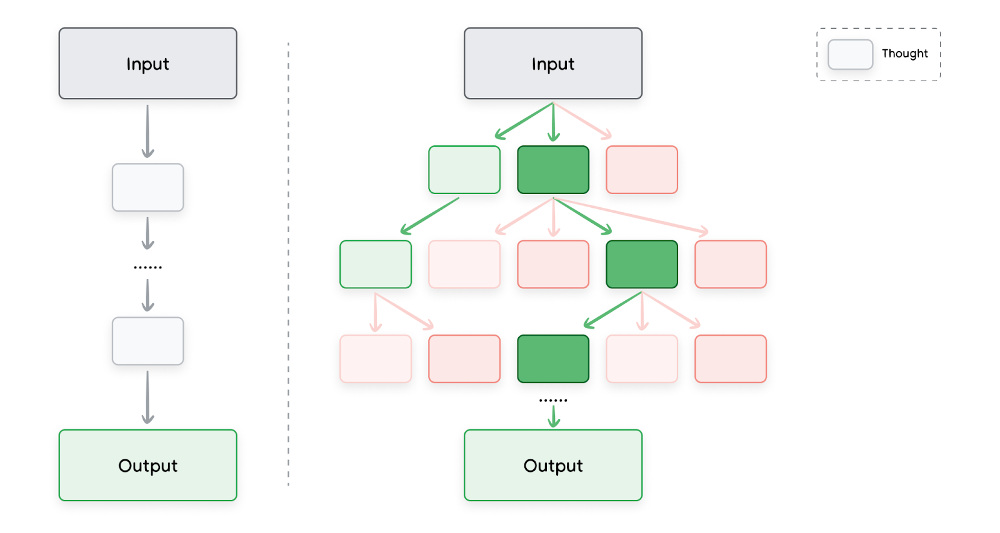

# Tree of Thoughts (ToT)

思维树 (Tree of Thoughts, ToT)

Now that we are familiar with chain of thought and self-consistency prompting, let’s review Tree of Thoughts (ToT).12 It generalizes the concept of CoT prompting because it allows LLMs to explore multiple different reasoning paths simultaneously, rather than just following a single linear chain of thought. This is depicted in Figure 1.

熟悉了思维链 (Chain of Thought, CoT) 和自洽 (self-consistency) 提示 (Prompt) 之后，来看思维树。12 它推广了思维链提示的概念，因为大语言模型 (LLM) 可以同时探索多条不同的推理 (Reasoning) 路径，而不只是跟着一条线性的思维链走。图 1 画出了这一点。

**Figure 1. A visualization of chain of thought prompting on the left versus. Tree of Thoughts prompting on the right**

[图片_001：左侧为思维链提示，右侧为思维树提示 - 第 36 页]

图 1：左侧是思维链提示的示意，右侧是思维树提示的示意。图例中的 Thought 是思维。左侧从 Input 经一串思维到 Output；右侧从 Input 分出多条思维分支，绿线标出被选中的路径，再汇到 Output。

This approach makes ToT particularly well-suited for complex tasks that require exploration. It works by maintaining a tree of thoughts, where each thought represents a coherent language sequence that serves as an intermediate step toward solving a problem. The model can then explore different reasoning paths by branching out from different nodes in the tree.

这种做法使思维树特别适合需要探索的复杂任务。它维护一棵思维树，其中每个思维是一段连贯的语言序列，作为解题的中间步骤。模型 (Model) 再从树的不同节点分支出去，探索不同的推理路径。

There’s a great notebook, which goes into a bit more detail showing The Tree of Thought (ToT) which is based on the paper ‘Large Language Model Guided Tree-of-Thought’.9

有一份很好的 notebook，更详细地展示了思维树，它基于论文《大语言模型引导的思维树》。9
