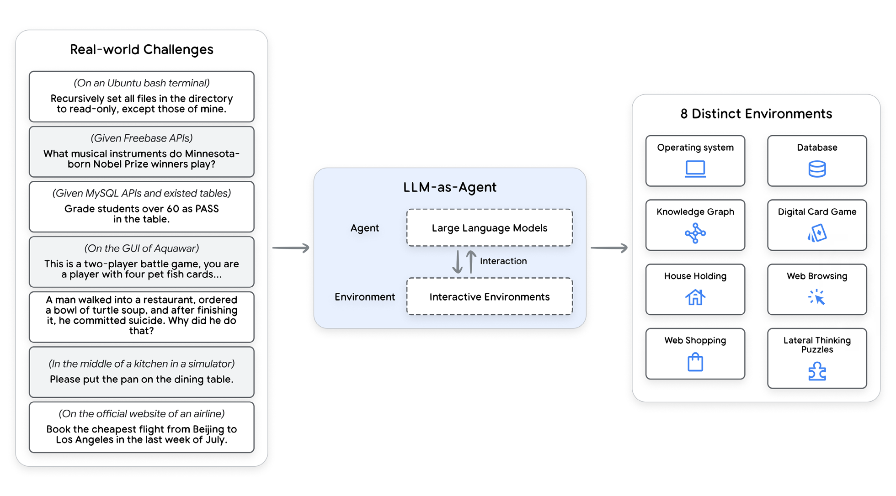
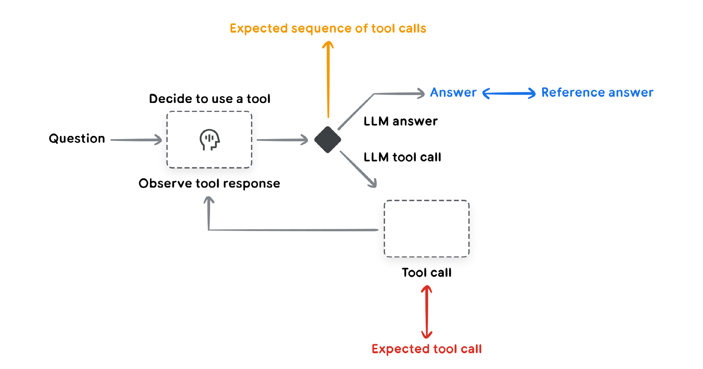
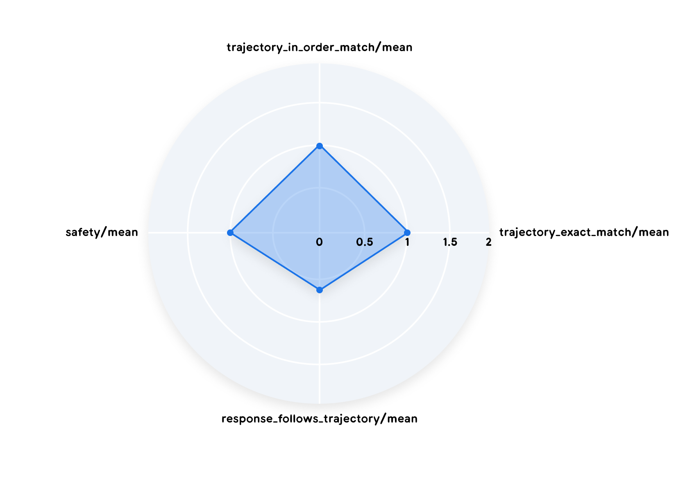

# Agent Evaluation

<mark>智能体评估</mark>

To bridge the gap between a proof-of-concept and a production-ready AI agent, a robust and automated evaluation framework is essential. Unlike evaluating generative models, where the focus is primarily on the final output, agent evaluation requires a deeper understanding of the decision-making process. Agent evaluation can be broken down into three components that we discuss in this chapter:

<mark>要弥合概念验证与可投入生产的 AI 智能体 (Agent) 之间的差距，一套稳健且自动化的评估框架必不可少。评估生成式模型时，焦点主要在最终输出；智能体评估则需要对决策过程有更深入的理解。智能体评估可以拆成三个组成部分，我们在本章加以讨论：</mark>

1. Assessing Agent Capabilities: Evaluating an agent's core abilities, such as its capacity to understand instructions and reason logically.

<mark>1. 评估智能体能力：评估智能体的核心能力，例如它理解指令并进行逻辑推理 (Reasoning) 的能力。</mark>

2. Evaluating Trajectory and Tool Use: Analyzing the steps an agent takes to reach a solution, including its choice of tools, strategies, and the efficiency of its approach.

<mark>2. 评估轨迹 (Trajectory) 与工具使用 (Tool Use)：分析智能体为达成解答所采取的步骤，包括它对工具 (Tools) 的选择、策略，以及这种方法的效率。</mark>

3. Evaluating the Final Response: Assessing the quality, relevance, and correctness of the agent's final output.

<mark>3. 评估最终响应：评估智能体最终输出的质量、相关性与正确性。</mark>

---

## Assessing Agent Capabilities

<mark>评估智能体能力</mark>

Before evaluating your specific agentic use cases, publicly available benchmarks and technical reports can provide insight into core capabilities and limitations to consider when building out your agentic use cases. Public benchmarks exist for most fundamental agentic capabilities like model performance, hallucinations, tool calling and planning. For example, tool calling, the ability to select and use appropriate tools, is demonstrated by benchmarks like the Berkeley Function-Calling Leaderboard (BFCL)16 and τ-bench17 that also outlines common mistakes. Another example, PlanBench18 aims to assess planning and reasoning, across several domains and specific capabilities.

<mark>在评估你具体的智能体式用例之前，公开的基准和技术报告可以提供洞察，指出在构建这些用例时需要考虑的核心能力与局限。大多数基础的智能体式能力都有公开基准，例如模型表现、幻觉、工具调用和规划 (Planning)。例如，工具调用，也就是选择并使用合适工具的能力，由 Berkeley Function-Calling Leaderboard (BFCL)16 和 τ-bench17 等基准所展示，τ-bench 还概述了常见错误。另一个例子是 PlanBench18，它旨在跨若干领域和具体能力评估规划与推理。</mark>

But tool calling and planning is not the only capability you should consider. Agents inherit behaviors from their LLMs and each of their other components. Likewise, agent and user interactions have a history in traditional conversational design systems and workflow systems, and therefore can inherit the set of metrics and measurements that are used to determine the efficacy of these systems.

<mark>但工具调用和规划并不是你唯一应当考虑的能力。智能体会从其大语言模型 (LLM) 以及各自的其他组件继承行为。同样，智能体与用户的交互在传统的对话设计系统和流程系统中已有历史，因此可以继承用来判定这些系统有效性的那一套指标和度量。</mark>

<mark>[图 4：AgentBench 的高层示意图19。左侧「真实世界挑战 (Real-world Challenges)」列出多张任务卡片：在 Ubuntu bash 终端中，把目录里除自己的文件以外的所有文件递归设为只读；借助 Freebase API 询问出生于明尼苏达的诺贝尔奖得主演奏什么乐器；借助 MySQL API 和已有的表，把 60 分以上的学生记为 PASS；在 Aquawar 的图形界面上，作为持有四张宠物鱼卡牌的玩家进行双人对战；一道龟汤横向思维谜题（某人在餐厅喝完一碗龟汤后自杀，为什么）；在模拟器的厨房里把锅放到餐桌上；在航空公司官网上预订七月最后一周从北京到洛杉矶最便宜的航班。箭头指向中间的「LLM 即智能体 (LLM-as-Agent)」：智能体一侧是大语言模型，环境一侧是交互式环境，二者以「交互 (Interaction)」双向相连。再指向右侧「8 种不同环境 (8 Distinct Environments)」：操作系统 (Operating system)、数据库 (Database)、知识图谱 (Knowledge Graph)、数字卡牌游戏 (Digital Card Game)、家务 (House Holding)、网页浏览 (Web Browsing)、网购 (Web Shopping)、横向思维谜题 (Lateral Thinking Puzzles)。]</mark>

Holistic agent benchmarks like AgentBench19 try to capture end-to-end performance across several scenarios. This is more realistic, when the scenario reflects your agent use case, but not if it’s testing capabilities your agent doesn’t implement. It is difficult to simulate the environment, tools, instructions, and use case requirements in ways that are both specific and general at the same time. Companies and organizations are setting up public benchmarks for specialized use cases, like Adyen’s Data Analyst leaderboard DBAStep20 which may give you a more targeted evaluation - if you understand both the evaluation approach and the agents who are on the leaderboard.

<mark>像 AgentBench19 这样的整体式智能体基准，试图在若干场景中捕捉端到端表现。当场景反映的是你的智能体用例时，这样更贴近真实；如果它测试的是你的智能体并未实现的能力，则不然。很难同时以既具体又一般的方式去模拟环境、工具、指令和用例要求。公司和机构正在为专门用例建立公开基准，例如 Adyen 的数据分析师排行榜 DBAStep20，它可能给你更有针对性的评估——前提是你既理解评估方法，也了解排行榜上的那些智能体。</mark>

Public benchmarks are a valuable starting point, to get a feeling for what is possible and identify pitfalls to look out for. Most benchmark assessments include discussions of common failure modes that can guide you in setting up your own, use-case specific evaluation framework.

<mark>公开基准是有价值的起点，用来感受什么是可能的，并找出需要提防的陷阱。大多数基准评估都会讨论常见失败模式，这些讨论可以引导你建立自己的、针对具体用例的评估框架。</mark>

Beyond public evaluations, you will want to evaluate the behavior of your agent across a variety of scenarios to ensure it does what you want it to do. You are simulating interactions with your agent and evaluating how it responds. This includes the evaluating final response and also the set of steps it takes along the way (trajectory). Those are the 2 most common and practical approaches we recommend you start with. There are many other evaluation techniques you can use beyond these, either for finer details on sub-components or broader approaches.

<mark>在公开评估之外，你还会想在各种场景中评估智能体的行为，确保它做的是你希望它做的事。你在模拟与智能体的交互，并评估它如何回应。这包括评估最终响应，也包括它沿途采取的那一组步骤（轨迹）。这是我们建议你起步时采用的 2 种最常见、也最实用的方法。除此之外还有许多评估技术可以用，或是针对子组件看更细的细节，或是采用更宽的方法。</mark>

Software engineers will compare this to automated testing of code. Investing in automated tests saves you time and gives you confidence in the software you are building. With agents, this automation pays off faster, in both time and confidence. Curating the evaluation data set will be extremely important for accurately representing the use case your agent will encounter, even more so than in software testing.

<mark>软件工程师会把这比作对代码的自动化测试。在自动化测试上投入，能节省时间，并让你对正在构建的软件有信心。对智能体来说，这种自动化在时间和信心上都见效更快。整理评估数据集将极为重要，它要准确代表智能体将会遇到的用例，这一点甚至比在软件测试中更要紧。</mark>

---

## Evaluating Trajectory and Tool Use

<mark>评估轨迹与工具使用</mark>

An agent usually does several actions before it responds back to the user. It might compare the user input with session history to disambiguate a term, or lookup a policy document, search a knowledge base or invoke an API to save a ticket. Each of those actions is a step on a path, also called a “trajectory” of actions. Every time your agent does something, there’s a trajectory of actions under the hood.

<mark>智能体通常会先做若干动作，再回应用户。它可能会把用户输入与会话历史相对照，以消除某个用语的歧义；或者查阅一份政策文档、搜索知识库，或调用 API 来保存一张工单。每一个这样的动作都是一条路径上的一步，也称为一串行动的「轨迹」。每当你的智能体做一件事，底层都有一条行动轨迹。</mark>

Comparing the trajectory that you expect the agent to take vs the trajectory that the agent actually took, is particularly useful for developers who want to debug their application, identifying errors or inefficiencies, and ultimately improving performance.

<mark>把你期望智能体采取的轨迹，与它实际采取的轨迹相比较，对想要调试自己应用的开发者特别有用：可以识别错误或低效之处，并最终改进表现。</mark>

<mark>[图 5：LangSmith 中最终评估与轨迹的示意图21。问题 (Question) 指向一个带头部图标的虚线框，框旁标注「决定使用工具 (Decide to use a tool)」。箭头通向一个黑色菱形：向上的橙色箭头是「预期的工具调用序列 (Expected sequence of tool calls)」；向右上的灰箭头是「LLM 回答 (LLM answer)」，蓝色箭头从「参考答案 (Reference answer)」指向「答案 (Answer)」；向右下的灰箭头是「LLM 工具调用 (LLM tool call)」，进入标有「工具调用 (Tool call)」的虚线框。该框有灰箭头折返头部图标，旁注「观察工具响应 (Observe tool response)」，形成回路；向下的红色双向箭头则对照「预期的工具调用 (Expected tool call)」。</mark>

The following six ground-truth-based automated trajectory evaluations provide different lenses to assess the performance of an agent:

<mark>下面六种基于真值 (ground truth) 的自动化轨迹评估，提供不同的透镜来衡量智能体的表现：</mark>

1. Exact match: Requires the AI agent to produce a sequence of actions (a "trajectory") that perfectly mirrors the ideal solution. This is the most rigid metric, allowing no deviation from the expected path.

<mark>1. 精确匹配 (Exact match)：要求 AI 智能体产出一串动作（一条「轨迹」），与理想解答完全一致。这是最严格的指标，不允许偏离预期路径。</mark>

2. In-order match: This metric assesses an agent's ability to complete the expected trajectory, while accommodating extra, unpenalized actions. Success is defined by completing the core steps in order, with flexibility for additional actions.

<mark>2. 按序匹配 (In-order match)：这项指标评估智能体完成预期轨迹的能力，同时容纳额外的、不扣分的动作。成功的定义是按顺序完成核心步骤，并对额外动作留有弹性。</mark>

3. Any-order match: Compared to in-order match, this metric now disregards the order. It asks if the agent included all necessary actions, but does not look into the order of actions taken and also allows for extra steps.

<mark>3. 任意顺序匹配 (Any-order match)：与按序匹配相比，这项指标不再考虑顺序。它问的是智能体是否包含了所有必要动作，但不查看所采取动作的顺序，并且也允许额外步骤。</mark>

4. Precision: How many of the tool calls in the predicted trajectory are actually relevant or correct according to the reference trajectory?

<mark>4. 精确率 (Precision)：预测轨迹中的工具调用，有多少按照参考轨迹来看确实相关或正确？</mark>

5. Recall: How many of the essential tool calls from the reference trajectory are actually captured in the predicted trajectory?

<mark>5. 召回率 (Recall)：参考轨迹中的必要工具调用，有多少确实被预测轨迹捕捉到了？</mark>

6. Single-tool use: Understand if a specific action is within the agent's trajectory. This metric is useful to understand if the agent has learned to utilize a particular tool yet.

<mark>6. 单工具使用 (Single-tool use)：了解某个特定动作是否处在智能体的轨迹之中。这项指标有助于了解智能体是否已经学会使用某一个特定工具。</mark>

<mark>[图 6：绘制单条轨迹评估及若干指标的雷达图24。四个轴分别为上方的 trajectory_in_order_match/mean、右侧的 trajectory_exact_match/mean（刻度标有 0、0.5、1、1.5、2）、下方的 response_follows_trajectory/mean，以及左侧的 safety/mean。蓝色填充四边形的右顶点落在刻度 1，左顶点的半径与之相近，上、下两个顶点更靠近中心。]</mark>

Consider these metrics as different lenses for analyzing and debugging your agent's trajectory. Each metric offers a unique perspective, but not all will be relevant to every situation. For instance, some use cases demand strict adherence to the ideal trajectory, while others allow for more creative deviations. A clear limitation of this evaluation approach is that you need to have a reference trajectory in place for this to work. While ground-truth-based automated trajectory evaluations that are discussed here are prevalent in popular libraries. Research is advancing the use of agent autoraters for more efficient evaluation, for example Agent as a Judge, 202422.

<mark>可以把这些指标看作分析和调试智能体轨迹的不同透镜。每项指标提供一种独特视角，但并非每一项都与每种情形相关。例如，有的用例要求严格遵循理想轨迹，有的则允许更有创造性的偏离。这种评估方法有一个明显局限：必须先备有一条参考轨迹，它才能工作。尽管此处讨论的、基于真值的自动化轨迹评估在流行的库中很普遍，研究正在推进使用智能体自动评分器 (autorater) 来做更高效的评估，例如 Agent as a Judge, 202422。</mark>

---

## Evaluating the Final Response

<mark>评估最终响应</mark>

The final response evaluation boils down to a simple question: Does your agent achieve its goals? You can define custom success criteria, tailored to your specific needs, to measure this. For example, you could assess whether a retail chatbot accurately answers product questions, or whether a research agent effectively summarizes findings with the appropriate tone and style. To automate this process, you can use autorater. An autorater is an LLM that acts as a judge. Given the input prompts and the generated response, it mirrors human evaluation by assessing the response against a set of user-provided criteria. For this evaluation to work, it is crucial to consider that given the absence of ground-truth, you need to be very precise in defining your evaluation criteria, as this is the core of what your evaluation is looking at. You find a number of predefined criteria in various libraries, treat them as a starting point and tweak them to provide your definition of good.

<mark>最终响应评估归结为一个简单的问题：你的智能体达成目标了吗？你可以定义贴合自身具体需要的定制成功标准，来度量这一点。例如，你可以评估一个零售聊天机器人是否准确回答了产品问题，或者一个研究智能体是否以恰当的语气和风格有效地总结了发现。要自动化这一过程，可以使用自动评分器。自动评分器是一个充当评委的大语言模型。给定输入提示和生成的响应，它对照一组用户提供的标准来评估该响应，从而仿效人工评估。要让这种评估奏效，关键在于考虑到：既然没有真值，你就需要非常精确地定义评估标准，因为这正是评估所审视的核心。你会在各种库里找到若干预定义标准，把它们当作起点，再加以调整，以给出你对「好」的定义。</mark>

---

## Human-in-the-Loop Evaluation

<mark>人在回路 (Human-in-the-Loop, HITL) 评估</mark>

The fields of agent development and agent evaluation are rapidly evolving. Evaluating AI agents presents significant challenges, including defining clear objectives, designing realistic environments, managing stochastic behavior, and ensuring fairness and bias mitigation, particularly in socially impactful applications. Therefore, it's crucial to incorporate a human-in-the-loop approach alongside the automated evaluations discussed previously (which involve predefined metrics and autoraters). Human-in-the-loop is valuable for tasks requiring subjective judgment or creative problem-solving, it can also serve to calibrate and double-check if your automated evaluation approaches actually work and align with your preferences. Key benefits include:

<mark>智能体开发与智能体评估这两个领域正在快速演变。评估 AI 智能体面临重大挑战，包括定义清晰的目标、设计现实的环境、应对随机行为，以及确保公平并缓解偏见，在具有社会影响的应用中尤其如此。因此，关键是在先前讨论的自动化评估（涉及预定义指标和自动评分器）之外，同时纳入人在回路的方法。人在回路对需要主观判断或创造性解题的任务很有价值，它也可以用来校准并复核你的自动化评估方法是否真的有效、是否与你的偏好一致。主要益处包括：</mark>

- Subjectivity: Humans can evaluate qualities that are difficult to quantify, such as creativity, common sense, and nuance.

<mark>- 主观性：人可以评估难以量化的品质，例如创造力、常识和细微差别。</mark>

- Contextual Understanding: Human evaluators can consider the broader context of the agent's actions and their implications.

<mark>- 上下文理解：人类评估者可以考虑智能体行动更广的上下文及其影响。</mark>

- Iterative Improvement: Human feedback provides valuable insights for refining the agent's behavior and learning process.

<mark>- 迭代改进：人类反馈为改进智能体的行为和学习过程提供有价值的洞察。</mark>

- Evaluating the evaluator: Human feedback can provide a signal to calibrate and refine your autoraters.

<mark>- 评估评估者：人类反馈可以提供信号，用来校准并改进你的自动评分器。</mark>

To implement human-in-the-loop evaluation, consider these methods:

<mark>要实施人在回路评估，可以考虑这些方法：</mark>

- Direct Assessment: Human experts directly rate or score the agent's performance on specific tasks.

<mark>- 直接评估：人类专家直接对智能体在特定任务上的表现评级或打分。</mark>

- Comparative Evaluation: Experts compare the agent's performance to that of other agents or your previous iterations.

<mark>- 比较评估：专家把智能体的表现与其他智能体的表现，或与你先前的迭代相比较。</mark>

- User Studies: Participants interact with the agent and provide feedback on its behavior, usability, and overall effectiveness.

<mark>- 用户研究：参与者与智能体交互，并就其行为、可用性和总体有效性提供反馈。</mark>

---

## More about Agent Evaluation

<mark>关于智能体评估的更多内容</mark>

In this section we cover agent evaluation from the practical perspective. But this is just the tip of the iceberg. Agent evaluation presents many challenges. Evaluation data for your agents may be difficult to find. While synthetic data or LLMs as judges can be used, evaluations may still be incomplete. Also, LLM-as-a-Judge metrics, for example, may prioritize final outcomes over the agent's reasoning and intermediate actions, potentially missing key insights. Additionally, as evaluations for agent systems have a history in conversational and workflow systems, there is so much to explore on how to inherit methods and metrics to evaluate agent's capabilities, such as the ability to improve task performance over multiple interactions. Evaluations for multi-modal generations pose additional complexities; images, audio, and video evaluations require their own evaluation methods and metrics. Finally, real-world environments pose further challenges, as they are dynamic and unpredictable, making it difficult to evaluate agents in controlled settings.

<mark>本节我们从实践角度讨论智能体评估。但这只是冰山一角。智能体评估有许多挑战。你的智能体所用的评估数据可能很难找到。虽然可以使用合成数据，或让大语言模型充当评委，评估仍可能不完整。另外，例如大模型即评委 (LLM-as-a-Judge) 指标可能会优先看最终结果，而不是智能体的推理和中间动作，从而可能错过关键洞察。此外，由于智能体系统的评估在对话系统和流程系统中已有历史，如何继承方法与指标来评估智能体的能力，还有很多可以探索，例如在多次交互中提升任务表现的能力。多模态生成的评估带来额外的复杂性；图像、音频和视频的评估需要各自的评估方法和指标。最后，真实世界环境带来进一步的挑战，因为它们动态且不可预测，使得在受控环境中评估智能体变得困难。</mark>

Looking ahead, to solve these open challenges, the field of agent evaluation is evolving rapidly. Key trends include a shift towards process-based evaluation, prioritizing the understanding of agent reasoning; an increase in AI-assisted evaluation methods for improved scalability; and a stronger focus on real-world application contexts. The development of new standardized benchmarks is also gaining traction, facilitating objective comparisons between agents, while increased emphasis on explainability and interpretability aims to provide deeper insights into agent behavior.

<mark>展望未来，为解决这些未解挑战，智能体评估领域正在快速演变。主要趋势包括：转向基于过程的评估，优先理解智能体的推理；增加 AI 辅助的评估方法，以提高可扩展性；以及更加强调真实世界的应用情境。新的标准化基准也越来越受重视，便于在智能体之间做客观比较；同时，对可解释性与可解读性的更加强调，旨在对智能体行为提供更深入的洞察。</mark>

Table 1: A table comparing strengths and weaknesses of automated evaluations for Agents.

<mark>表 1：一张比较智能体自动化评估之优势与劣势的表。</mark>

| Evaluation Method | Strengths | Weaknesses |
| --- | --- | --- |
| Human Evaluation | Captures nuanced behavior, considers human factors | Subjective, time-consuming, expensive, difficult to scale |
| LLM-as-a-Judge | Scalable, efficient, consistent | May overlook intermediate steps, limited by LLM capabilities |
| Automated Metrics | Objective, scalable, efficient | May not capture full capabilities, susceptible to gaming |

| <mark>评估方法</mark> | <mark>优势</mark> | <mark>劣势</mark> |
| --- | --- | --- |
| <mark>人工评估</mark> | <mark>能捕捉细微行为，考虑人的因素</mark> | <mark>主观、耗时、昂贵、难以扩展</mark> |
| <mark>大模型即评委</mark> | <mark>可扩展、高效、一致</mark> | <mark>可能忽略中间步骤，受大语言模型能力限制</mark> |
| <mark>自动化指标</mark> | <mark>客观、可扩展、高效</mark> | <mark>可能无法捕捉全部能力，容易被钻空子</mark> |

At this point it should be clear that only by continually refining evaluation methods, we will ensure that AI agents are developed and deployed responsibly, effectively, and ethically in the coming future.

<mark>至此应当已经清楚：唯有持续改进评估方法，我们才能确保 AI 智能体在今后被负责任、有效且合乎伦理地开发与部署。</mark>
