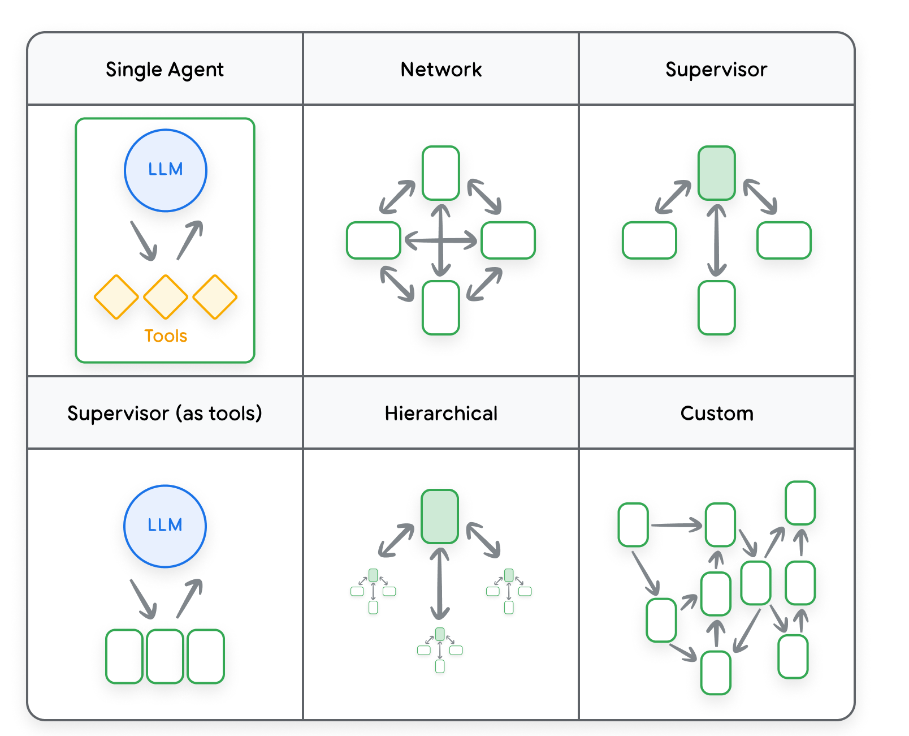
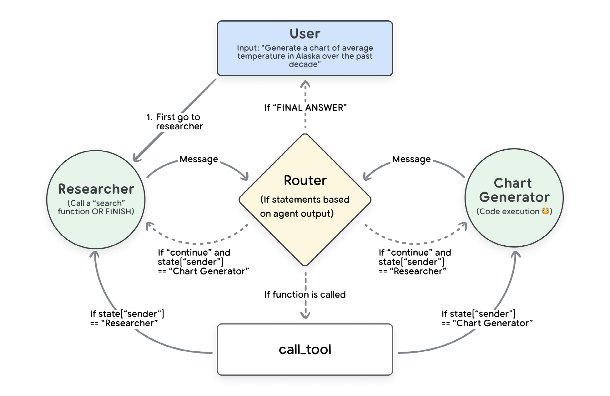

# Multiple Agents & Their Evaluation

<mark>多智能体及其评估</mark>

Agent evaluation, which assesses the effectiveness, reliability, and adaptability of autonomous AI agents, as seen in the previous section, has emerged as a key focus area. We have seen a significant evolution in AI systems, transitioning towards multi-agent architectures—where multiple specialized agents collaborate to achieve complex objectives. A multi-agent system is like a team of experts, each specializing in a particular area, working together to solve a complex problem. Each agent is an independent entity, potentially using a different LLM, and with its own unique role and context. Agents communicate and collaborate to achieve a common goal. This approach differs from traditional single-agent systems, where one LLM handles all aspects of a task.

<mark>智能体 (Agent) 评估衡量自主 AI 智能体的有效性、可靠性和适应性。如上一节所示，它已经成为一个重点领域。我们看到 AI 系统有了显著的演进，正在转向多智能体架构——多个专门化的智能体协作，以达成复杂目标。多智能体系统 (Multi-Agent System) 就像一支专家团队，每人专精一个领域，共同解决一个复杂问题。每个智能体都是独立实体，可能使用不同的大语言模型 (LLM)，并拥有自己独特的角色和上下文。智能体相互通信、协作，以达成共同目标。这种做法不同于传统的单智能体系统：在单智能体系统里，一个 LLM 处理任务的所有方面。</mark>

Multi-agent systems offer several advantages over single-agent systems:

<mark>相对单智能体系统，多智能体系统有若干优势：</mark>

- **Enhanced Accuracy:** Agents can cross-check each other's work, leading to more accurate results.

<mark>- **更高的准确性：** 智能体可以交叉核对彼此的工作，从而得到更准确的结果。</mark>

- **Improved Efficiency:** Agents can work in parallel, speeding up task completion.

<mark>- **更高的效率：** 智能体可以并行工作，从而加快任务完成。</mark>

- **Better Handling of Complex Tasks:** Large tasks can be broken down into smaller, more manageable subtasks, with each agent focusing on a specific aspect.

<mark>- **更好地处理复杂任务：** 大任务可以拆成更小、更易于管理的子任务，每个智能体专注于一个具体方面。</mark>

- **Increased Scalability:** The system can be easily scaled by adding more agents with specialized capabilities.

<mark>- **更强的可扩展性：** 只要增加更多具备专门能力的智能体，系统就可以轻松扩展。</mark>

- **Improved Fault Tolerance:** If one agent fails, others can take over its responsibilities.

<mark>- **更好的容错能力：** 如果某个智能体失败，其他智能体可以接管它的职责。</mark>

- **Reduced Hallucinations and Bias:** By combining the perspectives of multiple agents, the system can reduce the effects of hallucinations and bias, leading to more reliable and trustworthy outputs.

<mark>- **减少幻觉与偏见：** 把多个智能体的视角结合起来，系统可以减弱幻觉和偏见的影响，从而产生更可靠、更可信的输出。</mark>

---

## Understanding Multi-Agent Architectures

<mark>理解多智能体架构</mark>

Unlike traditional monolithic AI systems, multi-agent architectures break down a problem into distinct tasks handled by specialized agents. Each agent operates with defined roles, interacting dynamically with others to optimize decision-making, knowledge retrieval, and execution. These architectures enable more structured reasoning, decentralized problem-solving, and scalable task automation, offering a paradigm shift from single-agent workflows.

<mark>与传统的单体式 AI 系统不同，多智能体架构把一个问题拆成由专门化智能体处理的各项独立任务。每个智能体按明确的角色运行，并与其他智能体动态交互，以优化决策、知识检索和执行。这些架构使推理 (Reasoning) 更有结构，使问题解决去中心化，并使任务自动化可以扩展，从而带来相对单智能体工作流的范式转变。</mark>

At their core, multi-agent systems leverage principles of modularity, collaboration, and hierarchy to create a robust AI ecosystem. Agents within these systems can be categorized based on their function for example:

<mark>在核心上，多智能体系统借助模块化、协作和层级这些原则，构建一个稳健的 AI 生态系统。这些系统中的智能体可以按功能分类，例如：</mark>

- **Planner Agents:** Responsible for breaking down high-level objectives into structured sub-tasks.

<mark>- **规划 (Planning) 智能体：** 负责把高层目标拆成有结构的子任务。</mark>

- **Retriever Agents:** Optimize knowledge acquisition by dynamically fetching relevant data from external sources.

<mark>- **检索智能体 (Retriever Agents)：** 通过从外部来源动态获取相关数据，来优化知识获取。</mark>

- **Execution Agents:** Perform computations, generate responses, or interact with APIs.

<mark>- **执行智能体 (Execution Agents)：** 执行计算、生成回答，或与 API 交互。</mark>

- **Evaluator Agents:** Monitor and validate responses, ensuring coherence and alignment with objectives.

<mark>- **评估智能体 (Evaluator Agents)：** 监控并校验回答，确保连贯，并与目标一致。</mark>

Through these components, multi-agent architectures extend beyond simple prompt-based interactions, enabling AI-driven workflows that are adaptive, explainable, and efficient.

<mark>借助这些组件，多智能体架构超出了简单的、基于提示的交互，使 AI 驱动的工作流能够自适应、可解释且高效。</mark>

---

## Multi-Agent Design Patterns and Their Business Impact

<mark>多智能体设计模式及其业务影响</mark>

To design effective multi-agent architectures, specific design patterns have emerged. These patterns define interaction protocols, delegation mechanisms, and role distributions, allowing businesses to implement AI-driven automation in structured ways. Some common design patterns include:

<mark>为了设计有效的多智能体架构，一些特定的设计模式已经出现。这些模式规定交互协议、委派机制和角色分配，使企业能够以有结构的方式实现 AI 驱动的自动化。一些常见的设计模式包括：</mark>

Table 2: A table comparing types of multi-agent systems.

<mark>表 2：比较各类多智能体系统的表格。</mark>

| Type of Multi-Agent System | Description | Example |
| --- | --- | --- |
| Sequential | Agents work in a sequential manner, with each agent completing its task before passing the output to the next agent. | An assembly line, where each worker performs a specific operation before passing the product to the next worker. |
| Hierarchical | Agents are organized in a hierarchical structure, with a "manager" agent coordinating the workflow and delegating tasks to "worker" agents. | A system with a leader agent responsible for making strategic decisions and follower agents executing tasks based on the leader's instructions. |
| Collaborative | Agents work together collaboratively, sharing information and resources to achieve a common goal. | A team of researchers working on a project, where each member contributes their expertise and insights. |
| Competitive | Agents may compete with each other to achieve the best outcome. | LLMs act as individual players in a game like Overcooked-AI, where they must coordinate their actions to achieve a shared goal while competing for resources and optimizing individual performance. |

| <mark>多智能体系统的类型</mark> | <mark>描述</mark> | <mark>示例</mark> |
| --- | --- | --- |
| <mark>顺序 (Sequential)</mark> | <mark>智能体以顺序方式工作：每个智能体先完成自己的任务，再把输出传给下一个智能体。</mark> | <mark>一条装配线：每位工人先完成一项特定操作，再把产品传给下一位工人。</mark> |
| <mark>层级 (Hierarchical)</mark> | <mark>智能体按层级结构组织，由一个「管理者」智能体协调工作流，并把任务委派给「工作者」智能体。</mark> | <mark>这样一个系统：领导者智能体负责做出战略决策，跟随者智能体根据领导者的指令执行任务。</mark> |
| <mark>协作 (Collaborative)</mark> | <mark>智能体协作共事，共享信息和资源，以达成共同目标。</mark> | <mark>一支从事某个项目的研究团队，每位成员都贡献自己的专长和见解。</mark> |
| <mark>竞争 (Competitive)</mark> | <mark>智能体可能彼此竞争，以取得最好的结果。</mark> | <mark>大语言模型在类似 Overcooked-AI 的游戏中充当各自的玩家：它们必须协调自己的行动以达成共享目标，同时争夺资源并优化各自的表现。</mark> |

<mark>[图 7：一幅描绘不同多智能体拓扑的图，来自 LangGraph 文档23。共 2 行 3 列。单智能体：蓝色 LLM 圆圈与三个黄色菱形工具双向相连。网络：四个智能体节点以双向箭头互连。监督者：一个绿色监督节点与三个工作者双向相连。监督者（作为工具）：LLM 把下方三个智能体节点当作工具调用。层级：绿色监督者连接三个子监督者，每个子监督者再各带两个子节点。自定义：多个节点以不规则的有向箭头相连。]</mark>

The choice of design pattern depends on the specific application and the desired level of interaction between agents.

<mark>设计模式的选择取决于具体应用，以及所希望的智能体之间的交互程度。</mark>

Businesses benefit from these patterns by reducing operational bottlenecks, improving knowledge retrieval, and enhancing automation reliability. Multi-agent systems enable companies to scale AI deployments while ensuring agility in decision-making and workflow execution.

<mark>企业从这些模式中获益，是因为它们减少了运营瓶颈，改善了知识检索，并提高了自动化的可靠性。多智能体系统使公司能够扩展 AI 部署，同时保证决策和工作流执行上的敏捷。</mark>

---

## Important components of Agents

<mark>智能体的重要组件</mark>

The architecture of LLM-based AI agents consists of several interrelated components essential for autonomous operation and intelligent interaction:

<mark>基于 LLM 的 AI 智能体的架构，由若干相互关联的组件构成。这些组件对自主运行和智能交互是必需的：</mark>

- **Interaction Wrapper:** This component serves as the interface between the agent and its environment, managing communication and adapting to various input and output modalities.

<mark>- **交互封装 (Interaction Wrapper)：** 这个组件是智能体与其环境之间的接口，负责管理通信，并适应各种输入与输出模态。</mark>

- **Memory Management:** This includes short-term working memory for immediate context, cache, and sessions. It also can include long-term storage for learned patterns and experiences, as episodes, examples, skills or reference data. It also includes “reflection” to decide which short term items (eg: user preference) should be copied into long term memory (eg: user profile), and if that can be shared across agents, tasks, or sessions.

<mark>- **记忆 (Memory) 管理：** 这包括用于即时上下文、缓存和会话的短期工作记忆。它也可以包括长期存储，用来保存学到的模式和经验，形式可以是情节、示例、技能或参考数据。它还包括「反思 (Reflection)」，用来决定哪些短期条目（例如用户偏好）应当复制进长期记忆（例如用户画像），以及这些内容能否在智能体、任务或会话之间共享。</mark>

- **Cognitive Functionality:** This is often underpinned by Chain-of-Thought (CoT), ReAct, reasoning, thinking, or a planner subsystem - it allows agents to decompose complex tasks into logical steps and engage in self-correction. In some cases this also includes user intent refinement, to ask a clarifying question if uncertain.

<mark>- **认知功能 (Cognitive Functionality)：** 这通常由思维链 (Chain-of-Thought, CoT)、ReAct、推理、思考或一个规划子系统来支撑。它让智能体把复杂任务分解成合乎逻辑的步骤，并进行自我纠正。在某些情况下，这也包括细化用户意图：如果不确定，就提出一个澄清问题。</mark>

- **Tool Integration:** This subsystem enables agents to utilize external tools, expanding their capabilities beyond natural language processing. Dynamic tool registries allowing discovery, registration, and “Tool RAG”.

<mark>- **工具集成 (Tool Integration)：** 这个子系统使智能体能够利用外部工具 (Tools)，也就是进行工具使用 (Tool Use)，从而把能力扩展到自然语言处理之外。动态工具注册表允许发现、注册，以及「Tool RAG」。</mark>

- **Flow / Routing:** This governs connections with other agents, facilitating dynamic neighbor discovery and efficient communication within the multi-agent system. This might be implemented as a delegation of a task to a background agent, or handoff of the user interaction to an agent, or the use of an agent as a tool.

<mark>- **流程 / 路由 (Flow / Routing)：** 它管控与其他智能体的连接，便于在多智能体系统内动态发现邻居并高效通信。实现方式可以是把一项任务委派给一个后台智能体，或把用户交互交接给某个智能体，或把某个智能体当作工具来使用。</mark>

- **Feedback Loops / Reinforcement Learning:** These enable continuous learning and adaptation by processing interaction outcomes and refining decision-making strategies. For gen AI agents this rarely takes the form of traditional RL training, but the performance metrics of the past can be incorporated into future decision making.

<mark>- **反馈回路 / 强化学习 (Feedback Loops / Reinforcement Learning)：** 它们通过处理交互结果并改进决策策略，使持续学习和适应成为可能。对生成式 AI 智能体来说，这很少采取传统 RL 训练的形式，但过去的性能指标可以纳入未来的决策。</mark>

- **Agent Communication:** Effective communication between agents is crucial for the success of multi-agent systems. The Agent to Agent communication protocol facilitates structured and efficient communication among agents, enabling them to achieve consensus and address complex problems collaboratively.

<mark>- **智能体通信 (Agent Communication)：** 智能体之间有效的通信，对多智能体系统的成功至关重要。智能体到智能体通信协议促进智能体之间有结构、有效率的通信，使它们能够达成共识，并协作应对复杂问题。</mark>

- **Remote Agent Communication:** Agent to Agent communication within an organization is critical to allows agents to share messages, tasks, and knowledge. Once your multi-agent system includes a remote agent, the communication protocol becomes even more important. Asynchronous tasks and sessions need to be durable, and updated with notifications while end users are not in session. Negotiations between Agents must allow for bringing a user into session and for supported UX capabilities.

<mark>- **远程智能体通信 (Remote Agent Communication)：** 组织内部的智能体到智能体通信至关重要，这样才能让智能体共享消息、任务和知识。一旦你的多智能体系统包含远程智能体，通信协议就更加重要。异步任务和会话需要持久保存，并在最终用户不在会话中时通过通知加以更新。智能体之间的协商必须允许把用户带入会话，也必须顾及受支持的 UX 能力。</mark>

- **Agent & Tool Registry (mesh):** As you go beyond a handful of tools or a handful of agents, you need a robust system to discover, register, administer, select and utilize from a “mesh” of tools or agents. Critically important is the ontology and description of the tools and agents, their capabilities and requirements, and their performance metrics. Your agents will make a plan and choose which tool or which agent to use from such a system, and those choices are informed by the data in the system.

<mark>- **智能体与工具注册表 (Agent & Tool Registry, mesh)：** 当你超出少量工具或少量智能体时，就需要一个稳健的系统，以便从工具或智能体的「mesh」中发现、注册、管理、选择并加以使用。至关重要的是工具和智能体的本体与描述、它们的能力与要求，以及它们的性能指标。你的智能体会制定一个计划，并从这样的系统中选择使用哪个工具或哪个智能体，而这些选择以该系统中的数据为依据。</mark>

<mark>[图 8：一幅展示用户与多个自我协调智能体交互过程的图24。顶部用户的输入是「Generate a chart of average temperature in Alaska over the past decade」。步骤 1 先进入左侧的 Researcher（调用 search 函数，或 FINISH）。Researcher 与右侧的 Chart Generator（代码执行）都向中间的 Router 发送 Message。Router 按智能体输出做条件判断：若为 FINAL ANSWER，则返回用户；若为 continue 且 state["sender"] 等于 Researcher，则前往 Chart Generator；若为 continue 且 state["sender"] 等于 Chart Generator，则前往 Researcher；若调用了函数，则进入底部的 call_tool，再按 state["sender"] 回到 Researcher 或 Chart Generator。</mark>

These architectural elements provide a robust foundation for the autonomous operation and collaborative capabilities of LLM agents within multi-agent systems.

<mark>这些架构要素，为多智能体系统中 LLM 智能体的自主运行和协作能力提供了稳健的基础。</mark>

---

## Challenges in Multi-Agent systems

<mark>多智能体系统中的挑战</mark>

While multi-agent systems offer numerous advantages, they also face several challenges:

<mark>尽管多智能体系统有许多优势，它们也面临若干挑战：</mark>

- **Task Communication:** Today most agent frameworks communicate in messages, not structured async tasks.

<mark>- **任务通信：** 如今大多数智能体框架以消息通信，而不是以结构化的异步任务通信。</mark>

- **Task Allocation:** Efficiently dividing complex tasks among different agents can be challenging, and feedback loops are often left up to the developer to implement.

<mark>- **任务分配：** 在不同智能体之间高效地划分复杂任务可能很困难，反馈回路也常常留给开发者自己去实现。</mark>

- **Coordinating Reasoning:** Getting agents to debate and reason together effectively requires sophisticated coordination mechanisms.

<mark>- **协调推理：** 要让智能体有效地一起辩论、一起推理，需要精巧的协调机制。</mark>

- **Managing Context:** Keeping track of all the information, tasks, and conversations between agents can be overwhelming.

<mark>- **管理上下文：** 跟踪智能体之间的全部信息、任务和对话，可能会难以招架。</mark>

- **Time and Cost:** Multi-agent interactions can be computationally expensive and time-consuming. This results in higher runtime prices and more user latency.

<mark>- **时间与成本：** 多智能体交互可能计算开销很大，而且耗时。这会带来更高的运行时价格，以及更大的用户延迟。</mark>

- **Complexity:** In the same way that microservice architecture allows each microservice more flexibility and simplicity, the system as a whole usually becomes more complex.

<mark>- **复杂性：** 正如微服务架构让每个微服务更灵活、也更简单，系统作为整体通常会变得更复杂。</mark>

Addressing these challenges is crucial for developing robust and efficient multi-agent systems.

<mark>应对这些挑战，对于开发稳健而高效的多智能体系统至关重要。</mark>

---

## Multi-Agent Evaluation

<mark>多智能体评估</mark>

Luckily, the evaluation of multi-agent systems is a clear progression of evaluating single agent systems. Agent Success Metrics are unchanged, business metrics as your north star, goals and critical task success metrics, application telemetry metrics like latency and errors. Instrumenting the multi-agent system with trace will help debug and understand what is happening during complex interactions.

<mark>好在，多智能体系统的评估是单智能体系统评估的清晰延伸。智能体成功指标 (Agent Success Metrics) 没有改变：业务指标是你的北极星，此外还有目标与关键任务的成功指标，以及延迟和错误这类应用遥测指标。用追踪 (trace) 给多智能体系统做埋点，有助于在复杂交互期间进行调试，并理解正在发生什么。</mark>

In the Agent Evaluation section we discussed Evaluating Trajectories and Evaluating the Final Response as the 2 best approaches to automated evaluation of an agent, and this remains the case for multi-agent systems. For a multi-agent system, a trajectory of actions might include several or even all of your agents. Even though several agents may collaborate on a task, a single final answer is returned to the user at the end and can be evaluated in isolation.

<mark>在智能体评估一节中，我们讨论了评估轨迹 (Trajectory) 和评估最终回答，把它们作为智能体自动化评估的 2 种最佳方法，对多智能体系统仍然如此。对一个多智能体系统来说，一条行动轨迹可能包含你的若干个、甚至全部智能体。即使若干智能体协作完成一项任务，最后返回给用户的仍是单一的最终答案，并且可以单独评估。</mark>

Because a multi-agent system probably has more steps, you can drill down and evaluate at every step. You can evaluate each of your agents in isolation and the system as a whole. Trajectory evaluations are a scalable approach to do exactly this.

<mark>因为多智能体系统的步骤往往更多，你可以下钻到每一步进行评估。你可以单独评估每一个智能体，也可以把系统作为整体来评估。轨迹评估是一种可扩展的做法，正好用来做这件事。</mark>

There are some questions you need to ask, which are unique to multi-agent systems, including:

<mark>有一些问题是多智能体系统所特有的，你需要提出来，其中包括：</mark>

- **Cooperation and Coordination:** How well do agents work together and coordinate their actions to achieve common goals?

<mark>- **合作与协调：** 智能体共同工作，并协调自己的行动以达成共同目标，这方面做得怎么样？</mark>

- **Planning and Task Assignment:** Did we come up with the right plan, and did we stick to it? Did child agents deviate from the main plan or get lost in a cul-de-sac?

<mark>- **规划与任务分配：** 我们是否制定了正确的计划，并且坚持执行了？子智能体是否偏离了主计划，或者迷失在死胡同里？</mark>

- **Agent Utilization:** How effectively do agents select the right agent and choose to use the agent as a tool, delegate a background task, or transfer the user?

<mark>- **智能体利用：** 智能体在选对智能体，并选择把该智能体当作工具使用、委派一项后台任务，或转交用户时，效果如何？</mark>

- **Scalability:** Does the system's quality improve as more agents are added? Does the latency go down? Are we being more efficient or less?

<mark>- **可扩展性：** 随着加入更多智能体，系统质量是否提高？延迟是否下降？我们是变得更高效，还是更低效？</mark>

These types of questions can guide developers to identify areas for improvement in the multi-agent system. You will answer these questions using the same tools you use for single agent systems, but the complexity of the analysis goes up.

<mark>这类问题可以引导开发者找出多智能体系统中有待改进的地方。你会用评估单智能体系统时所用的同一套工具来回答这些问题，但分析的复杂度会上升。</mark>
