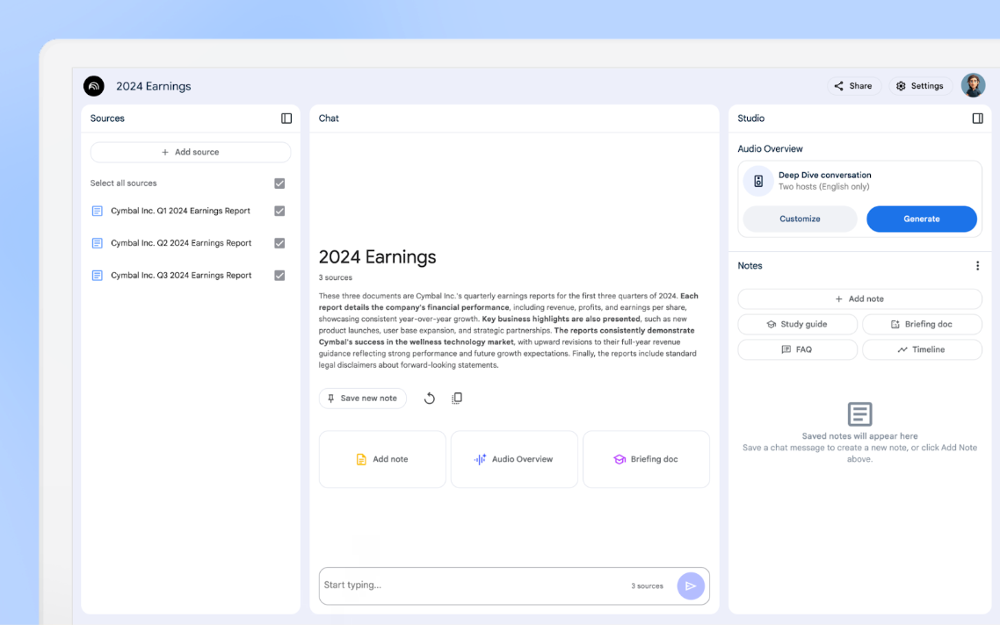
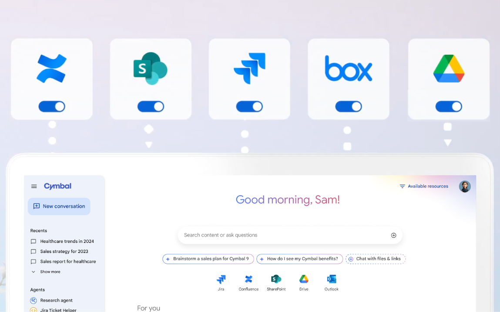

# Agents in the enterprise

<mark>企业中的智能体</mark>

## Manager of agents

<mark>智能体的管理者</mark>

2025 is the year of the agents, and this will particularly be true in the context of enterprises that will develop and use agents that will assist employees to perform specific tasks or autonomously run in the background performing automation. Business analysts can effortlessly uncover industry trends and create compelling, data-driven presentations fueled by AI-generated insights. HR teams can revolutionize the employee experience with streamlined onboarding, even for complex tasks like 401k selection. Software engineers can proactively identify and resolve bugs, enabling them to build and iterate with greater efficiency, and accelerate deployment cycles. Marketers can unlock deeper performance analysis, optimize content recommendations, and fine-tune campaigns effortlessly to achieve better results.

<mark>2025 年是智能体 (Agent) 之年，在企业里尤其如此。企业会开发并使用智能体：它们协助员工完成特定任务，或在后台自主运行、执行自动化。业务分析师可以轻松发现行业趋势，并借助 AI 生成的洞察，做出有说服力、由数据驱动的演示文稿。人力资源团队可以借助更顺畅的入职流程重塑员工体验，即便是 401k 选择这类复杂任务也不例外。软件工程师可以主动发现并解决缺陷，从而更高效地构建和迭代，并加快部署周期。营销人员可以开展更深入的效果分析，优化内容推荐，并轻松微调营销活动，以取得更好的结果。</mark>

We see two types of agents emerging:

<mark>我们看到，有两类智能体正在出现：</mark>

1. "Assistants": Agents that interact with the user, take a task, execute it, and come back to the user. Conversational agents popularized by frameworks like Gems or GPTs usually belong to this category. Assistants can be general - able to help on a variety of tasks - or specialized to a particular domain, or tasks. Examples include agents that help schedule meetings, analyze data, write code, write marketing press releases, help sellers with sales opportunities, or even agents that perform deep research on a particular topic as requested by the user. These agents can be synchronous and return the requested information or perform the requested task fast, or they run for a longer period of time before returning (like the deep research agents).

<mark>1. 「助手」：这类智能体与用户交互，接过一项任务，执行它，再回到用户身边。因 Gems 或 GPTs 这类框架而流行的对话式智能体，通常属于这一类。助手可以是通用的——能在多种任务上提供帮助——也可以专精于某一领域或某些任务。例子包括帮助安排会议、分析数据、编写代码、撰写营销新闻稿、协助销售人员处理销售机会的智能体，甚至还有按用户要求对某一主题做深度研究的智能体。这些智能体可以是同步的，很快返回所请求的信息，或很快完成所请求的任务；也可以运行较长一段时间再返回（如深度研究智能体）。</mark>

2. "Automation agents": Agents that run in the background, listen to events, monitor changes in systems or data, and then make smart decisions and act. Action might include acting on backend systems, performing some tests to validate the observation, fixing problems, notifying the right employees, etc. This can really be seen as the backbone of the automation of the future. While in the past we had to write special code to specify the logic of automations, now we can start relying on smart and general decision making abilities of AI agents.

<mark>2. 「自动化智能体」：这类智能体在后台运行，监听事件，监视系统或数据中的变化，然后做出聪明的决策并采取行动。行动可以包括在后端系统上执行操作、做一些测试来验证所观察到的情况、修复问题、通知合适的员工，等等。这确实可以看作未来自动化的骨干。过去我们必须编写专门的代码来规定自动化的逻辑，现在则可以开始依靠 AI 智能体聪明且通用的决策能力。</mark>

Rather than simply invoking agents to perform a task and wait for the output, knowledge workers will increasingly become managers of agents. They will be assigning tasks to multiple agents and manage them, check if any of agents need help or require approval to proceed, use the output of specific agents to start new tasks, monitor execution of long running tasks to review and steer them in the right direction. Novel user interfaces to allow this type of virtual team management will emerge to allow orchestration, monitoring and managing a multi-agent system with agents performing tasks, calling (or even creating) other agents.

<mark>知识工作者将越来越多地成为智能体的管理者，而不再只是调用智能体去完成一项任务、然后等待输出。他们会把任务分派给多个智能体并加以管理，检查是否有智能体需要帮助或需要批准才能继续，用特定智能体的输出启动新任务，并监控长时间运行任务的执行情况，以便审阅并把它们导向正确方向。适应这类虚拟团队管理的新型用户界面将会出现，以便编排 (Orchestration)、监控和管理一个多智能体系统：其中的智能体执行任务，并调用（甚至创建）其他智能体。</mark>

Google Agentspace aims at providing this type of experience and allow to:

<mark>Google Agentspace 旨在提供这类体验，并让人能够：</mark>

- Create new agents by using a no/low code interface or a full code framework to implement both specialized assistants and automation agents

<mark>- 用无代码 / 低代码界面，或用全代码框架，创建新的智能体，以实现专用助手和自动化智能体</mark>

- Configure and manage the agents access for company administrators

<mark>- 供公司管理员配置并管理智能体的访问权限</mark>

- Invoke the right agents when appropriate

<mark>- 在适当的时候调用合适的智能体</mark>

- Monitor, manage, and orchestrate multiple agents in a UI suited for team management

<mark>- 在适合团队管理的界面中监控、管理并编排多个智能体</mark>

---

## Google Agentspace

<mark>Google Agentspace</mark>

Google Agentspace29 offers a suite of AI-driven tools designed to elevate enterprise productivity by facilitating access to pertinent information and automating intricate, agentic workflows. It harnesses the advanced reasoning capabilities of Gemini, the power of Google's search infrastructure, and secure access to enterprise data, irrespective of its physical location.

<mark>Google Agentspace29 提供一套由 AI 驱动的工具 (Tools)，借更便捷地获取相关信息，并把复杂的智能体式工作流自动化，来提升企业生产力。它运用 Gemini 的高级推理 (Reasoning) 能力、Google 搜索基础设施的力量，以及对企业数据的安全访问，不论这些数据实际存放在何处。</mark>

Agentspace directly addresses the limitations inherent in traditional knowledge management systems, which frequently fall short in areas such as personalization, automated answer generation, contextual comprehension, and comprehensive information retrieval. It empowers employees with efficient information access by consolidating disparate content sources, generating grounded and personalized responses, and streamlining operational workflows. Key functionalities include the capacity to ingest a wide variety of data formats, synchronize data from Software-as-a-Service (SaaS) platforms, deliver access-controlled search results and AI-generated answers, and integrate AI assistance and intelligent agents into cohesive workflows.

<mark>Agentspace 直接应对传统知识管理系统固有的局限。这类系统在个性化、自动生成答案、上下文理解以及全面的信息检索等方面，常常有所不足。它把分散的内容来源汇集起来，生成有依据锚定 (grounding) 的个性化回答，并理顺运营工作流，从而让员工能够高效获取信息。关键功能包括：摄入多种多样的数据格式，从软件即服务 (SaaS) 平台同步数据，交付带访问控制的搜索结果和 AI 生成的答案，并把 AI 辅助与智能体整合进连贯的工作流。</mark>

The architecture of Agentspace Enterprise is founded upon several core principles. Paramount among these is built-in trust, which prioritizes security, explainability, and governance through features such as single sign-on (SSO) authentication, an integrated permissions model, and user-level access controls. Google's advanced intelligence is leveraged to discern user behavior and content patterns through machine learning, resulting in the delivery of highly relevant results via semantic understanding, knowledge graphs, and LLMs. Universal connectivity is achieved by connecting to a diverse array of enterprise systems with on-demand and automated data refreshes, thereby eliminating information silos. Enterprise-level customization and user-level personalization are facilitated through granular controls for search functionality, recommendations, LLMs, and knowledge graphs, providing tailored experiences based on individual user roles, permissions, and search history. Real-time feedback and adaptation mechanisms enable the continuous refinement of results through machine learning and user input. Blended Retrieval Augmented Generation (RAG) allows for customizable data blending, powering generative AI applications grounded in enterprise data. Finally, scalability is a critical design consideration, with the system engineered to accommodate growth across geographical regions, languages, and peak usage demands.

<mark>Agentspace Enterprise 的架构建立在若干核心原则之上。其中最重要的是内建信任：借助单点登录 (SSO) 认证、集成的权限模型，以及用户级访问控制等特性，把安全、可解释性和治理放在优先位置。Google 的高级智能通过机器学习来辨别用户行为与内容模式，再经由语义理解、知识图谱和大语言模型 (LLM)，给出高度相关的结果。通用连接靠的是接入多种多样的企业系统，并以按需和自动两种方式刷新数据，从而消除信息孤岛。企业级定制和用户级个性化，通过对搜索功能、推荐、LLM 和知识图谱的细粒度控制来实现，并按每位用户的角色、权限和搜索历史，提供量身定制的体验。实时反馈与适应机制，能借助机器学习和用户输入持续改进结果。混合式检索增强生成 (RAG) 支持可定制的数据混合，用来驱动以企业数据为依据的生成式 AI 应用。最后，可扩展性是一项关键的设计考量，系统被设计为能够适应在地域、语言以及高峰用量上的增长。</mark>

Security is always top of mind. Google Agentspace is built on the Google Cloud secure-by-design infrastructure, giving you the peace of mind to confidently deploy AI agents across your organization. It provides granular IT controls, including role-based access control (RBAC), VPC Service Controls, and IAM integration, ensuring your data remains protected and compliant at all times.

<mark>安全始终是头等要事。Google Agentspace 构建在 Google Cloud 的 secure-by-design 基础设施之上，让你可以安心、有信心地在整个组织中部署 AI 智能体。它提供细粒度的 IT 管控，包括基于角色的访问控制 (RBAC)、VPC Service Controls 和 IAM 集成，确保你的数据始终受到保护并保持合规。</mark>

Security is a foundational principle of Agentspace. Built upon the secure infrastructure of Google Cloud, it provides a robust environment for the deployment of AI agents. Granular IT controls, encompassing role-based access control (RBAC), Virtual Private Cloud (VPC) Service Controls, and Identity and Access Management (IAM) integration, guarantee data protection and regulatory compliance. These security measures are essential for the safeguarding of sensitive information and give users the peace of mind to confidently deploy AI agents across their organization.

<mark>安全是 Agentspace 的一项基本原则。它建立在 Google Cloud 的安全基础设施之上，为部署 AI 智能体提供一个稳健的环境。细粒度的 IT 管控涵盖基于角色的访问控制 (RBAC)、Virtual Private Cloud (VPC) Service Controls，以及身份与访问管理 (IAM) 集成，确保数据受到保护并符合监管要求。这些安全措施对保护敏感信息至关重要，并让用户可以安心、有信心地在整个组织中部署 AI 智能体。</mark>

---

## NotebookLM Enterprise

<mark>NotebookLM Enterprise</mark>

NotebookLM30 is a research and learning tool designed to streamline the process of understanding and synthesizing complex information. It empowers users to upload various source materials, including documents, notes, and other relevant files, and leverages the power of artificial intelligence to facilitate deeper comprehension. Imagine researching a multifaceted topic; NotebookLM allows you to consolidate all your scattered resources into a single, organized workspace. In essence, NotebookLM functions as a dedicated research assistant, accelerating the research process and enabling users to move beyond mere information collection to genuine understanding.

<mark>NotebookLM30 是一款研究与学习工具，用来把理解并综合复杂信息的过程理顺。它让用户上传各种源材料，包括文档、笔记和其他相关文件，并借助人工智能促成更深的理解。设想你正在研究一个多方面的主题；NotebookLM 让你把散落的资料全部汇入同一个有条理的工作区。从本质上说，NotebookLM 充当一位专职的研究助手，加快研究过程，让用户从单纯收集信息进到真正的理解。</mark>

<mark>[图 11：NotebookLM Enterprise30 配有几份模拟财报。界面标题为 2024 Earnings，分为三栏。左栏 Sources 可 Add source，并已勾选 Cymbal Inc. 的 Q1、Q2 与 Q3 2024 Earnings Report。中栏 Chat 同样标题为 2024 Earnings，标注 3 sources，摘要这三份季度财报中的营收、利润、每股收益与同比增长；其下有 Save new note，以及 Add note、Audio Overview、Briefing doc，输入框为 Start typing...。右栏 Studio 的 Audio Overview 写着 Deep Dive conversation，并注明 Two hosts (English only)，配有 Customize 与 Generate；Notes 中有 Study guide、Briefing doc、FAQ、Timeline，空态文字为 Saved notes will appear here。顶部有 Share 与 Settings。</mark>

NotebookLM Plus builds upon this foundation, offering a premium tier with enhanced features and capabilities. While the core functionality of uploading sources, asking questions, and generating summaries remains, NotebookLM Plus typically adds features like increased storage for source materials, enabling work with larger and more complex projects. It may also include more sophisticated AI-powered analysis tools, such as more nuanced summarization options, enhanced question-answering capabilities, or the ability to identify connections and relationships between different sources more effectively.

<mark>NotebookLM Plus 在这个基础上更进一步，提供特性与能力都更强的付费层级。上传来源、提问和生成摘要这些核心功能依然保留；与此同时，NotebookLM Plus 通常会增加源材料的存储空间等特性，从而能处理更大、更复杂的项目。它还可能包含更精细的、由 AI 驱动的分析工具，例如更细致的摘要选项、更强的问答能力，或更有效地识别不同来源之间的联系与关系。</mark>

Building upon the foundation of NotebookLM Plus, NotebookLM Enterprise30 brings these powerful capabilities to the enterprise environment, streamlining how employees interact with and derive insights from their data. This enterprise-grade version enables users to not only upload and synthesize information, but also to uncover hidden patterns and engage with data in innovative ways. A prime example is the AI-generated audio summary feature, which enhances comprehension and facilitates efficient knowledge absorption by allowing users to "listen" to their research.

<mark>在 NotebookLM Plus 的基础上，NotebookLM Enterprise30 把这些强大能力带入企业环境，理顺员工与数据交互并从中获取洞察的方式。这个企业级版本不仅让用户上传并综合信息，还能发现隐藏的模式，并以创新的方式与数据互动。一个突出的例子是 AI 生成的音频摘要：它让用户可以「听」自己的研究，从而加深理解，并更高效地吸收知识。</mark>

Technically, NotebookLM, both in its consumer and enterprise forms, employs LLMs to process uploaded documents, extract key concepts, and generate summaries. The audio summary feature uses text-to-speech (TTS) technology incorporating advanced prosody control to ensure clarity and naturalness. Critically, NotebookLM Enterprise incorporates enterprise-grade security and privacy features, ensuring that sensitive company data is handled with the utmost care and protected in accordance with organizational policies.

<mark>从技术上讲，无论消费者版还是企业版，NotebookLM 都使用 LLM 来处理上传的文档、提取关键概念并生成摘要。音频摘要功能使用文本转语音 (TTS) 技术，并加入高级的韵律控制，以保证清晰和自然。尤为关键的是，NotebookLM Enterprise 纳入了企业级的安全与隐私特性，确保敏感的公司数据得到最审慎的处理，并依照组织政策受到保护。</mark>

---

## Google AgentSpace Enterprise

<mark>Google AgentSpace Enterprise</mark>

Google Agentspace furnishes employees with a unified, company-branded, multimodal search agent that serves as the definitive source of enterprise information. Drawing upon Google's extensive search capabilities, Agentspace offers unparalleled conversational assistance. Employees get answers to complex queries, proactive recommendations, and unified access to information from any source. This functionality extends to both unstructured data, such as documents and emails, and structured data, like tables. Integrated translation capabilities ensure comprehensive understanding, regardless of the original language of the information. Pre-built connectors for widely used third-party applications, including Confluence, Google Drive, Jira, Microsoft SharePoint, ServiceNow, and others, empower employees to seamlessly access and query relevant data sources, facilitating more informed decision-making.

<mark>Google Agentspace 为员工提供一个统一的、带有公司品牌的多模态搜索智能体，作为企业信息的权威来源。依托 Google 广泛的搜索能力，Agentspace 提供无与伦比的对话式辅助。员工能得到复杂查询的答案、主动的推荐，以及对任何来源信息的统一访问。这一功能既覆盖非结构化数据，例如文档和电子邮件，也覆盖结构化数据，例如表格。集成的翻译能力确保人们能够充分理解信息，不论信息原本使用哪种语言。面向广泛使用的第三方应用，还有预置连接器，包括 Confluence、Google Drive、Jira、Microsoft SharePoint、ServiceNow 等，让员工能够无缝访问并查询相关数据来源，从而做出更明智的决策。</mark>

<mark>[图 12：为 Cymbal 银行定制的 Agentspace29，连接着若干数据存储。上方五个连接器卡片的开关均已打开，可见 SharePoint、Jira、Box 和 Google Drive 等标识，并以虚线连向下方工作区。下方是 Cymbal 品牌界面：问候 Good morning, Sam!，搜索框文字为 Search content or ask questions，建议问题包括 Brainstorm a sales plan for Cymbal、How do I see my Cymbal benefits? 和 Chat with files & links。来源图标标着 Jira、Confluence、SharePoint、Drive、Outlook。侧栏有 New conversation、Recents（例如 Healthcare trends in 2024）以及 Agents（Research agent 与 Jira Ticket Helper），右上角为 Available resources。</mark>

Much more than just information retrieval, agents can take actions in the real world, manage async tasks and workflows, and help employees get work done. A gallery of agents can be configured based on an organization's unique needs and will help with deep research, idea generation and merit based refinement, creative asset generation, data analytics and more.

<mark>智能体能做的远不止信息检索。它们可以在现实世界中采取行动，管理异步任务和工作流，并帮助员工把工作完成。可以按组织的独特需要配置一个智能体库，用来协助深度研究、想法生成与基于优劣的提炼、创意素材生成、数据分析等等。</mark>

Agentspace Enterprise Plus facilitates the creation of custom AI agents tailored to specific business functions. This platform enables the development and deployment of contextually aware generative AI agents, empowering employees across departments—marketing, finance, legal, engineering, and more—to conduct more effective research, rapidly generate content, and automate repetitive tasks, including multi-step workflows. A centralized interface streamlines the discovery and access of these specialized agents, promoting scalable AI adoption. Custom agents will connect with internal and external systems and data, be tailored to company domain and policies, and potentially even utilize machine learning models trained on proprietary business data. The platform provides builders tools for agent development, deployment, and lifecycle management.

<mark>Agentspace Enterprise Plus 便于创建针对特定业务职能而定制的 AI 智能体。这个平台能够开发并部署具备上下文感知能力的生成式 AI 智能体，使营销、财务、法务、工程等部门的员工能够做更有效的研究、快速生成内容，并自动化重复性任务，包括多步骤工作流。集中式界面理顺了这些专用智能体的发现与访问，促进可扩展地采用 AI。定制智能体会连接内部和外部的系统与数据，按公司的领域和政策来定制，甚至还可能使用在专有业务数据上训练的机器学习模型。该平台为构建者提供智能体开发、部署和生命周期管理所需的工具。</mark>
