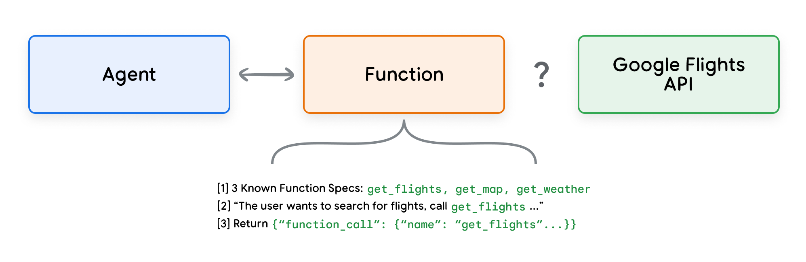
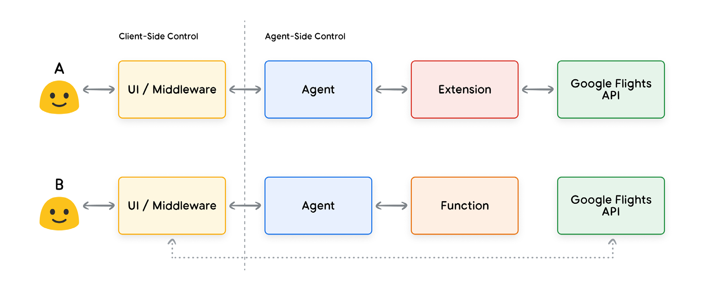
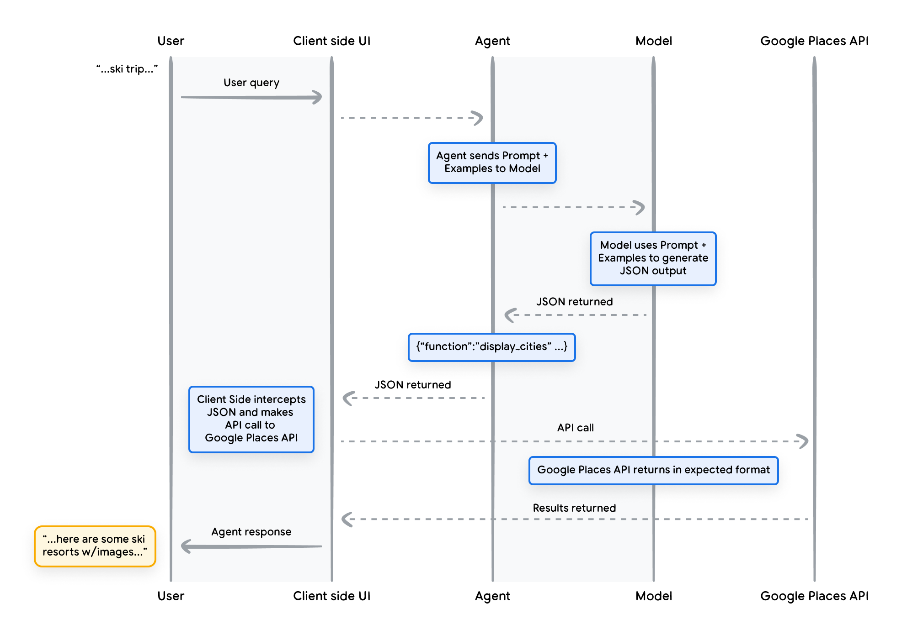

# Functions

<mark>函数</mark>

In the world of software engineering, functions are defined as self-contained modules of code that accomplish a specific task and can be reused as needed. When a software developer is writing a program, they will often create many functions to do various tasks. They will also define the logic for when to call function_a versus function_b, as well as the expected inputs and outputs.

<mark>在软件工程里，函数 (Function) 被定义成自成一体的代码模块：完成一项具体任务，并可以按需要复用。软件开发者写程序时，常常会创建许多函数来做不同的任务。他们还会定义何时调用 function_a、何时调用 function_b 的逻辑，以及预期的输入和输出。</mark>

Functions work very similarly in the world of agents, but we can replace the software developer with a model. A model can take a set of known functions and decide when to use each Function and what arguments the Function needs based on its specification. Functions differ from Extensions in a few ways, most notably:

<mark>函数在智能体 (Agent) 世界里的工作方式非常相似，只是软件开发者换成了模型 (Model)。模型可以拿一组已知函数，根据函数规格决定何时使用每一个函数、以及该函数需要哪些参数。函数与扩展 (Extension) 有几处不同，最显著的是：</mark>

1. A model outputs a Function and its arguments, but doesn’t make a live API call.
2. Functions are executed on the client-side, while Extensions are executed on the agent-side.

<mark>1. 模型输出一个函数及其参数，但并不发起真实的 API 调用。</mark>

<mark>2. 函数在客户端执行，扩展在智能体侧执行。</mark>

Using our Google Flights example again, a simple setup for functions might look like the example in Figure 7.

<mark>再以 Google Flights 为例，函数的一种简单配置可能像图 7 那样。</mark>



<mark>图 7：函数如何与外部 API 交互？智能体与函数双向连接，函数与 Google Flights API 之间仍是问号。示例给出三个已知函数规格（get_flights、get_map、get_weather）、调用说明，以及返回的 function_call。</mark>

Note that the main difference here is that neither the Function nor the agent interact directly with the Google Flights API. So how does the API call actually happen?

<mark>注意，这里的主要差别是：函数和智能体都不直接与 Google Flights API 交互。那么 API 调用实际上是怎么发生的？</mark>

With functions, the logic and execution of calling the actual API endpoint is offloaded away from the agent and back to the client-side application as seen in Figure 8 and Figure 9 below. This offers the developer more granular control over the flow of data in the application. There are many reasons why a Developer might choose to use functions over Extensions, but a few common use cases are:

<mark>使用函数时，调用真实 API 端点的逻辑和执行被从智能体卸下，交回客户端应用，如图 8 和图 9。这让开发者对应用里的数据流有更细的控制。开发者选择函数而不是扩展的理由很多，常见的使用场景包括：</mark>

- API calls need to be made at another layer of the application stack, outside of the direct agent architecture flow (e.g. a middleware system, a front end framework, etc.)
- Security or Authentication restrictions that prevent the agent from calling an API directly (e.g API is not exposed to the internet, or non-accessible by agent infrastructure)
- Timing or order-of-operations constraints that prevent the agent from making API calls in real-time. (i.e. batch operations, human-in-the-loop review, etc.)
- Additional data transformation logic needs to be applied to the API Response that the agent cannot perform. For example, consider an API endpoint that doesn’t provide a filtering mechanism for limiting the number of results returned. Using Functions on the client-side provides the developer additional opportunities to make these transformations.
- The developer wants to iterate on agent development without deploying additional infrastructure for the API endpoints (i.e. Function Calling can act like “stubbing” of APIs)

<mark>- API 调用需要发生在应用栈的另一层，位于智能体架构的直接流程之外（例如中间件系统、前端框架等）。</mark>

<mark>- 安全或认证方面的限制，使智能体不能直接调用 API（例如 API 不暴露在互联网上，或智能体基础设施访问不到）。</mark>

<mark>- 时序或操作顺序上的约束，使智能体不能实时发起 API 调用（例如批处理、人在回路 (Human-in-the-Loop, HITL) 审核等）。</mark>

<mark>- 需要对 API 响应做额外的数据变换，而这是智能体做不了的。例如，某个 API 端点没有过滤机制来限制返回结果的数量。在客户端使用函数，就给开发者多了一些做这些变换的机会。</mark>

<mark>- 开发者想迭代智能体的开发，而不必为 API 端点再部署一套基础设施（也就是说，函数调用 (Function Calling) 可以像给 API 做桩实现 (stubbing) 一样）。</mark>

While the difference in internal architecture between the two approaches is subtle as seen in Figure 8, the additional control and decoupled dependency on external infrastructure makes Function Calling an appealing option for the Developer.

<mark>如图 8 所示，两种做法在内部架构上的差别很细微，但多出来的控制，以及对外部基础设施的解耦，使函数调用对开发者很有吸引力。</mark>



<mark>图 8：扩展与函数调用在客户端控制与智能体侧控制上的划分。A：用户经 UI / 中间件到智能体，再经扩展直达 Google Flights API，调用发生在智能体侧。B：函数停在智能体侧，真正连到 Google Flights API 的是客户端的 UI / 中间件。</mark>

---

## Use cases

<mark>使用场景</mark>

A model can be used to invoke functions in order to handle complex, client-side execution flows for the end user, where the agent Developer might not want the language model to manage the API execution (as is the case with Extensions). Let’s consider the following example where an agent is being trained as a travel concierge to interact with users that want to book vacation trips. The goal is to get the agent to produce a list of cities that we can use in our middleware application to download images, data, etc. for the user’s trip planning. A user might say something like:

<mark>可以用模型来调用函数，以便为最终用户处理复杂的客户端执行流。智能体开发者可能并不希望由语言模型来管理 API 的执行（扩展就是那样做的）。看下面这个例子：一个智能体被训练成旅行礼宾，与想预订度假行程的用户交互。目标是让智能体产出一份城市列表，供中间件应用用来下载图片、数据等，服务用户的行程规划。用户可能会这样说：</mark>

> I’d like to take a ski trip with my family but I’m not sure where to go.
>
> <mark>我想和家人去滑雪，但还不知道去哪里。</mark>

In a typical prompt to the model, the output might look like the following:

<mark>如果用一段普通提示去问模型，输出可能像这样：</mark>

> Sure, here’s a list of cities that you can consider for family ski trips:
>
> - Crested Butte, Colorado, USA
> - Whistler, BC, Canada
> - Zermatt, Switzerland
>
> <mark>好的，下面是一些可以考虑的家庭滑雪城市：</mark>
>
> <mark>- 美国科罗拉多州 Crested Butte</mark>
>
> <mark>- 加拿大不列颠哥伦比亚省 Whistler</mark>
>
> <mark>- 瑞士 Zermatt</mark>

While the above output contains the data that we need (city names), the format isn’t ideal for parsing. With Function Calling, we can teach a model to format this output in a structured style (like JSON) that’s more convenient for another system to parse. Given the same input prompt from the user, an example JSON output from a Function might look like Snippet 5 instead.

<mark>上面的输出里有我们需要的数据（城市名），但格式不适合解析。有了函数调用，可以教模型把输出排成结构化样式（比如 JSON），让另一个系统更容易解析。给定用户同样的输入提示，函数给出的 JSON 输出可能像片段 5 这样。</mark>

```text
function_call {
  name: "display_cities"
  args: {
    "cities": ["Crested Butte", "Whistler", "Zermatt"],
    "preferences": "skiing"
  }
}
```

**Snippet 5. Sample Function Call payload for displaying a list of cities and user preferences**

<mark>片段 5：用于展示城市列表和用户偏好的函数调用载荷示例。</mark>

This JSON payload is generated by the model, and then sent to our Client-side server to do whatever we would like to do with it. In this specific case, we’ll call the Google Places API to take the cities provided by the model and look up Images, then provide them as formatted rich content back to our User. Consider this sequence diagram in Figure 9 showing the above interaction in step by step detail.

<mark>这段 JSON 载荷由模型生成，然后送到客户端服务器，由我们随意处理。在这个具体例子里，我们会调用 Google Places API，用模型给出的城市去查找图片，再把它们整理成富内容返回给用户。图 9 的时序图逐步展示了上述交互。</mark>



<mark>图 9：函数调用生命周期的时序图。用户把滑雪行程查询交给客户端 UI；智能体把提示和示例发给模型；模型生成 JSON（display_cities）；客户端拦截 JSON 并调用 Google Places API；结果返回后，客户端把带图片的滑雪胜地回复给用户。</mark>

The result of the example in Figure 9 is that the model is leveraged to “fill in the blanks” with the parameters required for the Client side UI to make the call to the Google Places API. The Client side UI manages the actual API call using the parameters provided by the model in the returned Function. This is just one use case for Function Calling, but there are many other scenarios to consider like:

<mark>图 9 这个例子的结果是：模型被用来「填空」，填上客户端 UI 调用 Google Places API 所需的参数。客户端 UI 再用返回的函数里由模型提供的参数，去管理真正的 API 调用。这只是函数调用的一个使用场景，还有许多其他情形值得考虑，例如：</mark>

- You want a language model to suggest a function that you can use in your code, but you don't want to include credentials in your code. Because function calling doesn't run the function, you don't need to include credentials in your code with the function information.
- You are running asynchronous operations that can take more than a few seconds. These scenarios work well with function calling because it's an asynchronous operation.
- You want to run functions on a device that's different from the system producing the function calls and their arguments.

<mark>- 你希望语言模型建议一个可以在代码里使用的函数，但又不想把凭证写进代码。因为函数调用并不运行这个函数，所以不必把凭证和函数信息一起放进代码。</mark>

<mark>- 你在跑可能超过几秒的异步操作。这类场景很适合函数调用，因为它本身就是异步操作。</mark>

<mark>- 你希望在另一台设备上运行函数，而这台设备并不是产生函数调用及其参数的那个系统。</mark>

One key thing to remember about functions is that they are meant to offer the developer much more control over not only the execution of API calls, but also the entire flow of data in the application as a whole. In the example in Figure 9, the developer chose to not return API information back to the agent as it was not pertinent for future actions the agent might take. However, based on the architecture of the application, it may make sense to return the external API call data to the agent in order to influence future reasoning, logic, and action choices. Ultimately, it is up to the application developer to choose what is right for the specific application.

<mark>关于函数，有一件事要记住：它们的用意是让开发者获得多得多的控制，不仅控制 API 调用的执行，也控制整个应用里的数据流。在图 9 的例子里，开发者选择不把 API 信息返回给智能体，因为那些信息与智能体以后可能采取的行动无关。不过，根据应用的架构，把外部 API 调用的数据返回给智能体也可能是合理的，以便影响以后的推理 (Reasoning)、逻辑和行动选择。最终，具体应用该怎么做，由应用开发者来定。</mark>

---

## Function sample code

<mark>函数示例代码</mark>

To achieve the above output from our ski vacation scenario, let’s build out each of the components to make this work with our gemini-1.5-flash-001 model.

<mark>要在滑雪度假这个场景里得到上面的输出，我们把各个组件搭起来，让它在 gemini-1.5-flash-001 模型上工作。</mark>

First, we’ll define our display_cities function as a simple Python method.

<mark>首先，把 display_cities 函数定义成一个简单的 Python 方法。</mark>

```python
def display_cities(cities: list[str], preferences: Optional[str] = None):
    """Provides a list of cities based on the user's search query and preferences.

    Args:
        preferences (str): The user's preferences for the search, like skiing,
            beach, restaurants, bbq, etc.
        cities (list[str]): The list of cities being recommended to the user.

    Returns:
        list[str]: The list of cities being recommended to the user.
    """
    return cities
```

**Snippet 6. Sample python method for a function that will display a list of cities.**

<mark>片段 6：一个用于展示城市列表的函数的 Python 方法示例。</mark>

Next, we’ll instantiate our model, build the Tool, then pass in our user’s query and tools to the model. Executing the code below would result in the output as seen at the bottom of the code snippet.

<mark>接下来实例化模型，构建工具 (Tool)，再把用户查询和工具传给模型。执行下面的代码，会得到代码片段底部那样的输出。</mark>

```python
from vertexai.generative_models import GenerativeModel, Tool, FunctionDeclaration

model = GenerativeModel("gemini-1.5-flash-001")
display_cities_function = FunctionDeclaration.from_func(display_cities)
tool = Tool(function_declarations=[display_cities_function])
message = "I'd like to take a ski trip with my family but I'm not sure where to go."
res = model.generate_content(message, tools=[tool])
print(f"Function Name: {res.candidates[0].content.parts[0].function_call.name}")
print(f"Function Args: {res.candidates[0].content.parts[0].function_call.args}")
```

```text
> Function Name: display_cities
> Function Args: {'preferences': 'skiing', 'cities': ['Aspen', 'Vail', 'Park City']}
```

**Snippet 7. Building a Tool, sending to the model with a user query and allowing the function call to take place**

<mark>片段 7：构建一个工具，连同用户查询一起发给模型，并让函数调用发生。</mark>

In summary, functions offer a straightforward framework that empowers application developers with fine-grained control over data flow and system execution, while effectively leveraging the agent/model for critical input generation. Developers can selectively choose whether to keep the agent “in the loop” by returning external data, or omit it based on specific application architecture requirements.

<mark>总结一下：函数提供了一个直截了当的框架，让应用开发者对数据流和系统执行有细粒度的控制，同时有效地借助智能体 / 模型来生成关键输入。开发者可以选择把外部数据返回去，让智能体留在回路里，也可以根据具体的应用架构要求把它省掉。</mark>
