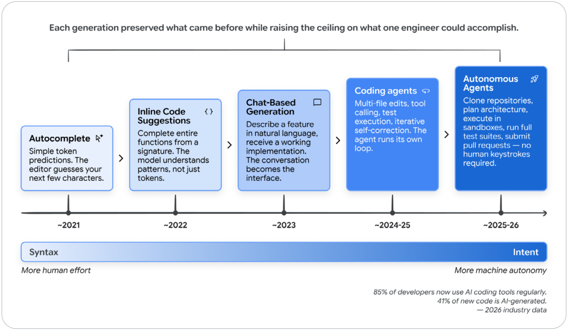

# Introduction

<mark>引言</mark>

For most of computing history, programming has been an act of translation: understand the problem in human terms, design a solution in abstract terms, then render it in syntax a machine can execute. Each step introduces friction. That friction is now collapsing. Software engineering is undergoing its most significant transformation since the introduction of high-level programming languages. For decades, the developer's primary interface with the machine has been syntax: curly braces, semicolons, type annotations, and the precise grammar of programming languages. That era is ending.

<mark>在计算史的大部分时间里，编程都是一种翻译：先用人的语言理解问题，再用抽象语言设计方案，最后把它写成机器能执行的语法。每一步都带来摩擦。这种摩擦正在消失。软件工程正在经历自高级编程语言出现以来最重大的转变。几十年来，开发者与机器的主要界面一直是语法：花括号、分号、类型标注，以及编程语言精确的文法。那个时代正在结束。</mark>

> The most profound shift in software engineering isn't a new language, framework, or cloud service. It's the transition from writing code to expressing intent, and trusting intelligent systems to translate that intent into working software.

<mark>软件工程最深刻的转变，不是一门新语言、一个新框架或一项云服务。它是从写代码转向表达意图，并信任智能系统把意图翻译成能运行的软件。</mark>

---

A new paradigm has arrived in which developers express what they want to build rather than how to build it. The machine handles implementation. The human provides intent, architecture, and judgment. This isn't a distant future - it's the daily reality for a rapidly growing number of professional developers. As of early 2026, 85% of professional developers regularly use AI Coding Agents, 51% use them daily, and an estimated 41% of all new code is AI-generated.1

<mark>一种新范式已经到来：开发者表达想构建什么，而不是如何构建。机器负责实现。人提供意图、架构和判断。这不是遥远的未来，而是越来越多职业开发者的日常。截至 2026 年初，85% 的职业开发者经常使用 AI 编码智能体 (AI Coding Agent)，51% 每天使用，估计全部新代码中有 41% 由 AI 生成。1</mark>

This shift didn't happen overnight. It began with autocomplete - simple token prediction in the editor. Then came inline code suggestions that could complete entire functions. Next, chat-based interfaces allowed developers to describe features in natural language and receive working implementations. Now, fully autonomous agents can clone repositories, plan multi-file changes, execute them in sandboxed environments, run tests, and submit pull requests - all without a human typing a single line of code.

<mark>这一转变不是一夜之间发生的。它从自动补全开始，也就是编辑器里简单的 token 预测。接着是能补全整个函数的行内代码建议。然后，基于对话的界面让开发者用自然语言描述功能，并收到可运行的实现。现在，完全自主的智能体 (Agent) 可以克隆仓库、规划多文件改动、在沙箱环境里执行、运行测试并提交拉取请求 (pull request)，全程不需要人敲一行代码。</mark>

<mark>图 1：从自动补全到自主。每一代都保留前一代的能力，同时抬高单个工程师能完成的上限。时间轴从约 2021 年的自动补全、约 2022 年的行内代码建议、约 2023 年的对话式生成、约 2024–25 年的编码智能体，到约 2025–26 年的自主智能体。底部从语法（更多人力）过渡到意图（更多机器自主）。</mark>

---

The implications for the software development life cycle (SDLC) are profound. Every phase - from requirements gathering to deployment to maintenance - is being reshaped by AI capabilities. But this transformation isn't uniform or simple. The spectrum ranges from casual "vibe coding," where a developer prompts an AI and accepts whatever comes back, to disciplined "agentic engineering," where AI acts as a powerful implementation engine within carefully designed systems of constraints, tests, and feedback loops, with humans retaining oversight over architecture, correctness, and quality.

<mark>这对软件开发生命周期 (software development life cycle, SDLC) 的影响是深刻的。从需求收集到部署再到维护，每个阶段都在被 AI 能力重塑。但这次转变并不均匀，也不简单。光谱的一端是随意的「氛围编码 (vibe coding)」：开发者给 AI 下提示，返回什么就接受什么。另一端是有纪律的「智能体工程 (agentic engineering)」：AI 在精心设计的约束、测试和反馈回路里充当强大的实现引擎，人仍掌管架构、正确性和质量。</mark>

The distinction matters. Telling a CTO that your team is vibe coding their payment processing system will, and should, raise alarm bells. Telling that same CTO that your team practices agentic engineering, with AI handling implementation under human-designed constraints while test coverage ensures correctness, is a fundamentally different conversation.

<mark>这个区分很重要。告诉一位 CTO，你的团队正在用氛围编码做他们的支付处理系统，会、也应该拉响警报。告诉同一位 CTO，你的团队在做智能体工程：AI 在人设计的约束下负责实现，测试覆盖保证正确性，这是完全不同的一场对话。</mark>

This paper provides the foundation for that conversation. We trace the spectrum from casual vibe coding to disciplined agentic engineering, examine how the developer's role is shifting from writing code to exercising judgment — from conductor to orchestrator — and lay out what it takes to adopt these tools in ways that produce software you can actually depend on.

<mark>这篇为那场对话打下基础。我们沿着从随意的氛围编码到有纪律的智能体工程这条光谱往下走，考察开发者的角色如何从写代码转向行使判断，从指挥 (conductor) 转向编排者 (orchestrator)，并说明要怎样采用这些工具，才能产出真正可以依赖的软件。</mark>

---

## Why this paper, why now

<mark>为什么是这篇，为什么是现在</mark>

New tools, capabilities, and paradigms emerge weekly. Engineering teams need a framework for making sense of this landscape - not a snapshot that will be outdated in months, but a set of principles and mental models that will remain useful as the specific tools evolve.

<mark>新工具、新能力和新范式每周都在出现。工程团队需要一个框架来理解这片图景。它不该是几个月后就会过时的快照，而该是一组原则和心智模型，在具体工具演变之后仍然有用。</mark>

---

## Who this paper is for

<mark>这篇写给谁</mark>

This paper is for software engineers, engineering managers, architects, and technical leaders who want to understand how AI is reshaping the SDLC and adopt these new capabilities without sacrificing the discipline that production software demands. We assume familiarity with modern software development practices but not with the specifics of AI or machine learning.

<mark>这篇写给软件工程师、工程经理、架构师和技术负责人：他们想理解 AI 如何重塑 SDLC，并在采用这些新能力时，不牺牲生产软件所要求的纪律。我们假定读者熟悉现代软件开发实践，但不假定他们熟悉 AI 或机器学习的细节。</mark>
