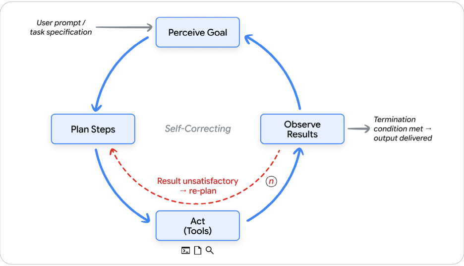
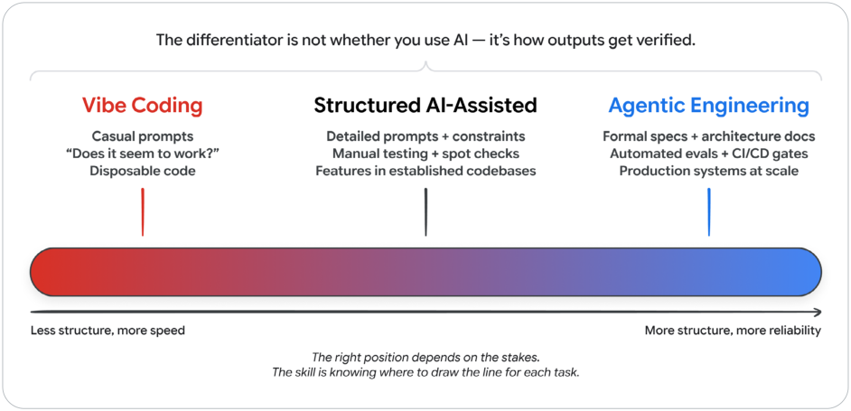
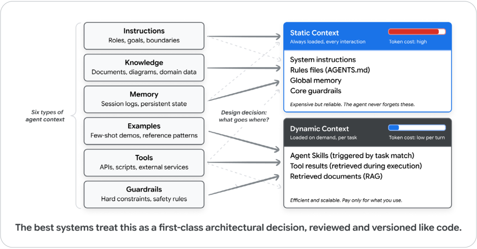

# The shift from syntax to intent

<mark>从语法到意图</mark>

Before we go further, we need a shared picture of what an agent is and what vibe coding actually means. Both terms have accumulated enough meanings that they need to be unpacked carefully.

<mark>继续往下之前，我们需要对智能体 (Agent) 是什么、氛围编码 (vibe coding) 到底指什么，有一幅共同的图。这两个词已经攒下太多含义，需要仔细拆开。</mark>

---

## AI Agents: A Quick Refresher

<mark>AI 智能体：快速回顾</mark>

An AI agent is a software system that perceives a goal, plans steps to reach it, takes actions through tools, observes the results, and iterates until the goal is met or it hits a stopping condition. Where a chatbot produces a response and waits for the next prompt, an agent runs its own loop. You give it a goal at the top, then it decides what to do next at each step.

<mark>AI 智能体是这样一套软件系统：它感知一个目标，规划到达目标的步骤，通过工具 (Tools) 采取行动，观察结果，然后迭代，直到目标达成或碰到停止条件。聊天机器人给出一次回复，然后等下一条提示；智能体则运行自己的循环。你在顶层给它一个目标，之后每一步做什么由它自己决定。</mark>

<mark>图 2：智能体循环。感知目标、规划步骤、用工具行动、观察结果，然后迭代。用户提示或任务规格进入「感知目标」；结果不满意就重新规划；满足终止条件后交付输出。</mark>

---

Every agent, however simple or sophisticated, is built from five parts. The November 2025 Introduction to Agents whitepaper covers each in depth.2 For our purposes here, the short version:

<mark>每一个智能体，无论简单还是复杂，都由五个部分构成。2025 年 11 月的《智能体入门》白皮书对每一部分都有深入说明。2 这里只给短版本：</mark>

- The model is the reasoning engine. It reads the current context, decides what should happen next, and produces the next thought, the next tool call, or the next message.

<mark>模型 (Model) 是推理 (Reasoning) 引擎。它阅读当前上下文，决定下一步该发生什么，并产出下一个想法、下一次工具调用，或下一条消息。</mark>

- Tools connect the model to the world. They include APIs the agent can call, code it can execute, databases it can query, and other agents it can delegate to.

<mark>工具把模型连接到世界。其中包括智能体可以调用的 API、可以执行的代码、可以查询的数据库，以及可以委派的其他智能体。</mark>

- Memory is the state. It allows the agent to recall past interactions, retrieve project-specific rules, and retain context across sessions so it never starts from a blank slate.

<mark>记忆 (Memory) 是状态。它让智能体回想起过去的交互，取回项目专属的规则，并在会话之间保留上下文，从而不必从一张白纸开始。</mark>

- Orchestration is the code that runs the loop. It assembles the context for each model call, dispatches tool calls, captures their results, and decides whether to continue.

<mark>编排 (Orchestration) 是运行这个循环的代码。它为每一次模型调用组装上下文，分发工具调用，捕获结果，并决定是否继续。</mark>

- Deployment is what turns the prototype into a service: hosting, identity, observability, and the production infrastructure the agent runs on.

<mark>部署 (Deployment) 把原型变成服务：托管、身份、可观测性，以及智能体运行其上的生产基础设施。</mark>

These four parts work together in a continuous loop: get the mission, scan the scene, think it through, take action, observe and iterate. The loop is the beating heart of every agent. Everything else in this paper, and everything in the rest of the course, is a variation on this loop.

<mark>这四个部分在一个连续循环里协同：领到任务，扫视现场，想清楚，采取行动，观察并迭代。这个循环是每一个智能体跳动的心脏。这篇里的其余内容，以及这门课剩下的全部内容，都是这个循环的变体。</mark>

---

## What is vibe coding?

<mark>什么是氛围编码？</mark>

In February 2025, Andrej Karpathy posted a description of a new way of programming that resonated widely across the software engineering community. He described an approach where you "fully give in to the vibes, embrace exponentials, and forget that the code even exists." In this mode, a developer describes what they want in natural language, accepts the AI's output, and when something breaks, copies the error message back into the prompt and asks the AI to fix it.2

<mark>2025 年 2 月，Andrej Karpathy 发了一段对新编程方式的描述，在软件工程社区里引起广泛共鸣。他描述的做法是「完全顺从氛围，拥抱指数，甚至忘掉代码的存在」。在这种模式下，开发者用自然语言描述想要什么，接受 AI 的输出；出了问题，就把错误信息复制回提示，让 AI 去修。2</mark>

The term went viral because it captured something real: many developers were already working this way but hadn't had language for it. Within months, "vibe coding" became a common descriptor for any AI-assisted development workflow, which created confusion. Is a senior engineer using an AI assistant to implement a well-specified feature "vibe coding"? Is a team using AI agents to execute a carefully planned architecture? The term was applied so broadly it began to lose meaning.

<mark>这个词爆火，是因为它抓住了真实的事：很多开发者已经在这样工作，只是没有语言来称呼它。几个月内，「氛围编码」成了任何 AI 辅助开发工作流的通用说法，混乱也随之而来。资深工程师用 AI 助手实现一个规格清楚的功能，算氛围编码吗？一个团队用 AI 智能体去执行精心规划的架构，算吗？这个词用得太宽，开始失去意义。</mark>

By early 2026, Karpathy himself acknowledged that the original framing was too narrow, introducing the term "agentic engineering" to describe the more disciplined end of the spectrum.4

<mark>到 2026 年初，Karpathy 自己也承认最初的框定太窄，并提出「智能体工程 (agentic engineering)」这个词，用来描述光谱上更有纪律的那一端。4</mark>

---

## The spectrum: vibe coding to agentic engineering

<mark>光谱：从氛围编码到智能体工程</mark>

Rather than treating vibe coding and agentic engineering as a binary, we find it more useful to think of them as endpoints on a spectrum. The key differentiator is not whether you use AI. It's how much structure, verification, and human judgment surrounds the AI's output.

<mark>与其把氛围编码和智能体工程当成二元对立，不如把它们看成光谱的两端，这样更有用。关键差别不是你用不用 AI，而是 AI 的输出周围有多少结构、验证和人的判断。</mark>

**Table 1: The Spectrum from Vibe Coding to Agentic Engineering**

<mark>表 1：从氛围编码到智能体工程的光谱</mark>

| Dimension | Vibe Coding | Structured AI-Assisted Coding | Agentic Engineering |
| --- | --- | --- | --- |
| Intent specification | Casual natural language prompts | Detailed prompts with examples and constraints | Formal specs, architecture docs, memory files |
| Verification | "Does it seem to work?" | Manual testing, spot-checking | Automated test suites, CI/CD gates, LM judges |
| Codebase understanding | Minimal; developer may not read the generated code | Selective review of critical paths | Comprehensive review of architecture; AI handles implementation details |
| Error handling | Copy-paste error messages back to the AI | Developer diagnoses root cause, AI implements fix | Agents self-diagnose within defined bounds; humans handle architectural issues |
| Appropriate scope | Prototypes, scripts, personal projects, hackathons | Features within established codebases | Production systems, team-scale development |
| Risk profile | High; acceptable for disposable code | Moderate; human judgment at key checkpoints | Low; systematic verification at every stage |

| <mark>维度</mark> | <mark>氛围编码</mark> | <mark>有结构的 AI 辅助编码</mark> | <mark>智能体工程</mark> |
| --- | --- | --- | --- |
| <mark>意图规格</mark> | <mark>随意的自然语言提示</mark> | <mark>带示例和约束的详细提示</mark> | <mark>正式规格、架构文档、记忆文件</mark> |
| <mark>验证</mark> | <mark>「看起来能跑吗？」</mark> | <mark>手工测试、抽查</mark> | <mark>自动化测试套件、CI/CD 门禁、语言模型评委 (LM judge)</mark> |
| <mark>对代码库的理解</mark> | <mark>很少；开发者可能不读生成的代码</mark> | <mark>选择性评审关键路径</mark> | <mark>全面评审架构；AI 处理实现细节</mark> |
| <mark>错误处理</mark> | <mark>把错误信息复制粘贴回 AI</mark> | <mark>开发者诊断根因，AI 实现修复</mark> | <mark>智能体在划定边界内自我诊断；人处理架构问题</mark> |
| <mark>适用范围</mark> | <mark>原型、脚本、个人项目、黑客松</mark> | <mark>既有代码库里的功能</mark> | <mark>生产系统、团队规模的开发</mark> |
| <mark>风险画像</mark> | <mark>高；对一次性代码可以接受</mark> | <mark>中等；关键检查点上有人的判断</mark> | <mark>低；每个阶段都有系统化验证</mark> |

<mark>图 3：从氛围编码到智能体工程的光谱。差别不在于用不用 AI，而在于输出如何被验证。左端结构更少、速度更快；右端结构更多、可靠性更高。落在哪个位置取决于利害，技能在于知道每项任务该把线画在哪里。</mark>

---

The single biggest differentiator between the two ends is how outputs get verified. In vibe coding, verification is optional; the developer runs the code and checks if it seems right. In agentic engineering, two mechanisms work together. Tests verify the deterministic parts of the system: a function given this input produces that output. Evaluations, or evals, verify the parts that are not deterministic: did the agent take the right trajectory of steps, choose the right tools, and produce a final response that meets the quality bar. Tests are checked by code; evals are checked by labelled datasets, scoring rubrics, and LM judges. Without both, the practice is always vibe coding, regardless of how sophisticated the prompts are.

<mark>两端之间最大的单一差别，是输出如何被验证。在氛围编码里，验证是可选的：开发者跑一下代码，看看是不是对的。在智能体工程里，两种机制一起工作。测试验证系统里确定性的部分：给定这个输入，函数产出那个输出。评估 (evaluation)，也就是 eval，验证非确定性的部分：智能体是否走了正确的步骤轨迹 (trajectory)，是否选了正确的工具，最终响应是否达到质量线。测试由代码检查；评估由标注数据集、评分量规和语言模型评委检查。两者缺一，这种实践就始终是氛围编码，无论提示写得多精巧。</mark>

> **Applied Tip**
>
> The right position on this spectrum depends on the stakes. A weekend prototype can be pure vibe coding. A production API handling financial transactions demands agentic engineering. Most real work falls somewhere in between, and the skill is knowing where to draw the line for each task.

> **<mark>实践提示</mark>**
>
> <mark>在这条光谱上站在哪，取决于利害有多大。周末原型可以是纯粹的氛围编码。处理金融交易的生产 API 要求智能体工程。大多数真实工作落在中间某处，技能在于知道每项任务该把线画在哪里。</mark>

---

## Context engineering: the real skill

<mark>上下文工程 (Context Engineering)：真正的技能</mark>

As the field has matured, a key insight has emerged: the quality of AI-generated code depends less on the cleverness of your prompts and more on the quality of the context provided. This realization has given rise to the concept of context engineering, the practice of providing AI agents with rich, structured information about your codebase, architecture, conventions, and intent.5

<mark>随着这个领域成熟，一个关键认识出现了：AI 生成代码的质量，较少取决于提示有多巧妙，更多取决于提供的上下文质量。由此产生了上下文工程 (context engineering) 这个概念：把关于代码库、架构、约定和意图的丰富、结构化信息提供给 AI 智能体。5</mark>

Developers must consider six primary types of context:

<mark>开发者必须考虑六种主要的上下文：</mark>

- Instructions: The agent's core role, goals, and operational boundaries.

<mark>指令：智能体的核心角色、目标和操作边界。</mark>

- Knowledge: Retrieved documents, architectural diagrams, and domain-specific data.

<mark>知识：检索到的文档、架构图和领域数据。</mark>

- Memory: Short-term session logs (what just happened) and long-term persistent state (what the project is).

<mark>记忆：短期会话日志（刚刚发生了什么）和长期持久状态（这个项目是什么）。</mark>

- Examples: Few-shot behavioral demonstrations and codebase reference patterns.

<mark>示例：少样本的行为示范，以及代码库里的参考模式。</mark>

- Tools: The precise definitions of the APIs, scripts, and external services the agent can invoke.

<mark>工具：智能体可以调用的 API、脚本和外部服务的精确定义。</mark>

- Guardrails: Hard constraints, formatting rules, and safety validations.

<mark>护栏 (Guardrails)：硬约束、格式规则和安全校验。</mark>

In AI code generation, context engineering involves carefully balancing which of these six elements the agent possesses upfront versus what it can retrieve on demand. This creates a critical separation between static and dynamic context.

<mark>在 AI 代码生成里，上下文工程要仔细平衡：这六类要素里，哪些智能体一开始就拥有，哪些可以按需检索。由此形成静态上下文与动态上下文之间关键的分离。</mark>

Static context is always loaded: system instructions, rule files (AGENTS.md, CLAUDE.md, GEMINI.md), global memory, and persona definitions. It defines who the agent is and how it behaves. Static context is expensive because every token is present in every interaction, regardless of relevance.

<mark>静态上下文 (static context) 始终加载：系统指令、规则文件（AGENTS.md、CLAUDE.md、GEMINI.md）、全局记忆和人格定义。它定义智能体是谁、如何行为。静态上下文很贵，因为每一个 token 都出现在每一次交互里，无论相不相关。</mark>

Dynamic context is loaded on demand: skill instructions triggered by task matching, tool results retrieved during execution, documents fetched from RAG pipelines, and windowed session history. Dynamic context is efficient because the agent pays the token cost only when the information is needed.

<mark>动态上下文 (dynamic context) 按需加载：由任务匹配触发的技能指令、执行过程中取回的工具结果、从检索增强生成 (RAG) 管道取回的文档，以及窗口化的会话历史。动态上下文更省，因为智能体只在需要这些信息时才支付 token 成本。</mark>

The design decision of what belongs in static context versus dynamic context is a genuine engineering trade-off. Too much static context wastes tokens and dilutes signals. Too little means the agent forgets critical rules. The best systems treat this boundary as a first-class architectural decision, reviewed and versioned like any other configuration.

<mark>什么放进静态上下文、什么放进动态上下文，是一个真正的工程权衡。静态上下文太多会浪费 token，并稀释信号。太少则意味着智能体忘掉关键规则。最好的系统把这条边界当成一等的架构决策，像其他配置一样评审、版本化。</mark>

<mark>图 4：上下文工程，静态与动态。六类智能体上下文（指令、知识、记忆、示例、工具、护栏）要决定各自去向。静态上下文每次交互都加载，token 成本高，但可靠。动态上下文按任务按需加载，token 成本低，只为用到的东西付费。最好的系统把这当成一等架构决策，像代码一样评审和版本化。</mark>

---

The most powerful pattern for managing dynamic context is Agent Skills: structured, portable packages of procedural knowledge that the agent loads only when the task calls for it.

<mark>管理动态上下文最有力的模式是智能体技能 (Agent Skills)：结构化、可携带的程序性知识包，只在任务需要时才由智能体加载。</mark>

Rather than embedding every piece of specialized knowledge into the agent's system prompt, skills allow the agent to remain a lightweight generalist that flexes into specialist roles on demand through progressive disclosure. The agent sees only lightweight metadata at startup, loads full instructions when a task matches, and pulls deep reference material only when explicitly needed. The result is that an agent can carry dozens of specialized capabilities while paying the token cost for only the one it is actively using.

<mark>不必把每一块专门知识都嵌进智能体的系统提示。技能让智能体保持为一个轻量的通才，再通过渐进式披露 (progressive disclosure) 按需变成专家。启动时智能体只看到轻量元数据，任务匹配时才加载完整指令，只有明确需要时才拉取深层参考材料。结果是，一个智能体可以携带几十种专门能力，却只为正在使用的那一种支付 token 成本。</mark>

Agent Skills have seen rapid adoption across major coding agents and enterprise platforms because they solve four problems that have plagued AI agent development:

<mark>智能体技能在主要编码智能体和企业平台上被迅速采用，因为它们解决了困扰 AI 智能体开发的四个问题：</mark>

- Context rot from overloaded prompts

<mark>提示过载带来的上下文腐烂 (context rot)</mark>

- Absence of procedural memory for LLMs

<mark>大语言模型 (LLM) 缺少程序性记忆</mark>

- Operational overhead of multi-agent architectures

<mark>多智能体架构的运维开销</mark>

- Need for portability across tools and vendors

<mark>需要在工具和厂商之间可移植</mark>

This section introduced the core principles of context engineering: the six types of context every agent needs, the trade-off between static and dynamic context, and Agent Skills as the key pattern for managing that trade-off at scale.

<mark>这一节介绍了上下文工程的核心原则：每个智能体需要的六类上下文，静态与动态上下文之间的权衡，以及智能体技能作为在规模上管理这一权衡的关键模式。</mark>

The companion Day-3 paper in this series on Context Engineering: Sessions, Skills & Memory takes each of these ideas further, covering how to design and manage sessions, write and evaluate skills, build persistent memory across interactions, and optimize token economics for production systems.

<mark>本系列第 3 天的配套论文《上下文工程：会话、技能与记忆》把这些想法再往前推，涵盖如何设计和管理会话、编写并评估技能、跨交互建立持久记忆，以及为生产系统优化 token 经济。</mark>

The shift from "prompt engineering" to "context engineering" reflects a deeper truth about working with AI. Models don't need cleverly worded instructions as much as they need the same context that a skilled human developer would need to do good work. The question isn't "how do I trick the AI into writing good code?" It's "what would a new team member need to know to contribute effectively, and how do I encode that knowledge in a form the AI can use?"

<mark>从「提示工程 (prompt engineering)」到「上下文工程」的转变，反映了与 AI 共事的一层更深的事实。模型需要的，与其说是措辞巧妙的指令，不如说是一个熟练的人类开发者要做好工作所需要的同一份上下文。问题不是「我怎样骗 AI 写出好代码？」而是「一个新队友要有效贡献，需要知道什么，我又如何把这些知识编码成 AI 能用的形式？」</mark>

Context engineering is the bridge between vibe coding and agentic engineering. It is also the bridge between this section and the next one, where we look at the structure that surrounds every model and makes it useful.

<mark>上下文工程是氛围编码与智能体工程之间的桥。它也是这一节与下一节之间的桥。下一节我们看包裹每一个模型、并让它变得有用的那层结构。</mark>
