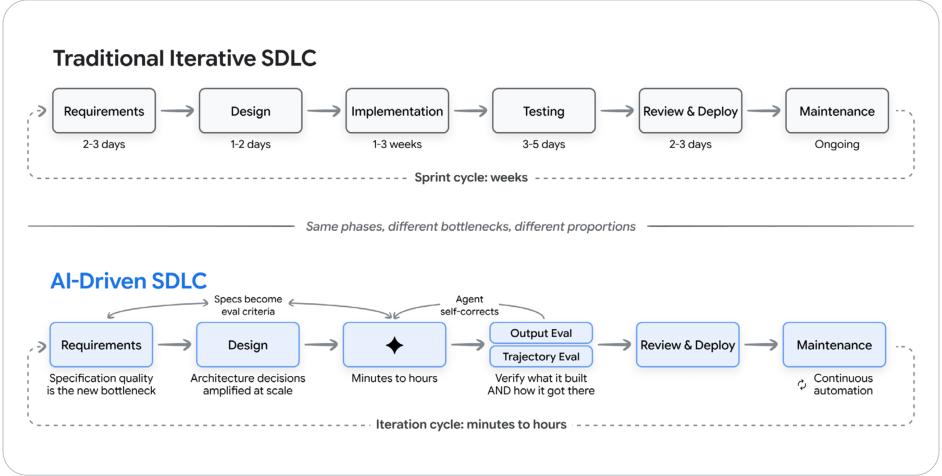
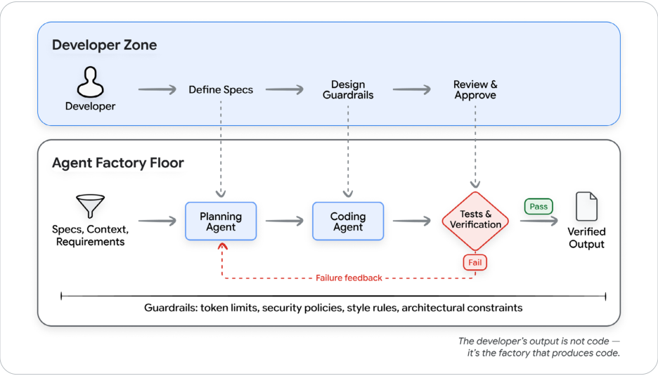

# The new software development life cycle

<mark>新的软件开发生命周期</mark>

By shifting our focus from writing syntax to engineering this context, the bottlenecks in software creation fundamentally change. We are no longer waiting on human hands to type boilerplate; we are waiting on human minds to define the boundaries. This necessitates a complete reimagining of the traditional Software Development Life Cycle (SDLC), as the systems we use to build software now dictate the speed at which it is delivered.

<mark>把注意力从写语法转向工程化这份上下文之后，软件创造的瓶颈从根本上变了。我们不再等人类的手去敲样板代码；我们在等人的头脑去划定边界。这要求彻底重新想象传统的软件开发生命周期 (Software Development Life Cycle, SDLC)，因为我们用来构建软件的系统，现在决定了它被交付的速度。</mark>

---

## The traditional SDLC under pressure

<mark>承压的传统 SDLC</mark>

The software development life cycle has already been through one major transformation. Over the past two decades, most enterprises moved from sequential waterfall processes to iterative models: Agile sprints, continuous integration, DevOps pipelines, and rapid release cycles. That shift shortened feedback loops, brought testing closer to development, and made deployment a continuous process rather than a quarterly event.

<mark>软件开发生命周期已经经历过一次重大转变。过去二十年里，大多数企业从顺序的瀑布过程转向迭代模型：敏捷冲刺、持续集成、DevOps 流水线，以及快速发布周期。那次转变缩短了反馈回路，让测试更靠近开发，并把部署从季度事件变成连续过程。</mark>

AI compresses this cycle dramatically, but unevenly: implementation that once took weeks can now be done in hours, while requirements, architecture, and verification remain stubbornly human-paced. The result is not a faster version of the old SDLC. It is a different workflow, where the boundaries between phases blur, iteration cycles shorten from weeks to minutes, and the developer's role shifts from primary implementor to system designer and quality arbiter.

<mark>AI 剧烈地压缩这个周期，但压缩得并不均匀：曾经要几周的实现现在可以几小时完成，而需求、架构和验证仍然顽固地按人的节奏走。结果不是旧 SDLC 的加速版。它是另一种工作流：阶段之间的边界变模糊，迭代周期从几周缩短到几分钟，开发者的角色从主要实现者转向系统设计者和质量仲裁者。</mark>

<mark>图 5：传统 SDLC 与 AI 驱动的 SDLC。阶段相同，瓶颈和比例不同。传统迭代 SDLC 的冲刺以周计：需求 2–3 天，设计 1–2 天，实现 1–3 周，测试 3–5 天，评审与部署 2–3 天，维护持续进行。AI 驱动的 SDLC 里，规格质量成为新瓶颈，架构决策在规模上被放大，实现缩短到几分钟到几小时，测试同时做输出评估和轨迹评估，维护变成持续自动化。迭代周期是几分钟到几小时。</mark>

---

A note on pace of change: The phase-by-phase picture described above reflects the state of AI-driven SDLC as of mid-2026. It is shifting fast. Early signs suggest that the compression will spread beyond implementation: teams are already experimenting with workflows where developers go directly from specs to review, with AI agents handling implementation, testing, and deployment in the background. The boundaries drawn in this section may look different in 12 months. What will remain constant is human judgment, taste, and the skill to verify AI output as the machines take on more of the implementation.

<mark>关于变化速度的说明：上面按阶段画出的图，反映的是 2026 年中 AI 驱动 SDLC 的状态。它变得很快。早期迹象表明，压缩会超出实现这一段：团队已经在试验这样的工作流，开发者直接从规格走到评审，AI 智能体 (Agent) 在后台处理实现、测试和部署。这一节画出的边界，12 个月后可能看起来不一样。会保持不变的，是人的判断、品味，以及在机器承担更多实现时验证 AI 输出的技能。</mark>

---

## How AI transforms each phase

<mark>AI 如何改变每个阶段</mark>

### Requirements and planning

<mark>需求与规划</mark>

Requirements is the phase where the gap between intent and implementation has historically been widest. Translating business needs into technical specifications has been a manual, error-prone process that creates a persistent gap between what stakeholders want and what engineers build.

<mark>需求是意图与实现之间的鸿沟历史上最宽的阶段。把业务需要翻译成技术规格，一直是手工的、容易出错的过程，并在干系人想要的东西和工程师构建的东西之间留下持久的缺口。</mark>

Modern AI tools can participate directly in requirements refinement: generating user stories from product briefs, identifying edge cases that humans miss, producing API schemas from natural-language descriptions, and generating interactive prototypes from specification documents. Agentic development environments allow developers to go from a description to a working prototype in minutes, collapsing the requirements-to-prototype feedback loop to near zero.

<mark>现代 AI 工具可以直接参与需求精炼：从产品简报生成用户故事，找出人会漏掉的边界情况，从自然语言描述产出 API 模式，并从规格文档生成交互原型。智能体开发环境让开发者在几分钟内从一段描述走到可运行的原型，把需求到原型的反馈回路压到接近于零。</mark>

Requirements stop being a document handed off between teams. They become a conversation between humans and AI that produces specification and initial implementation simultaneously.

<mark>需求不再是团队之间交接的一份文档。它们变成人和 AI 之间的一场对话，同时产出规格和最初的实现。</mark>

### Design and architecture

<mark>设计与架构</mark>

Architecture remains the most stubbornly human-centric phase of the SDLC, and for good reason. Architectural decisions are fundamentally about trade-offs: consistency vs. availability, complexity vs. flexibility, build vs. buy. These trade-offs depend on business context, organisational constraints, and long-term strategic considerations that AI cannot fully grasp.

<mark>架构仍然是 SDLC 里最顽固地以人为中心的阶段，而且理应如此。架构决策本质上是权衡：一致性对可用性，复杂度对灵活性，自建对购买。这些权衡取决于业务上下文、组织约束和长期战略考量，AI 无法完全把握。</mark>

AI excels at implementing architectural decisions once they are made. Given a clear architecture document, AI agents can scaffold entire applications, generate consistent patterns across modules, and ensure that new code conforms to established conventions. The developer's role shifts from writing boilerplate to making and documenting the structural decisions that boilerplate implements.

<mark>架构决策一旦做出，AI 就很擅长把它们实现出来。给一份清楚的架构文档，AI 智能体可以搭建整个应用的骨架，跨模块生成一致的模式，并确保新代码符合既有约定。开发者的角色从写样板代码，转向做出并记录那些样板代码所实现的结构性决策。</mark>

### Implementation

<mark>实现</mark>

Modern coding agents can generate entire features from natural-language descriptions, implement complex algorithms, and produce multi-file changes that work together correctly. The productivity gains are real: industry surveys report 25 to 39% productivity improvements, with some tasks seeing larger gains.7

<mark>现代编码智能体可以从自然语言描述生成整个功能，实现复杂算法，并产出能正确协同的多文件改动。生产力收益是真实的：行业调查报告有 25% 到 39% 的生产力提升，有些任务的收益更大。7</mark>

The picture is more nuanced than headline numbers suggest. A study by METR found that experienced developers using AI assistants actually took 19% longer on certain tasks, largely because of the time spent verifying, debugging, and correcting AI output.8 AI does not eliminate implementation work so much as transform it from writing to reviewing, guiding, and verifying.

<mark>图景比标题数字更细。METR 的一项研究发现，使用 AI 助手的有经验开发者在某些任务上实际多花了 19% 的时间，主要是因为花在验证、调试和纠正 AI 输出上的时间。8 AI 并没有消除实现工作，更多是把它从书写转变成评审、引导和验证。</mark>

### Testing and quality assurance

<mark>测试与质量保证</mark>

Testing AI-generated code requires evaluating not just what the agent produced, but how it got there. Output evaluation checks the final artifact: does the code compile, do the tests pass? Trajectory evaluation checks the full sequence of tool calls and intermediate reasoning. Both are necessary because a fluent output that skipped its verification steps is a more dangerous failure than one with a visible error.

<mark>测试 AI 生成的代码，不仅要评估智能体产出了什么，还要评估它是怎么走到那里的。输出评估 (output evaluation) 检查最终产物：代码能编译吗，测试通过了吗？轨迹评估 (trajectory evaluation) 检查工具调用和中间推理的完整序列。两者都必要，因为一段流畅、却跳过验证步骤的输出，比一个看得见错误的失败更危险。</mark>

AI also transforms test generation itself. Agents can produce test cases, including edge cases and property-based tests, that humans might not think of. More importantly, tests and evals become the primary mechanism for communicating intent to AI agents: a well-written eval suite tells the AI what "correct" means and provides an automated way to verify it.

<mark>AI 也改变测试生成本身。智能体可以产出测试用例，包括边界情况和基于属性的测试，这些是人可能想不到的。更重要的是，测试和评估 (eval) 成为向 AI 智能体传达意图的主要机制：一套写得好的评估套件告诉 AI「正确」是什么意思，并提供一种自动验证它的办法。</mark>

These practices are most effective when wired into a continuous quality flywheel: evaluate against a benchmark suite, diagnose failures by clustering root causes, optimize the prompts or tools that caused them, verify fixes against a regression suite, and monitor production traffic for new failure modes. Each cycle compounds.

<mark>这些实践接进一个连续的质量飞轮时最有效：对照基准套件做评估，用根因聚类诊断失败，优化造成失败的提示或工具，对照回归套件验证修复，并监控生产流量里的新失败模式。每一轮都在复利。</mark>

### Code review and deployment

<mark>代码评审与部署</mark>

The review process itself is being augmented, with AI serving as a first-pass reviewer that can identify potential bugs, style violations, security vulnerabilities, and performance issues before a human reviewer sees the code. This does not replace human review, since context-dependent decisions about design, maintainability, and strategic alignment still require human judgment, but it significantly reduces the cognitive burden on reviewers.

<mark>评审过程本身也在被增强。AI 充当第一轮评审者，在人类评审者看到代码之前，就能识别潜在缺陷、风格违规、安全漏洞和性能问题。这并不取代人的评审，因为关于设计、可维护性和战略对齐的、依赖上下文的决策仍然需要人的判断。但它显著减轻评审者的认知负担。</mark>

Deployment pipelines are becoming AI-aware as well. AI agents can monitor deployment health, automatically roll back problematic releases, and predict deployment risks based on the nature and scope of changes. Modern deployment platforms increasingly integrate with AI-powered observability to create feedback loops between production behaviour and development decisions.

<mark>部署流水线也在变得能感知 AI。AI 智能体可以监控部署健康，自动回滚有问题的发布，并根据变更的性质和范围预测部署风险。现代部署平台越来越多地与 AI 驱动的可观测性集成，在生产行为和开发决策之间形成反馈回路。</mark>

Day 5 in this series covers what changes for human reviewers when PR volume scales with agent output — bundled summaries, conditional LGTM, agent-driven code-review skills.

<mark>本系列第 5 天讨论，当拉取请求 (PR) 的数量随智能体产出而放大时，人类评审者要改变什么：打包摘要、有条件的 LGTM，以及由智能体驱动的代码评审技能。</mark>

### Maintenance and evolution

<mark>维护与演进</mark>

Perhaps the most underestimated transformation is in maintenance. Legacy codebases that were once impenetrable to new team members can now be navigated, understood, and modified with AI assistance. An AI agent can read a codebase, understand its patterns, identify the relevant files for a change, and implement modifications while respecting the existing architecture.

<mark>也许最被低估的转变在维护。曾经对新队友难以穿透的遗留代码库，现在可以在 AI 协助下导航、理解和修改。AI 智能体可以阅读代码库，理解它的模式，找出一次变更相关的文件，并在尊重既有架构的前提下实现修改。</mark>

This has significant implications for technical debt. Code that was considered "too risky to touch" because only its original authors understood it can now be safely refactored, modernized, and extended. AI agents can systematically migrate codebases between frameworks, update deprecated APIs, and modernize test suites - tasks that were previously so tedious and risky that they simply never happened.

<mark>这对技术债有重大含义。曾经因为只有原作者才懂、而被认为「太危险、不能碰」的代码，现在可以安全地重构、现代化和扩展。AI 智能体可以系统地把代码库在框架之间迁移，更新废弃的 API，并现代化测试套件。这些任务以前太烦、太险，于是根本不会发生。</mark>

---

## The factory model: building the system that builds software

<mark>工厂模型 (Factory Model)：构建那个构建软件的系统</mark>

The mental model that ties these transformations together is what we call the factory model. In this model, the developer's primary output is not code - it's the system that produces code. This system includes:8

<mark>把这些转变串起来的心智模型，就是我们所说的工厂模型 (factory model)。在这个模型里，开发者的主要产出不是代码，而是生产代码的那个系统。这个系统包括：8</mark>

- Specifications and context that define what needs to be built

<mark>定义需要构建什么的规格和上下文</mark>

- Agents that translate specifications into implementation

<mark>把规格翻译成实现的智能体</mark>

- Tests and quality gates that verify correctness

<mark>验证正确性的测试和质量门禁</mark>

- Feedback loops that route failures back to agents for correction

<mark>把失败送回智能体去纠正的反馈回路</mark>

- Guardrails that constrain agents to safe, predictable behavior

<mark>把智能体约束在安全、可预期行为里的护栏 (Guardrails)</mark>

A factory manager does not assemble every widget by hand. They design the assembly line and ensure quality control. The modern developer designs the development system and ensures that its output meets the required standard. Success comes from giving agents success criteria rather than step-by-step instructions, then letting them iterate.

<mark>工厂经理不会亲手装配每一个零件。他们设计装配线，并保证质量控制。现代开发者设计开发系统，并保证它的输出达到要求的标准。成功来自给智能体成功标准，而不是逐步指令，然后让它们迭代。</mark>

<mark>图 6：工厂模型。开发者设计系统，智能体产出代码，测试验证输出。开发者区里，人定义规格、设计护栏、评审并批准。智能体工厂车间里，规格、上下文和需求进入规划智能体，再到编码智能体，然后是测试与验证；失败则把反馈送回规划，通过则得到已验证的输出。护栏包括 token 限额、安全策略、风格规则和架构约束。开发者的产出不是代码，而是生产代码的那座工厂。</mark>

This raises the question that drives the rest of this paper: what is the central machine in the factory? What does the agent itself, the thing doing the work inside the assembly line, actually look like?

<mark>这引出驱动这篇剩余部分的问题：工厂里的核心机器是什么？装配线里真正干活的那个东西，也就是智能体本身，到底长什么样？</mark>
